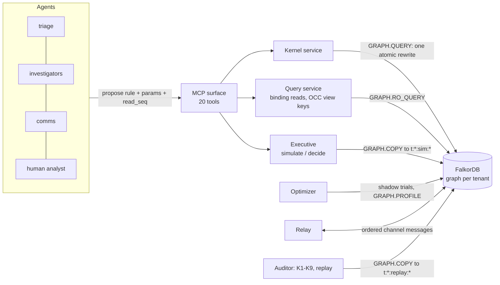

# GNOMON

**An event-sourced operating system for AI agents, built entirely inside FalkorDB.**

Agents propose changes to a shared world; the world accepts them only through pinned, linted rewrite rules that run
atomically inside the database, record who did what and why, and can be replayed, audited and queried at any point in
the past. On top of that sits an advisory layer: graph algorithms exposed as MCP tools, and an Executive that prices each
action in its own copy of the world before anything touches reality.

Author: **Surya Prasanth R** (sole human author and committer). Tracks entered: **01, 02 and 03**.
Design specification: [docs/design/master.md](docs/design/master.md). Demo video: see [Demo video](#demo-video).

**Contents:** [What it is](#what-it-is) · [Setup](#setup) · [Quickstart](#quickstart) · [Architecture](#architecture) ·
[Graph data model](#graph-data-model) · [Bitemporal time](#bitemporal-time-snapshot-and-as-of-queries) ·
[Rule templates](#rule-templates) · [Queries](#queries) · [Algorithms](#algorithms-and-the-mcp-surface) ·
[Scoring and cost model](#scoring-and-cost-model) · [Validation and audit](#validation-audit-and-mutation-testing) ·
[Multi-tenant and MCP walkthrough](#multi-tenant-and-mcp-client-walkthrough) · [Proofs](#demonstration-proofs) ·
[Tracks entered](#tracks-entered) · [Known limits](#known-limits) · [What I built and why](#what-i-built-and-why) ·
[Demo video](#demo-video) · [AI assistance disclosure](#ai-assistance-disclosure)

## What it is

Most agent frameworks keep memory in a place the model can write to freely. GNOMON turns that around.

* **Facts live in a bitemporal graph.** Every relationship records when it was true in the world (valid time) and when
  the system believed it (transaction time), so "who owned this service on Tuesday, as we knew it on Wednesday" is a
  query, not an archaeology project.
* **Every change is a rewrite.** An agent cannot write to the graph. It proposes a rule (a Cypher template pinned by
  sha) with parameters and the read positions it relied on. The Kernel, a UDF library inside FalkorDB, checks the
  proposal against the current state and either applies it atomically, appending one hash-chained `Rewrite`, or returns a
  named outcome (`REJECTED_STALE`, `REJECTED_GUARD`, `DUPLICATE`, and so on).
* **Races are found before they run.** Each rule declares the keys it reads and writes; a conflict matrix and eight lints
  (L1 to L8) refuse a rule that could race, before it is ever registered.
* **Actions are priced in a copy of the world.** The Executive copies the tenant graph with `GRAPH.COPY`, applies each
  candidate action there, scores the result with integer arithmetic and commits only the winner, with its evidence.
* **Everything is checkable.** Nine audit checks (K1 to K9) and a catalogue of 32 deliberate corruptions (MU1 to MU32)
  show that the guarantees hold, and that a broken guarantee is noticed.

Without FalkorDB there is no product: the Kernel is a FalkorDB UDF library, the log is a graph, the snapshots are
`GRAPH.COPY`, the algorithms are `algo.*` procedures, the optimizer measures with `GRAPH.PROFILE` and the tenants are
graphs. The synthetic company, tenants and incidents come from a seeded generator (`gnomon/sim/`); no real data is used.

## Setup

Requirements: Docker with Compose, [uv](https://docs.astral.sh/uv/) and Python 3.12 (uv installs it).

```bash
git clone <this repository> gnomon && cd gnomon
uv sync                          # the Python environment, locked by uv.lock
docker compose up -d --wait      # FalkorDB, pinned by image digest, AOF with appendfsync always
```

`docker-compose.yml` starts one service, FalkorDB, at the image digest recorded in `.agent/STATE.md`, listening on
`localhost:6379` (set `GNOMON_PORT` to use another host port). It runs with `--appendonly yes --appendfsync always`, so a
commit is acknowledged only after it is fsynced, and its data lives in the named volume `falkordb-data`.
Everything below reads the server address from `GNOMON_FALKORDB_URL` (default `localhost:6379`).

```bash
docker compose down -v           # stop and delete the data
```

To run the test suite instead of the compose stack, `uv run pytest` starts its own pinned FalkorDB under Testcontainers.
The full gate, which runs every test of every module, is `uv run python scripts/gate.py SHIP`.

## Quickstart

```bash
# 1. genesis plus the Core scenario: a seeded company, an incident, four agents, one investigator crash
uv run python -m gnomon.cli run --graph t:demo --seed 7

# 2. check the guarantees of that tenant (K1-K6), then ask why an entity is the way it is
uv run python -m gnomon.cli audit --graph t:demo
uv run python -m gnomon.cli why --graph t:demo --uid svc:s15

# 3. run the twelve proofs of the demonstration catalogue against the stack you just started
scripts/demo_proofs.sh                 # Windows: scripts\demo_proofs.ps1
scripts/demo_proofs.sh P1 C G          # or pick some
```

`gnomon.cli` prints one JSON document per command and exits non-zero on divergence, a failed audit, an unknown entity or a
failed proof. Its commands are `run`, `replay`, `audit`, `why`, `fedlog`, `counterfactual`, `approve`, `veto` and `proof`.

## Architecture



| Layer | What it adds | Package |
|---|---|---|
| Core Substrate | Dual clock, hash chain, composer, bitemporal facts, footprints and OCC, rules R1 to R11, replay and audit K1 to K6, query service, MCP read and propose tools, agents, outbox, scheduler | `gnomon/kernel`, `gnomon/footprint`, `gnomon/rules`, `gnomon/query`, `gnomon/audit`, `gnomon/agents`, `gnomon/ops` |
| T-A Decision framework | Pinned scorers, `Decision`, `Candidate`, `Evidence`, human approval and veto | `gnomon/executive`, `gnomon/rules/titan` |
| T-B Counterfactual Executive | Branch simulation, `Exec.blastRadius`, action rules, K7 | `gnomon/executive`, `gnomon/sim` |
| T-C Self-optimizing engine | Workload telemetry, shadow trials, logged index changes (M1, M2), K8 | `gnomon/optimizer` |
| T-D Federation | One graph per tenant, a sys graph, ordered channels, proxies, K9 | `gnomon/federation` |
| T-E Federated blast radius | Scorer v2 that counts consumers in other tenants | `gnomon/executive`, `gnomon/federation` |
| T-F Temporal projections | Algorithms and counterfactuals on the graph as it was | `gnomon/temporal` |

Each Titan layer is inert until a logged rewrite registers its rules: the composer does not emit its segments and no Core
rule changes behaviour. An applied rewrite is one query composed from fixed segments (`gnomon/kernel/segments/`: P0 checks
the head and the caller, PG the guards, Q0 the view keys, E0 the decision envelope, `ret` the result). The Kernel's own
source hash is part of the audit (K3), so a kernel upgrade cannot happen silently.

## Graph data model

Everything about a tenant is in one graph named `t:<tenant>`. The full schema is section 3 of the design; this is the
shape.

**Kernel nodes** (the log, the rules and the machinery):

| Label | Holds |
|---|---|
| `Head` | The tip: `seq`, `pt`, `lc`, `hash`, `kernel_sha`. Exactly one per tenant |
| `Rewrite` | One per applied change: `seq`, `rule`, `rule_sha`, `agent`, `params`, `read_seq`, `view_keys`, `write_keys`, `prev`, `hash` |
| `Rule` | A registered rule template with its sha, body, declared reads and writes, lint report sha and `active` flag |
| `KeyVersion` | The last `seq` that wrote each key: the basis of optimistic concurrency |
| `FactType` | The catalogue of relationship types and their cardinality and projection |
| `Outbox` | Messages an agent action must deliver exactly once |
| `Scorer`, `Approval`, `Decision`, `Candidate`, `Evidence` | The decision framework: what was weighed, by which pinned scorer, and who signed |
| `IndexEntry`, `ConstraintEntry` | The logical catalogue of physical indexes and constraints (audited by K8) |
| `Channel`, `XMsg` | Federation: one per peering direction, one per message with its digest and state |

**Domain nodes** (all carry `:Entity` and `uid`): `Agent`, `Skill`, `Team`, `Service`, `Deploy`, `Event`, `Alert`, `Incident`,
`Task`, `Message`, and for federation `ExternalService` and `Consumer`.

**Bitemporal fact types** (relationships that carry `fid`, `prev_fid`, `vf`, `vt`, `ts`, `te`, `tf`, `tt` and `rw`):

| Fact | Subject to object | Cardinality | Projection |
|---|---|---|---|
| `OWNED_BY` | Service to Team | functional | `OWNER_NOW` |
| `DEPENDS_ON` | Service to Service or ExternalService (`hard`) | set | `DEP_NOW` |
| `DEPLOYED` | Service to Deploy | functional | none |
| `REPLICA_OF` | replica Service to primary Service | functional | none |
| `MEMBER_OF` | Agent to Team | set | none |
| `ROOT_CAUSE` | Incident to Deploy or Service (`by`, `confidence`) | set | none |
| `CONSUMES` | Consumer to Service (`hard`) | set | `CONSUMES_NOW` |

**Structural, lease and provenance edges:** `HAS_SKILL`, `RAISED`, `ON`, `TRIGGERED`, `AFFECTS`, `PART_OF`, `NEEDS`, `ABOUT`,
`HOLDS` (a task lease, with `from_seq` and `until_pt`), `CITES` (a message or evidence cites the `fid` of a fact),
`CAUSED_BY` (a rewrite points to the rewrite that caused it), `COMMITTED_AS` (decision to the rewrite that carried it
out), `CONSIDERED` (decision to candidate), `JUSTIFIED_BY` (decision to evidence), `APPROVES` (approval to decision) and
`FOR` (approval to incident). Projection edges `DEP_NOW`, `OWNER_NOW` and `CONSUMES_NOW` are derived and rebuilt by replay;
nothing else is ever deleted.

Physical indexes and constraints are created by bootstrap DDL before genesis (`gnomon/bootstrap/ddl.py`) and recorded as
`IndexEntry` and `ConstraintEntry` rows with origin `genesis`.

## Bitemporal time: snapshot and as-of queries

Each fact version has a **valid time** `[vf, vt)` (when it was true in the world, in wall-clock milliseconds) and a
**transaction time** `[ts, te)` (the rewrite sequence numbers between which the system believed it). A version is never
edited: assert adds one, supersede and end close the old version and copy its past, and void closes it with nothing
replacing it.

| Predicate | Meaning |
|---|---|
| `current(f)` | `f.te = $INF`: what the system believes now |
| `valid_at(f, T)` | `f.vf <= T < f.vt`: true in the world at time `T` |
| `known_at_seq(f, S)` | `f.ts <= S < f.te`: believed after rewrite `S` |
| `known_at_pt(f, TT)` | believed at wall time `TT` (millisecond precision) |

A **snapshot** query reads the present, using the derived projections (`DEP_NOW`, `OWNER_NOW`): fast, and it is what agents
see while acting. An **as-of** query reads history with the predicates above, or runs an algorithm on a **temporal
projection graph** rebuilt for a chosen valid time and sequence (`gnomon/temporal/`): so `rank_critical` can be asked who
was critical on a past date, as the system knew it then. Replay (`gk replay --until S`) rebuilds the whole graph at any
sequence and compares its hash to the log, which is also how K4 works.

## Rule templates

The registry (`gnomon/rules/registry.yaml`) lists every rule with its caller roles, declared reads and writes, guard probes
and flags. A rule is registered by a logged rewrite carrying its body and the lint report; the Kernel runs only the
registered sha.

**Core rules** (`gnomon/rules/core/`):

| Template | Rule |
|---|---|
| `gnomon/rules/core/genesis.cypher` | R0 `Genesis`: head, kernel agent, catalogue, first rules |
| `gnomon/rules/core/register_rule.cypher` | M3 `RegisterRule` |
| `gnomon/rules/core/deactivate_rule.cypher` | M4 `DeactivateRule` |
| `gnomon/rules/core/register_agent.cypher` | M6 `RegisterAgent` |
| `gnomon/rules/core/observe_alert.cypher` | R1 `Observe.alert` |
| `gnomon/rules/core/observe_health.cypher` | R1 `Observe.health` |
| `gnomon/rules/core/observe_receipt.cypher` | R1 `Observe.receipt`: acknowledges an outbox delivery |
| `gnomon/rules/core/open_incident.cypher` | R4 `OpenIncident` |
| `gnomon/rules/core/claim_task.cypher` | `ClaimTask`: a lease, guarded so that 50 claims give one winner |
| `gnomon/rules/core/complete_task.cypher` | `CompleteTask` |
| `gnomon/rules/core/handoff.cypher` | `Handoff` |
| `gnomon/rules/core/expire_lease.cypher` | R8 `ExpireLease`: recovers work from a crashed agent |
| `gnomon/rules/core/post_update.cypher` | R9 `PostUpdate`: a message whose citations must be live |
| `gnomon/rules/core/propose_cause.cypher` | R10 `ProposeCause`: writes `ROOT_CAUSE` |
| `gnomon/rules/core/resolve_incident.cypher` | R11 `ResolveIncident` |

**Fact and entity families** (`gnomon/rules/families/`, instantiated per relationship or entity kind):

| Template | Rules it generates |
|---|---|
| `gnomon/rules/families/assert_fact.cypher.tmpl` | R2 `AssertFact.<REL>`: assert, or supersede a functional fact |
| `gnomon/rules/families/retract_fact.cypher.tmpl` | R3 `RetractFact.<REL>`: end or void |
| `gnomon/rules/families/register_entity.cypher.tmpl` | M7 `RegisterEntity.<Kind>` |

**Titan rules** (`gnomon/rules/titan/`):

| Template | Rule |
|---|---|
| `gnomon/rules/titan/register_scorer.cypher` | M5 `RegisterScorer`: pins a scorer by sha |
| `gnomon/rules/titan/request_approval.cypher` | R16 `RequestApproval` |
| `gnomon/rules/titan/approve_decision.cypher` | R17 `ApproveDecision`: approve or veto an exact decision sha |
| `gnomon/rules/titan/isolate_service.cypher` | R12 `IsolateService` |
| `gnomon/rules/titan/failover_service.cypher` | R13 `FailoverService` |
| `gnomon/rules/titan/rollback_deploy.cypher` | R14 `RollbackDeploy` |
| `gnomon/rules/titan/escalate_incident.cypher` | R15 `EscalateIncident` (the "no change" candidate) |
| `gnomon/rules/titan/restore_service.cypher` | R18 `RestoreService` |
| `gnomon/rules/titan/index_change.cypher` | M1 `IndexChange`: a decided physical schema change |
| `gnomon/rules/titan/index_settled.cypher` | M2 `IndexSettled`: the reconciler reports the DDL result |
| `gnomon/rules/titan/register_tenant.cypher` | `RegisterTenant` (sys graph) |
| `gnomon/rules/titan/peer_tenants.cypher` | `PeerTenants` (sys graph) |
| `gnomon/rules/titan/open_channel.cypher` | `OpenChannel` (sys graph, human only) |
| `gnomon/rules/titan/publish_health.cypher` | X2 `PublishHealth`: a provider announces its service state |
| `gnomon/rules/titan/send_subscription.cypher` | `SendSubscription`: a consumer asks a provider tenant for its service health |
| `gnomon/rules/titan/send_unsubscription.cypher` | `SendUnsubscription` |
| `gnomon/rules/titan/send_notice.cypher` | X1 `SendNotice`: a notice to a peer tenant |
| `gnomon/rules/titan/receive_health.cypher` | X3 `ReceiveMessage.health`: updates the proxy of a remote service |
| `gnomon/rules/titan/receive_subscribe.cypher` | X3 `ReceiveMessage.subscribe`: records a consumer |
| `gnomon/rules/titan/receive_unsubscribe.cypher` | X3 `ReceiveMessage.unsubscribe` |
| `gnomon/rules/titan/receive_notice.cypher` | X3 `ReceiveMessage.notice` |
| `gnomon/rules/titan/ack_message.cypher` | `AckMessage` |

Rules that change the world's response (isolate, fail over, roll back, restore) have `requires_decision` set and are
committed only inside a decision envelope: the scorer is pinned, the footprint is current, the approval matches the exact
decision sha, and the cited facts are still live. The same registry drives the conflict matrix in
[docs/explain/matrix.md](docs/explain/matrix.md): 496 rule pairs, 207 commute, 289 are guarded, none unguarded.

## Queries

All reads are read-only Cypher in `gnomon/query/reads/`. Binding reads (those an agent may act on) return the head `seq` and
the `fid` of each fact used, and record the keys they read, so a later proposal can be validated against them.

| Query | File | What it answers |
|---|---|---|
| Q1 | `gnomon/query/reads/q1.cypher` | Owner of a service at valid time `T`, as known after rewrite `S` |
| Q2 | `gnomon/query/reads/q2.cypher` | Current ownership history of a service |
| Q3 | `gnomon/query/reads/q3.cypher` | What the system believed after rewrite `S` about a service's history |
| Q4 | `gnomon/query/reads/q4.cypher` | Services a team owned at valid time `T` |
| Q5 | `gnomon/query/reads/q5.cypher` | Ownership change feed in a window: the canonical slow scan that the optimizer fixes with an index |
| Q6 | `gnomon/query/reads/q6.cypher` | Who owned each service an incident affected, at the moment it opened |
| Q7 | `gnomon/query/reads/q7.cypher` | Dependency topology at valid time `T`: the input to the temporal projection graphs (T-F) |
| RD | `rd_entity.cypher`, `rd_facts.cypher`, `rd_incident.cypher`, `rd_why.cypher` | Entity state, all facts of an entity, an incident with its tasks and leases, the provenance chain |

The same service read as Q1, Q2 and Q3 gives three different, correct answers: that is Proof P4.

## Algorithms and the MCP surface

Advisory algorithms run on the `DEP_NOW` projection (or, with `asof` or `asof_seq`, on a temporal projection graph) using
FalkorDB's `algo.*` procedures. They never write and are never binding: an agent can reason with them but a proposal is
still validated against the facts it read.

| MCP tool | Backed by | Question |
|---|---|---|
| `neighborhood` | `algo.bfs` | What depends on, or is depended on by, this service within `depth` hops? |
| `rank_critical` | `algo.pageRank` | Which services matter most? |
| `brokers` | `algo.betweenness` | Which services bridge otherwise separate parts? |
| `failure_domains` | `algo.WCC` | Which services fail together? |
| `communities` | `algo.labelPropagation` | Which services cluster? |
| `dependency_path` | `algo.SPpaths` | How does A reach B? |

The complete surface is 20 tools, offered to an agent according to its role and the layers active in its tenant. The
tools never write directly: `propose` and `decide` go through the Kernel.

| Kind | Tools |
|---|---|
| Info | `whoami` |
| Binding reads | `read_entity`, `facts`, `as_of`, `incident_status`, `list_actions` |
| Write | `propose`, `decide`, `send_notice` |
| Advisory | `neighborhood`, `rank_critical`, `brokers`, `failure_domains`, `communities`, `dependency_path`, `why`, `simulate`, `decision`, `optimizer_status`, `fedlog` |

`approve`, `veto`, rule and scorer registration and audit are human CLI commands only and are not exposed over MCP.

## Scoring and cost model

**Executive scorer** (integer arithmetic, pinned by sha). For an incident, the Executive copies the live graph into a
branch per candidate action and computes the set of impacted services with weights in the base and in each branch:

```
benefit_k   = sum over u in base of max(0, base[u] - branch_k.get(u, 0))
harm_k      = sum over u in branch_k of max(0, branch_k[u] - base.get(u, 0)) + TAU * |new teams in branch_k|
score_num_k = benefit_k * LAMBDA_D - LAMBDA_N * harm_k            (score = score_num / LAMBDA_D)
winner      = argmax score_num_k, ties broken by lowest params_sha
              if the winner is not "escalate" and score_num < MARGIN * LAMBDA_D, escalate instead
```

With `lambda = 3/2` a unit of harm costs one and a half units of benefit. Scorer v2 (T-E) adds the harm to consumers in
other tenants, which is what makes Proof E choose failover over isolation. A candidate that fails a guard is recorded as
`guard_pruned` with its reason; a human can veto the winner and the next best is re-selected under a new decision sha.

**Optimizer cost model** (recorded integers in microseconds). For each recorded query shape `q`, the optimizer measures the
median `med` and median absolute deviation `mad` on the base graph and on a shadow copy with the candidate index:

```
significant(q) = |med_b(q) - med_k(q)| > OPT_KAPPA * (mad_b(q) + mad_k(q))
gain_us        = sum over q of f_q * (significant(q) ? med_b(q) - med_k(q) : 0)
write_us       = sum over w of f_w * max(0, med_kw(w) - med_bw(w))
net_us         = gain_us - write_us - build_us / OPT_AMORT_WINDOWS - mem_us
accept iff the plan changed and net_us >= OPT_MARGIN_US
```

The decision stores `benefit = gain_us`, `harm = write_us + amortised build + memory` and `score_num = net_us`, with the raw
samples, so the arithmetic is reproducible from the record even though the timings are measured, not reproducible.

## Validation, audit and mutation testing

### Stateful validation (K1 to K9)

| Check | Layer | Verifies |
|---|---|---|
| K1 | Core | The hash chain: every rewrite's hash recomputes from its content and its predecessor |
| K2 | Core | Gapless `seq`; `Head.seq` equals the count of rewrites |
| K3 | Core | Rewrites used active rules; rule shas recompute; `kernel_sha` matches; scorer shas were active at commit |
| K4 | Core | Replay hash equals live hash (the whole logical graph) |
| K5 | Core | (a) every lease is valid; (b) no overlap; (c) citations were live when cited; (d) projections are exact |
| K6 | Core | `CAUSED_BY` points backwards; no ghost rewrites |
| K7 | T-A, T-B, T-C | Decisions re-simulate to the same scores; footprint is within the view keys; evidence is within the cites |
| K8 | T-C | The physical index and constraint catalogue equals the logical one |
| K9 | T-D | Channel gaplessness, exactly-once delivery, causality, digests and sys anchors |

`uv run python -m gnomon.cli audit --graph t:demo` runs K1 to K6 (`--checks K7` selects others); the assurance sweep also
runs K1 to K9 across a three-tenant federation after seeded random interleavings of every agent and operator step
(`tests/stateful/`), three identical seeded runs that must produce identical state hashes, and chaos tests that kill
agents, drop and duplicate deliveries and crash relays (`tests/chaos/`).

### Mutation testing (MU1 to MU32)

`gnomon/audit/mutations.py` holds 32 deliberate corruptions, each applied to a scratch copy and each required to be
detected by named checks. A mutation caught by nothing fails the suite. Examples: MU1 edits a rewrite's parameters (caught
by K1 and K4); MU5 edits `Head.hash` (K1); MU6 edits a rule body but keeps its sha (K3); MU32 forces the unguarded
`ClaimTask_v0`, which lint L1 refuses to register, onto a scratch copy and applies 50 claims (K5 sees 50 open leases).
The full table is section 21.2 of the design, and `tests/mutation/` and `tests/e2e/test_proof_g.py` run it.

### Test discipline

Every module was built tests first: each `feat(Axx)` commit follows a `test(Axx)` commit with saved failing output in
`.agent/evidence/`, enforced by `scripts/check_tdd.py`. The tests run against a real FalkorDB, never a mock. The cumulative
gate (`scripts/gate.py`) records its result in `gates/*.json`; `gates/ASSURE.json` is the last gate before shipping.

## Multi-tenant and MCP client walkthrough

**Tenants are graphs.** Each tenant is a separate graph (`t:acme`, `t:globex`), with its own log, head, rules and agents.
Nothing is shared between them except messages over a federation channel, opened by a human-only rule in the sys graph
(`t:_sys`) and relayed in order with a sender digest, a per-channel sequence number and a clock-skew check.

```bash
uv run python -m gnomon.cli run --graph t:acme   --seed 7
uv run python -m gnomon.cli run --graph t:globex --seed 11
uv run python -m gnomon.cli audit --graph t:acme                  # each tenant audits on its own
uv run python -m gnomon.cli fedlog --graphs acme=t:acme,globex=t:globex     # both logs merged by (pt, lc, tenant, seq)
```

Opening channels, publishing health and subscribing are shown by Proof D, and Proof E and Proof G build a three-tenant
federation (`tests/support/assurance_world.py`); the CLI covers per-tenant operation.

**An MCP client** talks to a tenant through `create_server` (save the snippet as `walkthrough.py` in the repository root and run it with `uv run python walkthrough.py`, after the Quickstart `run` commands). The agent identity is fixed when the server is created, so
the tools offered follow the agent's role and what the tenant has activated.

```python
import asyncio, json
from falkordb import FalkorDB
from mcp import Client

from gnomon.kernel.registry import load_registry
from gnomon.kernel.service import KernelHandle
from gnomon.mcp.server import create_server
from gnomon.query.service import QueryService

db = FalkorDB(host="localhost", port=6379)
service = QueryService(KernelHandle(db.select_graph("t:acme"), load_registry()))
server = create_server(service, agent="inv-a")          # an investigator registered by the Core scenario

async def main():
    async with Client(server) as client:
        print(sorted(t.name for t in (await client.list_tools()).tools))
        ranked = await client.call_tool("rank_critical", {"k": 3})            # algo.pageRank on DEP_NOW
        print(json.loads(ranked.content[0].text))
        history = await client.call_tool("as_of", {"query": "Q2", "args": {"svc": "s15"}})
        print(json.loads(history.content[0].text))                           # ownership history with fids

asyncio.run(main())
```

A proposal made through `propose` carries the ids of the reads it relied on; if any fact in them has moved since, the
Kernel answers `REJECTED_STALE` and names the key, the sequence and the rewrite that moved it. That is the whole contract
between an agent and the world, and it is why a model that invents an id or acts on stale knowledge cannot corrupt it.

## Demonstration proofs

`scripts/demo_proofs.sh` (Windows: `scripts/demo_proofs.ps1`) runs each proof as its executable test against the server in
`GNOMON_FALKORDB_URL` and prints `PROOF <name>: PASS`. Pass names to run a subset.

| Proof | Layer | What is shown | Claim |
|---|---|---|---|
| Proof P1 · Races found before they run | Core | `ClaimTask_v0` is refused by L1; 50 claims on v0 fail K5a on a scratch copy; on v1, 1 `APPLIED` and 49 `REJECTED_GUARD` | Races are found before they run |
| Proof P2 · Hallucination and staleness firewall | Core | An invented id is rejected; an ownership retraction makes an earlier proposal `REJECTED_STALE` naming the key | Models cannot corrupt memory or act on changed facts |
| Proof P3 · Crash and exactly-once | Core | `kill -9` mid-lease; `ExpireLease`; another agent continues; the replayed proposal returns `DUPLICATE` | Agents are data; crashes lose and repeat nothing |
| Proof P4 · Why, and time travel | Core | `why` across four agents; Q1 against Q2 against Q3 | Every change explains itself at any point in time |
| Proof P5 · Determinism and tamper evidence | Core | Replay gives an equal state hash; an out-of-band edit is caught by K4; edited params by K1 | Nothing changes without a trace |
| Proof A · Counterfactual action | T-B | Three branches scored side by side; live `Head.hash` unchanged; commit with Evidence | Every action is tested in its own copy first |
| Proof B · Gate, veto, re-selection | T-A | Rollback wins and is gated; the analyst vetoes; the next best commits; `APPROVES` appears only on the committed decision | Humans sign exactly what they saw |
| Proof C · Self-optimizing migration | T-C | Q5 slow, shadow trials, `IndexChange`, reconciler DDL, `IndexSettled`, `Edge By Index Scan`, K8 green | Physical schema changes are decided, logged and audited |
| Proof D · Federation ordering | T-D | Health fan-out to two tenants; `fedlog` order; skewed sender quarantined; duplicate returns `DUPLICATE`; K9 green | Causality holds across graphs that share nothing |
| Proof E · Federated blast radius | T-E | Failover is chosen because isolation would harm two tenants; a subscription mid-decision forces re-simulation | Decisions account for consumers they cannot see directly |
| Proof F · Counterfactual time travel | T-F | Algorithms on an as-of graph; `counterfactual` picks a different action because ownership differed then | The log answers "what would we have done?" |
| Proof G · Audit sweep | All | K1 to K9 green; three mutations injected live and caught by the predicted checks | Every guarantee is checkable |

## Tracks entered

GNOMON is entered in **Track 01**, **Track 02** and **Track 03**. Each page maps the track's focus areas to the mechanism, the
code and the proof that shows it.

| Track | Theme | Page | Proofs |
|---|---|---|---|
| 01 | Agents that reason over a graph and act on it | [docs/tracks/01.md](docs/tracks/01.md) | A, B, E, F, G |
| 02 | Memory and coordination for many agents | [docs/tracks/02.md](docs/tracks/02.md) | P1, P2, P3, D, G |
| 03 | Knowledge that stays current and traceable | [docs/tracks/03.md](docs/tracks/03.md) | P2, P4, P5, F |

## Known limits

Stated in full in section 28 of the design. The ones a reviewer is most likely to ask about:

1. **Simulation fidelity is model fidelity.** Action rules write expected state; the world's truth arrives later and can disagree.
2. **Measured optimizer scores are attested, not reproducible.** Plan shapes and score arithmetic reproduce from the recorded samples; the timings do not.
3. **Single-step decisions.** One rule per decision; no lookahead across branches of branches.
4. **One writer per graph.** Throughput is bounded per tenant and scales by tenant.
5. **History is copied.** Branches, shadows and replays copy the whole tenant graph including its log.
6. **`known_at_pt` has millisecond precision;** node properties are current-only, so health history comes from replay graphs.
7. **Federated views are eventually consistent;** decisions record channel positions so an audit knows what was visible.
8. **LLM non-determinism is recorded, not removed.** Replay reproduces the log, not the model.
9. **No confluence proof.** Conflicts are serialized and settled by guards and first committer wins.

Platform facts that deviated from the spec are recorded as spikes with approved fallbacks in `.agent/FACTS.md` and
`.agent/DECISIONS.md` (for example, FalkorDB Cloud UDF support is unverified, so the live deployment is Docker Compose).

## What I built and why

*This section is written by the author, in their own words, before submission.*

Most autonomous agent frameworks treat graphs as passive retrieval targets or give models unrestrained write access to an operational database, inevitably resulting in hallucinated IDs, concurrency races, and untraceable regressions.

I built GNOMON to solve this fundamental architectural flaw. GNOMON is an event-sourced, multi-agent operating system where untrusted LLMs cannot write directly to the graph. Instead, every state transition is an atomic, Cypher-composed rewrite pinned by cryptographic SHA-256 signatures, validated against explicit optimistic concurrency footprints, and evaluated through dual clocks (sequential sequence numbers and hybrid logical clocks).

By leveraging FalkorDB's native capabilities, GNOMON introduces a counterfactual Executive that branches live tenant state using GRAPH.COPY to simulate candidate actions, scoring systemic blast radius via exact integer arithmetic before any change touches reality. Physical database tuning is self-optimizing: the engine detects slow access patterns, tests indexes on isolated shadow graphs, and commits schema migrations as logged, audited rewrites. Finally, cross-tenant federation preserves happens-before causality across completely isolated tenant databases.

Every guarantee in GNOMON is mechanically enforced: nine stateful audit probes (K1–K9) and a 32-scenario mutation suite (MU1–MU32) verify that no state can mutate without leaving an unforgeable, replayable cryptographic trail.

## Demo video

Video: VIDEO-LINK-PENDING (recorded from [docs/video_script.md](docs/video_script.md)).

## AI assistance disclosure

<!-- AI-DISCLOSURE:BEGIN -->
Every module of this repository was implemented by an AI coding assistant (Claude Code, desktop app) working against tests written first, under the design in `docs/design/master.md`, which was itself drafted with Claude. The human author, Surya Prasanth R, approved every design decision (`.agent/DECISIONS.md`), answered every module's explain-back in their own words (`docs/explain/`) and is the sole committer in the git history. The demos use recorded model responses produced by a deterministic rule-based stand-in (`PolicyLLM`); no live language model is called by the product.

| Model | Runs | Modules | First run (UTC) | Last run (UTC) |
|---|---|---|---|---|
| `claude-opus-5-5` | 17 | A00, A01, A02, A03, A04, A05, A06, A07 | 2026-10-15T05:46:43Z | 2026-10-15T17:26:46Z |
| `claude-sonnet-5-5` | 17 | A08, A09, A10, A11, A12, A13, A14, A15, A16 | 2026-10-15T17:50:14Z | 2026-10-17T00:00:00Z |

34 ledger rows, A00 to A16 (the A17 release run is recorded in `.agent/LEDGER.md` when Gate SHIP is sealed). Generated by `scripts/gen_disclosure.py` from `.agent/LEDGER.md`; do not edit by hand.
<!-- AI-DISCLOSURE:END -->
