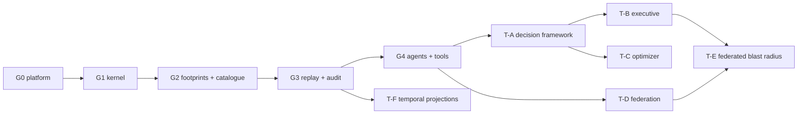
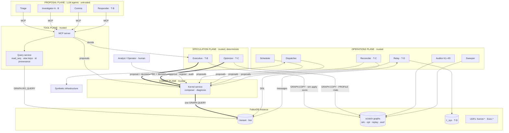

# [UNIFIED_OS_NAME] · Master Blueprint
## A Counterfactual Multi-Agent Operating System on FalkorDB
### Tier 4 Immutable Kernel · Counterfactual Executive · Self-Optimizing Engine · Multi-Tenant Federation

| Field | Value |
|---|---|
| Document | Master technical specification (complete feature set) |
| Companions | `graph-hack-supreme-track-2-3.md` (cited as **T4 §n**), `graph-hack-supreme-unified-track-1-2-3.md` (cited as **U1 §n**). Where this document differs from them, it supersedes them (§0.3) |
| Author | Surya Prasanth R |
| Status | Design master, compiled 14 Oct 2026 |
| Scope | Every subsystem, with no schedule and no cut list. Deployment is staged by expansion gates (§24), not by time |
| Tracks served | 01 Agents That Act on Connected Data · 02 Agent Memory and Coordination · 03 Company Brain |
| AI disclosure | Drafted with an AI assistant (Claude). Disclose it in any submission README (rule 11) |

> **Rule 8 status of this document.** This is a design document. The Cypher templates are complete as design artifacts. UDFs are specified as **contracts plus reference algorithms in pseudocode**, not JavaScript source, following the earlier instruction not to scaffold runnable JS. If this system is entered in Graph Hacks, the implementation must be written after **15 Oct 2026, 12:01 AM IST**. Re-implement from the design and do not paste from this file: rule 8 requires the main coding and design work to start after the event begins, and the FAQ requires the main FalkorDB implementation to be new work.

---

## Contents

**Part 0 · Orientation**
- [0.1 Layer map: Core Substrate and Titan Expansion Layer](#01-layer-map-core-substrate-and-titan-expansion-layer)
- [0.2 Changes from the companion documents](#02-changes-from-the-companion-documents)
- [0.3 Conventions](#03-conventions)
- [0.4 System invariants](#04-system-invariants)

**Part I · Core Substrate**
1. [Architecture](#1-architecture)
2. [Dual clock: seq and HLC](#2-dual-clock-seq-and-hlc)
3. [Graph schema](#3-graph-schema)
4. [Bitemporal fact model](#4-bitemporal-fact-model)
5. [Rule template system](#5-rule-template-system)
6. [Composer and the atomic apply query](#6-composer-and-the-atomic-apply-query)
7. [Footprints and optimistic concurrency](#7-footprints-and-optimistic-concurrency)
8. [UDF library `Kernel.*`](#8-udf-library-kernel)
9. [Core rule catalogue](#9-core-rule-catalogue)
10. [Query service, LLM boundary and core MCP tools](#10-query-service-llm-boundary-and-core-mcp-tools)
11. [Outbox, dispatcher, scheduler and synthetic infrastructure](#11-outbox-dispatcher-scheduler-and-synthetic-infrastructure)
12. [Replay, state hash and audit K1–K6](#12-replay-state-hash-and-audit-k1k6)
13. [Agents and core state machines](#13-agents-and-core-state-machines)

**Part II · Titan Expansion Layer**
14. [T-A · Decision framework](#14-t-a--decision-framework)
15. [T-B · Counterfactual Executive](#15-t-b--counterfactual-executive)
16. [T-C · Self-Optimizing Engine](#16-t-c--self-optimizing-engine)
17. [T-D · Multi-tenant federation](#17-t-d--multi-tenant-federation)
18. [T-E · Federated blast radius](#18-t-e--federated-blast-radius)
19. [T-F · Temporal projection graphs](#19-t-f--temporal-projection-graphs)

**Part III · Assurance and deployment**
20. [Complete MCP tool catalogue](#20-complete-mcp-tool-catalogue)
21. [Audit catalogue K1–K9 and mutation suite](#21-audit-catalogue-k1k9-and-mutation-suite)
22. [Test architecture](#22-test-architecture)
23. [Platform facts, assumptions and spikes](#23-platform-facts-assumptions-and-spikes)
24. [Expansion gates](#24-expansion-gates)
25. [Deployment topology and operations](#25-deployment-topology-and-operations)
26. [Demonstration catalogue](#26-demonstration-catalogue)
27. [Track alignment](#27-track-alignment)
28. [Known limits](#28-known-limits)
29. [Rules compliance](#29-rules-compliance)
- [Appendix A · Outcome codes](#appendix-a--outcome-codes)
- [Appendix B · Key catalogue](#appendix-b--key-catalogue)
- [Appendix C · Configuration constants](#appendix-c--configuration-constants)
- [Appendix D · Glossary](#appendix-d--glossary)

---

# Part 0 · Orientation

## 0.1 Layer map: Core Substrate and Titan Expansion Layer

The **Core Substrate** is a complete, shippable single-tenant system covering Tracks 02 and 03. Each **Titan** layer is additive. It is activated by logged rewrites that register its rules and scorers (§24), and until then it is inert: the composer never emits its segments, and no Core rule changes its behaviour.

| Component | Layer | Gate | Depends on | Inert until |
|---|---|---|---|---|
| Dual clock, Head, hash chain, composer P0/PG/Q0 | **Core** | G1 | — | always active |
| Bitemporal facts, projections, R2/R3 families | **Core** | G1 | G1 kernel | always active |
| Footprints, KeyVersion OCC, lints, conflict matrix | **Core** | G2 | G1 | always active |
| Rules R1, R4–R11; meta M3, M4, M6, M7 | **Core** | G2 | G1 | always active |
| Replay, state hash, audit K1–K6, mutation suite | **Core** | G3 | G2 | always active |
| Query service, enablement, core MCP tools, agents, outbox, scheduler | **Core** | G4 | G3 | always active |
| Decision framework: P1, E0, Scorer, Approval, M5, R16, R17 | **Titan T-A** | T-A | G4 | M5 + M3 registrations |
| Counterfactual Executive: branches, `Exec.blastRadius`, R12–R15, R18, K7 | **Titan T-B** | T-B | T-A | M3 registration of R12–R15, R18 |
| Self-Optimizing Engine: telemetry, analyzer, shadow trials, M1, M2, K8 | **Titan T-C** | T-C | T-A | M3 registration of M1, M2 |
| Federation: sys graph, channels, X0–X5, P2/P3, proxies, K9 | **Titan T-D** | T-D | G4 | sys genesis + M3 registration of X-rules |
| Federated blast radius: scorer v2, channel keys in footprints | **Titan T-E** | T-E | T-B + T-D | M5 registration of `Exec.blastRadius@2` |
| Temporal projection graphs (as-of algorithms) | **Titan T-F** | T-F | G3 | tool registration only (no rules) |



## 0.2 Changes from the companion documents

| # | Change | Reason |
|---|---|---|
| C1 | The clock tick moves from the postlude to the **prelude**. Bodies receive `nseq`, `now` and `now_lc` | T4 bodies wrote intervals with the *previous* rewrite's `pt`. A fact's transaction time must equal the pt of the rewrite that wrote it |
| C2 | Fact edges gain `fid`, `prev_fid`, `ts`, `te` (transaction time in seq) alongside `tf`, `tt` (in pt) | pt alone cannot order two rewrites in the same millisecond. Audit K5 needs exact seq-based transaction time |
| C3 | R3 creates a **new version** instead of editing the old one | Proper bitemporal semantics: what was believed between assertion and retraction is preserved |
| C4 | **Projection edges** (`DEP_NOW`, `OWNER_NOW`, `CONSUMES_NOW`) are maintained atomically by fact rules | FalkorDB algorithms filter by relationship type, not property, so they need a current-topology edge type |
| C5 | R8 uses the rewrite's own `now` instead of a `$now_pt` parameter | `now` is recorded and replayed, so no extra parameter is needed |
| C6 | Replay passes the **recorded** `view_keys` and `read_seq` | Replay now re-validates OCC and recreates `CAUSED_BY` edges. T4 replay skipped both |
| C7 | The chain also covers `read_seq` and a digest of `view_keys`. Rewrites store `attach` for decision and message payloads | Tamper evidence for what the agent saw. Replayable decision and message inputs |
| C8 | The K4 state hash covers the **whole logical graph**, not just the domain | Kernel nodes, outbox, approvals, decisions, channels and messages are all log-derived |
| C9 | New outcomes: `CALLER_DENIED`, `PID_CONFLICT`, `INVALID_VIEW`, `REJECTED_DECISION`, `OUT_OF_ORDER`, `SKEW_QUARANTINED`, `CORRUPT`, `KERNEL_ERROR` | Each rejection gets its own diagnosis |
| C10 | Gate rules renumbered: **R16 RequestApproval, R17 ApproveDecision, R18 RestoreService** (U1 had R16 ApproveDecision) | Approval becomes a two-step, in-graph protocol bound to the decision sha |
| C11 | M1 is split into **M1 IndexChange** (intent, decided) and **M2 IndexSettled** (confirmation) | FalkorDB DDL can't run inside the apply query, so physical migration is two-phase with a reconciler and audit K8 |
| C12 | Rule-registry and agent-registry changes are rewrites (M3, M4, M6, M7) | "Every state change is a rewrite" then has no exceptions after genesis |
| C13 | `GRAPH.COPY` is documented as snapshot-consistent. The torn-copy check (§15.2) is kept as defence in depth, not as a correctness requirement | Confirmed in the FalkorDB docs FAQ |

## 0.3 Conventions

| Item | Convention |
|---|---|
| Infinity | `$INF = 9007199254740991` (2^53 − 1), chosen so UDF number arithmetic stays exact |
| Zero hash | `$ZERO64` = 64 × `0` |
| Intervals | Half-open `[from, to)`. Valid time `[vf, vt)` in HLC pt (ms). Transaction time `[ts, te)` in seq, mirrored as `[tf, tt)` in pt |
| HLC order | Lexicographic on `(pt, lc)`. Across tenants: `(pt, lc, tenant, seq)` |
| Entity identity | Every domain node has label `:Entity` and `uid = <kind>:<id>`. Kinds: `svc`, `team`, `inc`, `task`, `msg`, `evt`, `alr`, `dep`, `agent`, `skill`, `ext`, `cons` |
| Hashing | SHA-256, lowercase hex |
| Canonical JSON | RFC 8785 (JSON Canonicalization Scheme): sorted keys, no insignificant whitespace, ES6 number serialization |
| Digest | `Kernel.digest(list)`: SHA-256 over the netstring encoding of the fields (§8.2) |
| Parameters | `$rule $rule_sha $agent $pid $p $params_json $attach $read_seq $view_keys $write_keys $mode $rec_pt $rec_lc $d $m` plus the constants in Appendix C |
| Macro `KCTX` | Expands to `h, causes, nseq, now, now_lc`, the kernel context every body carries |
| Macro `LIVE(f)` | Expands to `(f.te = $INF AND f.vf <= now AND now < f.vt)` |
| Family placeholders | `<REL> <S> <O> <PROJ>` are substituted at registration. The **expanded** text is what gets hashed |
| Keys | Opaque strings. They are built from templates (§5.4) and compared only for equality |
| Graph keys | `t:<tenant>` (live), `t:<tenant>:sim:<did>:<attempt>:<k>` (branch), `t:<tenant>:opt:<run>:<k>` (optimizer shadow), `t:<tenant>:replay:<seq>` (audit rebuild), `t:<tenant>:asof:<T>` (temporal projection), `t:_sys` (federation registry) |
| Scratch graphs | Any graph whose key contains `:sim:`, `:opt:`, `:replay:` or `:asof:` is scratch. The kernel never reads it and the sweeper deletes it |
| Markers | **[CORE]** and **[TITAN · T-x]** tag every section and template |

## 0.4 System invariants

| ID | Invariant | Enforced by | Audited by |
|---|---|---|---|
| I1 | Every logical state change after genesis is exactly one applied rewrite | Composer is the only writer; agents have no write path | K4 |
| I2 | `Head.seq` equals the number of `:Rewrite` nodes, and seqs are gapless from 1 | Q0 postlude; unique constraint on `Rewrite.seq` | K2 |
| I3 | Each rewrite's `prev` equals its predecessor's `hash`, and `Head.hash` equals the last hash | Q0 | K1 |
| I4 | Each rewrite used a rule that was registered and active at that seq | P0 pin | K3 |
| I5 | No applied rewrite acted on a view with a key changed after its `read_seq` | P0 staleness | K6 + replay (C6) |
| I6 | At most one unclosed `HOLDS` lease per task | R5 guards | K5a |
| I7 | No two current versions of a functional fact overlap in valid time for the same subject. For set facts, the same holds per (subject, object) | R2 guards | K5b |
| I8 | Every `CITES` edge targets a fact that was current and valid when the citing rewrite ran | R9, R10, P1 cite checks | K5c |
| I9 | Projection edges equal the set of current facts with open-ended validity | R2/R3 templates | K5d |
| I10 | `CAUSED_BY` points strictly backwards in seq | Q0 builds it from KeyVersion | K6 |
| I11 | **[T-A]** Every action-class rewrite has exactly one Decision, and every Decision has exactly one `COMMITTED_AS` rewrite | E0; unique `Decision.id` | K7 |
| I12 | **[T-B]** Re-simulating a Decision from the log reproduces its candidates, scores and winner | Deterministic sim mode + integer scorer | K7 |
| I13 | **[T-C]** The physical index catalogue equals the operational `IndexEntry` set | M1/M2 protocol + reconciler | K8 |
| I14 | **[T-D]** Per channel: gapless FIFO, exactly-once delivery, and receiver HLC strictly greater than sender HLC | P2, pid idempotency, `Kernel.recv` | K9 |

---

# Part I · Core Substrate

## 1. Architecture

**[CORE]** with Titan components shown for orientation.



### 1.1 Process topology

| Process | Trust | Graph access | Writes to live via |
|---|---|---|---|
| LLM agents | Untrusted | None directly; MCP only | MCP `propose` / `decide` → Kernel service |
| MCP server + query service | Trusted | `GRAPH.RO_QUERY` on live; read-only on scratch | Forwards proposals |
| Kernel service (composer) | Trusted, **the only writer to live** | `GRAPH.QUERY` on live; `GRAPH.QUERY` on branches in sim mode | Itself |
| Executive **[T-B]** | Trusted, deterministic, no LLM | `GRAPH.COPY` live → scratch; RO on scratch | Kernel service |
| Optimizer **[T-C]** | Trusted, deterministic analysis, measured timings | `GRAPH.COPY`; `GRAPH.PROFILE` / `GRAPH.EXPLAIN` / DDL on **scratch only** | Kernel service (M1) |
| Reconciler **[T-C]** | Trusted | **DDL on live** (the only non-rewrite operation on live); RO | Kernel service (M2) |
| Scheduler, Dispatcher | Trusted | RO | Kernel service (R8, R1 receipts) |
| Relay **[T-D]** | Trusted per peering | RO on live of both tenants | Kernel service of each tenant (X-rules) |
| Auditor | Trusted, read-only | RO on live; full access on `:replay:` scratch | None |
| Sweeper | Trusted | `GRAPH.LIST`, `GRAPH.DELETE` on scratch keys only | None |

## 2. Dual clock: seq and HLC

**[CORE]**

### 2.1 Definitions

| Clock | Domain | Purpose |
|---|---|---|
| `seq` | Gapless integer on `Head`, +1 per applied rewrite | Total order within one tenant graph. Drives replay, OCC (`read_seq`), transaction time (`ts`, `te`) and causality |
| HLC `(pt, lc)` | `pt` in ms ≥ the maximum wall time observed; `lc` a logical counter | Wall-aligned time for valid time and as-of queries; causally consistent order across tenants |

### 2.2 Tick rules (implemented by `Kernel.tick` and `Kernel.recv`, §8)

| Event | New `pt` | New `lc` |
|---|---|---|
| Local rewrite (live) | `l = max(pt, wall)` | `l == pt ? lc + 1 : 0` |
| Receive message `(m_pt, m_lc)` (live) | `l = max(pt, m_pt, wall)` | `l == pt == m_pt ? max(lc, m_lc) + 1` · `l == pt ? lc + 1` · `l == m_pt ? m_lc + 1` · else `0` |
| Replay or sim | recorded `(rec_pt, rec_lc)` | recorded. Must be strictly greater than the current `(pt, lc)`, or the UDF throws |

### 2.3 Modes

| Mode | Wall clock | Staleness check | Skew check | Used by |
|---|---|---|---|---|
| `live` | `timestamp()` read once, in the prelude | yes | yes (P2/P3) | Kernel service on live |
| `replay` | not used; recorded values | yes, with **recorded** view keys (passes by construction) | no | Replay engine, audit |
| `sim` | not used; `rec = (snapshot.pt, snapshot.lc + 1)` | yes (trivially current in the branch) | no | Executive and optimizer on scratch |

### 2.4 Ordering guarantees

1. **Within a tenant:** `seq` is a total order, and HLC is strictly increasing in seq. Each tick produces `(pt, lc)` greater than the previous one.
2. **Across tenants:** if rewrite *e* happens-before *f* (same tenant with lower seq, or *e* sent a message that *f* received, transitively), then `(pt_e, lc_e) < (pt_f, lc_f)`. This follows from the HLC receive rule.
3. **Bounded drift:** `pt − wall ≤ MAX_SKEW_MS`, because P2/P3 quarantine messages whose `s_pt` exceeds the local wall clock plus `MAX_SKEW_MS`.
4. **Federated log:** merging all tenant logs by `(pt, lc, tenant, seq)` gives a total order consistent with happens-before (§17.7).

### 2.5 Head state machine

| From | Event | Guard | To | Effect |
|---|---|---|---|---|
| ∅ | R0 Genesis | no `Head` exists | `seq = 1` | Head created with `pt, lc` from the tick; hash = H(genesis) |
| `seq = n` | Any applied rewrite | P0 passes; body yields one row | `seq = n + 1` | `pt, lc` ticked; `hash` = chain(n+1) |
| `seq = n` | Rejected proposal | any guard fails | `seq = n` | nothing is written |
| `seq = n` | Kernel error | UDF throws, constraint violated, timeout | `seq = n` | atomic rollback (spike S4) |

## 3. Graph schema

**[CORE]** unless tagged.

### 3.1 Kernel nodes (one set per tenant graph)

| Label | Properties | Keys / constraints | Written by |
|---|---|---|---|
| `Head` | `tenant, seq, pt, lc, hash, kernel_sha, sys_anchor` | unique `tenant` | PG, Q0 |
| `Rule` | `name, version, sha, body, prelude, evidence, class, layer, family, caller[], reads[], writes[], key_templates[], view_templates[], guard_probes_json, requires_decision, gated, lint_sha, active, registered_seq, deactivated_seq, rw` | unique `sha`; unique `(name, version)` | R0, M3, M4 |
| `KeyVersion` | `key, seq, rw` | unique `key` | Q0, R0 |
| `Rewrite` | `id, seq, pt, lc, rule, rule_sha, agent, params, attach, read_seq, view_keys[], write_keys[], prev, hash` | unique `id`; unique `seq`; mandatory `seq`, `rule_sha` | Q0 |
| `FactType` | `rel, s_labels[], o_labels[], cardinality, projection, attrs[]` | unique `rel` | R0 |
| `Outbox` | `pid, kind, target, to, incident, payload, state, attempts, last_seq` | unique `pid` | bodies; R1 receipt |
| `Scorer` **[T-A]** | `name, sha, kind, version, active, registered_seq, deactivated_seq, rw` | unique `sha` | M5 |
| `Approval` **[T-A]** | `aid, did, decision_sha, rule, params_sha, summary, state, verdict, approver, note, requested_seq, decided_seq, expires_pt, rw` | unique `aid` | R16, R17 |
| `Decision` **[T-A]** | `id, attempt, sha, kind, proposer, rationale_ref, scorer, scorer_sha, read_seq, hops, lambda_n, lambda_d, tau, margin, weight_scale, footprint_digest, workload_digest, rw` | unique `id` | E0 |
| `Candidate` **[T-A]** | `cid, k, rule, params_sha, outcome, reason, benefit, harm, teams_new, score_num, plan_before, plan_after, measure_digest, won` | unique `cid` | E0 |
| `Evidence` **[T-A]** | `eid, ord, algo, role, path[], rw` | unique `eid` | E0 |
| `IndexEntry` **[T-C]** (genesis rows Core) | `key, entity, label, prop, state, origin, op, requested_seq, settled_seq, settled_pt, ddl_ms, detail, rw` | unique `key` | R0, M1, M2 |
| `ConstraintEntry` | `key, kind, entity, label, props[], state` | unique `key` | R0 |
| `Channel` **[T-D]** | `key, peer, dir, next_seq, sys_peering, rw` | unique `key` | X0, X1–X3 |
| `XMsg` **[T-D]** | `id, chan, chan_seq, kind, svc, health, mode, consumer_svc, provider_svc, hard, criticality, body, digest, s_pt, s_lc, origin_tenant, origin_seq, origin_rw, r_pt, r_lc, r_seq, r_rw, state, acked_seq, rw` | unique `id` | X1–X4 |

### 3.2 Domain nodes (all carry `:Entity` and `uid`)

| Label | Properties | Created by |
|---|---|---|
| `Agent` | `id, role, active, rw` | R0, M6 |
| `Skill` | `id, rw` | R0, M7 |
| `Team` | `id, name, rw` | M7 |
| `Service` | `id, name, tier, criticality (1–5), user_facing, health ∈ {ok, degraded, down}, health_observed_pt, health_basis, mode ∈ {normal, isolated, failed_over}, active_replica, mode_seq, published_state, rw` | M7 |
| `Deploy` | `id, service, version, verified, expected_health, rw` | M7 |
| `Event` | `id, source_id, kind ∈ {alert, health, receipt}, observed_pt, payload_sha, rw` | R1 |
| `Alert` | `id, service, signature, severity, rw` | R1 |
| `Incident` | `id, service, signature, state ∈ {open, resolved}, escalated, holds, opened_seq, escalated_seq, resolved_seq, rw` | R4 |
| `Task` | `id, incident, kind, state ∈ {open, claimed, done}, result, done_seq, rw` | R4 |
| `Message` | `id, incident, body, author, rw` | R9 |
| `ExternalService` **[T-D]** | `id, tenant, remote_id, contract_criticality, health, remote_mode, health_s_pt, health_seq, subscribed_seq, rw` | M7 |
| `Consumer` **[T-D]** | `id, tenant, remote_svc, criticality, rw` | X3 subscribe |

### 3.3 Fact types (bitemporal relationships)

Every fact edge carries `{fid, prev_fid, vf, vt, tf, tt, ts, te, rw}` plus the type's own attributes.

| `rel` | Subject → object | Cardinality | Projection | Attributes | Asserted by | Retracted by |
|---|---|---|---|---|---|---|
| `OWNED_BY` | Service → Team | functional | `OWNER_NOW` | — | R2 | R3 |
| `DEPENDS_ON` | Service → Service, ExternalService | set | `DEP_NOW` | `hard` | R2 | R3 |
| `DEPLOYED` | Service → Deploy | functional | — | — | R2, R14 | R3, R14 |
| `REPLICA_OF` | Service (replica) → Service (primary) | functional | — | — | R2 | R3 |
| `MEMBER_OF` | Agent → Team | set | — | — | R2 | R3 |
| `ROOT_CAUSE` | Incident → Deploy, Service | set | — | `by, confidence` | R10 | R3 |
| `CONSUMES` **[T-D]** | Consumer → Service | set | `CONSUMES_NOW` | `hard` | X3 subscribe | X3 unsubscribe |

Fact edge properties:

| Property | Meaning |
|---|---|
| `fid` | Fact-version id = `<pid>#<n>`. Unique across the graph |
| `prev_fid` | The version this one replaces, if any |
| `vf`, `vt` | Valid time `[vf, vt)` in pt. `vt = $INF` means open-ended |
| `ts`, `te` | Transaction time `[ts, te)` in seq. `te = $INF` means current |
| `tf`, `tt` | The same transaction time in pt (for wall-aligned as-of queries) |
| `rw` | pid of the rewrite that created this version |

### 3.4 Structural, projection and provenance edges

| Type | From → to | Properties | Kind |
|---|---|---|---|
| `HAS_SKILL` | Agent → Skill | — | structural |
| `RAISED` | Event → Alert | — | structural |
| `ON` | Alert → Service | — | structural |
| `TRIGGERED` | Alert → Incident | — | structural |
| `AFFECTS` | Incident → Service | — | structural |
| `PART_OF` | Task → Incident | — | structural |
| `NEEDS` | Task → Skill | — | structural |
| `HOLDS` | Agent → Task | `from_seq, until_pt, closed_seq, close_reason, from_agent, rw` | lease |
| `ABOUT` | Message → Incident | — | structural |
| `CITES` | Message, Evidence → Entity | `fid` | citation |
| `DEP_NOW` | Service → Service, ExternalService | `fid, hard` | projection |
| `OWNER_NOW` | Service → Team | `fid` | projection |
| `CONSUMES_NOW` **[T-D]** | Consumer → Service | `fid, hard` | projection |
| `CAUSED_BY` | Rewrite → Rewrite | — | kernel |
| `COMMITTED_AS` **[T-A]** | Decision → Rewrite | — | provenance |
| `CONSIDERED` **[T-A]** | Decision → Candidate | — | provenance |
| `JUSTIFIED_BY` **[T-A]** | Decision → Evidence | — | provenance |
| `APPROVES` **[T-A]** | Approval → Decision | — | provenance |
| `FOR` **[T-A]** | Approval → Incident | — | provenance |

### 3.5 Bootstrap DDL (physical layer, run before R0)

DDL can't share a query with writes, so bootstrap runs these statements first, waits until every index and constraint reports operational, and then applies R0. R0 records them as `IndexEntry` and `ConstraintEntry` rows with `origin = 'genesis'`.

```cypher
// Node indexes
CREATE INDEX FOR (n:Head) ON (n.tenant)
CREATE INDEX FOR (n:Rule) ON (n.name)
CREATE INDEX FOR (n:Rule) ON (n.version)
CREATE INDEX FOR (n:Rule) ON (n.sha)
CREATE INDEX FOR (n:KeyVersion) ON (n.key)
CREATE INDEX FOR (n:Rewrite) ON (n.id)
CREATE INDEX FOR (n:Rewrite) ON (n.seq)
CREATE INDEX FOR (n:FactType) ON (n.rel)
CREATE INDEX FOR (n:Entity) ON (n.uid)
CREATE INDEX FOR (n:Agent) ON (n.id)
CREATE INDEX FOR (n:Skill) ON (n.id)
CREATE INDEX FOR (n:Team) ON (n.id)
CREATE INDEX FOR (n:Service) ON (n.id)
CREATE INDEX FOR (n:Deploy) ON (n.id)
CREATE INDEX FOR (n:Event) ON (n.source_id)
CREATE INDEX FOR (n:Alert) ON (n.id)
CREATE INDEX FOR (n:Incident) ON (n.id)
CREATE INDEX FOR (n:Incident) ON (n.service)
CREATE INDEX FOR (n:Task) ON (n.id)
CREATE INDEX FOR (n:Message) ON (n.id)
CREATE INDEX FOR (n:Outbox) ON (n.pid)
CREATE INDEX FOR (n:Outbox) ON (n.state)
CREATE INDEX FOR (n:IndexEntry) ON (n.key)
CREATE INDEX FOR (n:ConstraintEntry) ON (n.key)
// [T-A]
CREATE INDEX FOR (n:Scorer) ON (n.name)
CREATE INDEX FOR (n:Scorer) ON (n.sha)
CREATE INDEX FOR (n:Approval) ON (n.aid)
CREATE INDEX FOR (n:Decision) ON (n.id)
CREATE INDEX FOR (n:Candidate) ON (n.cid)
CREATE INDEX FOR (n:Evidence) ON (n.eid)
// [T-D]
CREATE INDEX FOR (n:Channel) ON (n.key)
CREATE INDEX FOR (n:XMsg) ON (n.id)
CREATE INDEX FOR (n:XMsg) ON (n.state)
CREATE INDEX FOR (n:ExternalService) ON (n.remote_id)

// Relationship indexes: fid and te on every fact type; fid on every projection
CREATE INDEX FOR ()-[f:OWNED_BY]-() ON (f.fid)
CREATE INDEX FOR ()-[f:OWNED_BY]-() ON (f.te)
CREATE INDEX FOR ()-[f:DEPENDS_ON]-() ON (f.fid)
CREATE INDEX FOR ()-[f:DEPENDS_ON]-() ON (f.te)
CREATE INDEX FOR ()-[f:DEPLOYED]-() ON (f.fid)
CREATE INDEX FOR ()-[f:DEPLOYED]-() ON (f.te)
CREATE INDEX FOR ()-[f:REPLICA_OF]-() ON (f.fid)
CREATE INDEX FOR ()-[f:REPLICA_OF]-() ON (f.te)
CREATE INDEX FOR ()-[f:MEMBER_OF]-() ON (f.fid)
CREATE INDEX FOR ()-[f:MEMBER_OF]-() ON (f.te)
CREATE INDEX FOR ()-[f:ROOT_CAUSE]-() ON (f.fid)
CREATE INDEX FOR ()-[f:ROOT_CAUSE]-() ON (f.te)
CREATE INDEX FOR ()-[f:DEP_NOW]-() ON (f.fid)
CREATE INDEX FOR ()-[f:OWNER_NOW]-() ON (f.fid)
// [T-D]
CREATE INDEX FOR ()-[f:CONSUMES]-() ON (f.fid)
CREATE INDEX FOR ()-[f:CONSUMES]-() ON (f.te)
CREATE INDEX FOR ()-[f:CONSUMES_NOW]-() ON (f.fid)
```

The valid-time properties `vf`/`vt` are **deliberately left unindexed**. They are what the Self-Optimizing Engine discovers and indexes (§16).

Constraints (Redis commands; each needs its supporting index first; creation is asynchronous, so bootstrap polls `db.constraints()` until all are `OPERATIONAL`):

```
GRAPH.CONSTRAINT CREATE t:<tenant> UNIQUE NODE Head PROPERTIES 1 tenant
GRAPH.CONSTRAINT CREATE t:<tenant> UNIQUE NODE Rule PROPERTIES 1 sha
GRAPH.CONSTRAINT CREATE t:<tenant> UNIQUE NODE Rule PROPERTIES 2 name version
GRAPH.CONSTRAINT CREATE t:<tenant> UNIQUE NODE KeyVersion PROPERTIES 1 key
GRAPH.CONSTRAINT CREATE t:<tenant> UNIQUE NODE Rewrite PROPERTIES 1 id
GRAPH.CONSTRAINT CREATE t:<tenant> UNIQUE NODE Rewrite PROPERTIES 1 seq
GRAPH.CONSTRAINT CREATE t:<tenant> MANDATORY NODE Rewrite PROPERTIES 2 seq rule_sha
GRAPH.CONSTRAINT CREATE t:<tenant> UNIQUE NODE FactType PROPERTIES 1 rel
GRAPH.CONSTRAINT CREATE t:<tenant> UNIQUE NODE Entity PROPERTIES 1 uid
GRAPH.CONSTRAINT CREATE t:<tenant> UNIQUE NODE Event PROPERTIES 1 source_id
GRAPH.CONSTRAINT CREATE t:<tenant> UNIQUE NODE Outbox PROPERTIES 1 pid
GRAPH.CONSTRAINT CREATE t:<tenant> UNIQUE NODE IndexEntry PROPERTIES 1 key
GRAPH.CONSTRAINT CREATE t:<tenant> UNIQUE NODE ConstraintEntry PROPERTIES 1 key
GRAPH.CONSTRAINT CREATE t:<tenant> UNIQUE NODE Scorer PROPERTIES 1 sha
GRAPH.CONSTRAINT CREATE t:<tenant> UNIQUE NODE Approval PROPERTIES 1 aid
GRAPH.CONSTRAINT CREATE t:<tenant> UNIQUE NODE Decision PROPERTIES 1 id
GRAPH.CONSTRAINT CREATE t:<tenant> UNIQUE NODE Candidate PROPERTIES 1 cid
GRAPH.CONSTRAINT CREATE t:<tenant> UNIQUE NODE Evidence PROPERTIES 1 eid
GRAPH.CONSTRAINT CREATE t:<tenant> UNIQUE NODE Channel PROPERTIES 1 key
GRAPH.CONSTRAINT CREATE t:<tenant> UNIQUE NODE XMsg PROPERTIES 1 id
GRAPH.CONSTRAINT CREATE t:<tenant> UNIQUE RELATIONSHIP OWNED_BY PROPERTIES 1 fid
GRAPH.CONSTRAINT CREATE t:<tenant> UNIQUE RELATIONSHIP DEPENDS_ON PROPERTIES 1 fid
GRAPH.CONSTRAINT CREATE t:<tenant> UNIQUE RELATIONSHIP DEPLOYED PROPERTIES 1 fid
GRAPH.CONSTRAINT CREATE t:<tenant> UNIQUE RELATIONSHIP REPLICA_OF PROPERTIES 1 fid
GRAPH.CONSTRAINT CREATE t:<tenant> UNIQUE RELATIONSHIP MEMBER_OF PROPERTIES 1 fid
GRAPH.CONSTRAINT CREATE t:<tenant> UNIQUE RELATIONSHIP ROOT_CAUSE PROPERTIES 1 fid
GRAPH.CONSTRAINT CREATE t:<tenant> UNIQUE RELATIONSHIP CONSUMES PROPERTIES 1 fid
```

Unique constraints are not enforced on array-valued properties. Every constrained property here is a scalar.

## 4. Bitemporal fact model

**[CORE]**

### 4.1 Predicates

| Predicate | Definition | Use |
|---|---|---|
| `current(f)` | `f.te = $INF` | What the system believes now |
| `valid_at(f, T)` | `f.vf <= T AND T < f.vt` | True in the world at time T |
| `known_at_seq(f, S)` | `f.ts <= S AND S < f.te` | Believed after rewrite S |
| `known_at_pt(f, TT)` | `f.tf <= TT AND TT < f.tt` | Believed at wall time TT (ms precision; see §28) |
| `LIVE(f)` | `current(f) AND valid_at(f, now)` | Guards inside rule bodies |

**Write constraint (enforced by R2/R3 guards):** `vf ≤ now` and `vt_end ≤ now`. No future-dated validity, which is what keeps projections exact without time-triggered maintenance.

### 4.2 Version operations

| Operation | Rule | Effect on versions |
|---|---|---|
| Assert | R2 | New version `[vf, ∞)`, `ts = nseq`, `te = ∞` |
| Supersede (functional) | R2 with `supersede = true` | The old version gets `te = nseq`. A copy `[old.vf, new.vf)` is created as a new current version, plus the new version `[vf, ∞)` |
| End | R3 `mode = 'end'` | The old version gets `te = nseq`. A copy `[old.vf, vt_end)` is created as a new current version |
| Void | R3 `mode = 'void'` | The old version gets `te = nseq`. Nothing replaces it (the fact was never true) |

Nothing is ever deleted except projection edges, which are derived and rebuilt by replay.

### 4.3 As-of query templates (read-only; binding reads in the query service)

```cypher
// Q1 · Owner of a service at valid time $T, as known after rewrite $S
MATCH (h:Head)
MATCH (s:Service {id: $svc})-[f:OWNED_BY]->(t:Team)
WHERE f.vf <= $T AND $T < f.vt AND f.ts <= $S AND $S < f.te
RETURN h.seq AS read_seq, t.id AS team, f.fid AS fid
```

```cypher
// Q2 · Full current ownership history of a service
MATCH (h:Head)
MATCH (s:Service {id: $svc})-[f:OWNED_BY]->(t:Team)
WHERE f.te = $INF
RETURN h.seq AS read_seq, t.id AS team, f.vf AS valid_from, f.vt AS valid_to, f.fid AS fid
ORDER BY f.vf
```

```cypher
// Q3 · What the system believed after rewrite $S about a service's history
MATCH (h:Head)
MATCH (s:Service {id: $svc})-[f:OWNED_BY]->(t:Team)
WHERE f.ts <= $S AND $S < f.te
RETURN h.seq AS read_seq, t.id AS team, f.vf AS valid_from, f.vt AS valid_to, f.fid AS fid
ORDER BY f.vf
```

```cypher
// Q4 · Services a team owned at valid time $T (current belief)
MATCH (h:Head)
MATCH (s:Service)-[f:OWNED_BY]->(t:Team {id: $team})
WHERE f.te = $INF AND f.vf <= $T AND $T < f.vt
RETURN h.seq AS read_seq, s.id AS service, f.fid AS fid
ORDER BY service
```

```cypher
// Q5 · Ownership change feed in a valid-time window. Unanchored edge scan:
//      the canonical slow shape that the optimizer (§16) fixes with an index on OWNED_BY.vf
MATCH (h:Head)
MATCH (s:Service)-[f:OWNED_BY]->(t:Team)
WHERE f.te = $INF AND f.vf >= $T1 AND f.vf < $T2
RETURN h.seq AS read_seq, s.id AS service, t.id AS team, f.vf AS changed_at, f.fid AS fid
ORDER BY changed_at
```

```cypher
// Q6 · Who owned each service an incident affected, at the moment it opened
MATCH (h:Head)
MATCH (i:Incident {id: $incident})-[:AFFECTS]->(s:Service)
MATCH (r:Rewrite {seq: i.opened_seq})
MATCH (s)-[f:OWNED_BY]->(t:Team)
WHERE f.vf <= r.pt AND r.pt < f.vt AND f.ts < r.seq AND r.seq <= f.te
RETURN h.seq AS read_seq, s.id AS service, t.id AS team, f.fid AS fid
```

```cypher
// Q7 · Dependency topology at valid time $T (current belief). The input to T-F projections
MATCH (a:Service)-[f:DEPENDS_ON]->(b)
WHERE f.te = $INF AND f.vf <= $T AND $T < f.vt
RETURN a.uid AS from, b.uid AS to, f.hard AS hard, f.fid AS fid
```

## 5. Rule template system

**[CORE]**

### 5.1 Rule definition (`def_json`, hashed)

| Field | Type | Meaning |
|---|---|---|
| `name` | string | e.g. `ClaimTask`, `AssertFact.OWNED_BY` |
| `version` | int | ≥ 1 |
| `class` | enum | `kernel`, `memory`, `action`, `meta`, `federation` |
| `layer` | enum | `core`, `T-A`, `T-B`, `T-C`, `T-D` |
| `family` | string or null | Family name for instantiated templates |
| `caller` | string[] | Roles allowed to propose it (sorted) |
| `prelude` | enum | `PG` (R0 only), `P0`, `P2`, `P3` |
| `requires_decision` | bool | Composes the P1 add-on and E0 |
| `gated` | bool | P1 requires a decided approval |
| `evidence` | bool | Equal to `requires_decision`; kept explicit for audit |
| `reads`, `writes` | string[] | Type-level footprint, e.g. `Task.state`, `HOLDS`, `OWNED_BY.*` |
| `key_templates` | string[] | Instance write-key templates (§5.4) |
| `view_templates` | string[] | View-key templates the query service applies to enablement tuples |
| `guard_probes` | {name, cypher}[] | Read-only queries, one per guard, used by diagnosis |
| `body` | string | Fully expanded Cypher body |

`sha = SHA-256(JCS(def_json))`. M3 recomputes it in-query with `Kernel.sha256` (§9.15), and K3 recomputes it offline.

### 5.2 Families

A family template contains placeholders. Registering a family member substitutes them, expands macros, and registers the result as an ordinary rule with its own sha. Members: `Observe.{alert, health, receipt}`, `AssertFact.{OWNED_BY, DEPENDS_ON, DEPLOYED, REPLICA_OF, MEMBER_OF}`, `RetractFact.{each fact type}`, `RegisterEntity.{Service, Team, Deploy, Skill, ExternalService}`, `ReceiveMessage.{notice, health, subscribe, unsubscribe}`.

### 5.3 Body contract

1. The body receives exactly one row binding `KCTX`.
2. All `MATCH`, `OPTIONAL MATCH`, `UNWIND` and `WHERE` clauses come **before the first write clause** (`CREATE`, `MERGE`, `SET`, `DELETE`, `REMOVE`, `FOREACH`).
3. The body ends with `WITH KCTX` on exactly one row, or zero rows if a guard failed.
4. Conditional writes use `FOREACH (_ IN CASE WHEN <cond> THEN [1] ELSE [] END | ...)`.
5. A body never reads a property in the same `SET` clause that writes it. Values are computed in a preceding `WITH`.
6. `MERGE` is used only to bind nodes the guards have proven exist.
7. Bodies never call `timestamp()`, `rand()` or `randomUUID()`. Only kernel segments read the wall clock.

### 5.4 Key templates

Grammar: `key := segment (":" segment)*`, where a segment is a literal, `*`, `{p.<field>}`, or `{p.<field>[]}` (expands to one key per list element). Keys are opaque once built. The full catalogue is in Appendix B. Families:

| Pattern | Covers |
|---|---|
| `<Label>:<id>:state` | Mutable state of one entity |
| `<Label>:*` | Type-level phantom key: any creation, or any state change relevant to predicate scans |
| `<REL>:<s_uid>:*`, `<REL>:*:<o_uid>` | Any version change of a fact touching that subject or object (projections included) |
| `<REL>:*` | Type-level phantom key for fact scans |
| `HOLDS:*:<task>` | Leases on a task |
| `Incident:<svc>:<signature>` | Incident deduplication |
| `Rule:<name>`, `Rule:*`, `Agent:*`, `Scorer:<name>`, `Index:<key>`, `Index:*`, `Approval:<aid>`, `Channel:<dir>:<peer>`, `Outbox:<pid>` | Kernel and Titan objects |

### 5.5 Lints (applied before M3 registration; their report hash is stored in `lint_sha`)

| ID | Lint | Rejects |
|---|---|---|
| L1 | Unguarded write | A rule writes an instance key but no guard reads a property covered by that key |
| L2 | Non-determinism | `timestamp()`, `rand()`, `randomUUID()`, or unordered collection results feeding writes |
| L3 | Single-row body | A `MATCH` not anchored on an indexed id or uid, or a body that can end with more than one row |
| L4 | Footprint completeness | Labels, types or properties found by the parser that are missing from `reads`/`writes` |
| L5 | Key provenance | A key template referencing anything other than `$p` fields |
| L6 | Write ordering | A read clause after the first write clause (§5.3 rule 2) |
| L7 | Same-SET read/write | A property both read and written in one `SET` |
| L8 | Decision consistency | `gated` without `requires_decision`, `evidence ≠ requires_decision`, or `class = action` without `requires_decision` |

## 6. Composer and the atomic apply query

**[CORE]** (P1, E0 **[T-A]**; P2, P3 **[T-D]**)

### 6.1 Segment composition

The composer (kernel service) builds one `GRAPH.QUERY` per proposal by concatenating kernel-owned segments around the pinned rule body. The composer source, together with the `Kernel` UDF library, is hashed into `Head.kernel_sha` at genesis.

| Rule kind | Segments, in order | Tick |
|---|---|---|
| R0 Genesis | `PG · BODY · Q0 · RET` | T0 on (0, 0) |
| Standard (`prelude = P0`) | `P0 · BODY · Q0 · RET` | T0 |
| Decision (`requires_decision`) | `P0 · P1 · BODY · Q0 · E0` | T0 |
| Federation receive (`prelude = P2`) | `P0 · P2 · BODY · Q0 · RET` | T2 |
| Federation ack (`prelude = P3`) | `P0 · P3 · BODY · Q0 · RET` | T3 |

| Tick | Expression substituted for `<TICK>` |
|---|---|
| T0 | `Kernel.tick(h.pt, h.lc, timestamp(), $mode, $rec_pt, $rec_lc)` |
| T2 | `Kernel.recv(h.pt, h.lc, timestamp(), $m.s_pt, $m.s_lc, $mode, $rec_pt, $rec_lc)` |
| T3 | `Kernel.recv(h.pt, h.lc, timestamp(), $m.r_pt, $m.r_lc, $mode, $rec_pt, $rec_lc)` |

### 6.2 P0 · standard prelude

```cypher
// ── P0 · PRELUDE (kernel-owned; every rule except R0) ───────────────────────
MATCH (h:Head)
MATCH (rule:Rule {name: $rule, sha: $rule_sha})
WHERE rule.active = true
MATCH (ag:Agent {id: $agent})
WHERE ag.active = true AND ag.role IN rule.caller
OPTIONAL MATCH (dup:Rewrite {id: $pid})
WITH h, rule, dup
WHERE dup IS NULL AND $read_seq <= h.seq
OPTIONAL MATCH (kv:KeyVersion)
WHERE kv.key IN $view_keys
WITH h, rule,
     sum(CASE WHEN kv.seq > $read_seq THEN 1 ELSE 0 END) AS stale,
     collect(DISTINCT kv.rw) AS causes
WHERE stale = 0
WITH h, rule, causes, <TICK> AS c
//── ◆P1 / ◆P2 / ◆P3 add-on inserted here ──
WITH h, causes, h.seq + 1 AS nseq, c.pt AS now, c.lc AS now_lc
```

`causes` holds the last writers of every key in the agent's view, whether or not they changed. Those rewrites become `CAUSED_BY` targets.

### 6.3 PG · genesis prelude

```cypher
// ── PG · GENESIS PRELUDE (R0 only) ──────────────────────────────────────────
OPTIONAL MATCH (h0:Head)
WITH count(h0) AS heads
WHERE heads = 0
  AND $rule = 'Genesis'
  AND any(r IN $p.rules WHERE r.name = 'Genesis' AND r.sha = $rule_sha)
  AND Kernel.sha256($p.kernel_src) = $p.kernel_sha
  AND size($p.agents) >= 1
  AND any(a IN $p.agents WHERE a.role = 'kernel')
  AND all(a IN $p.agents WHERE all(s IN a.skills WHERE s IN $p.skills))
  AND all(r IN $p.rules WHERE Kernel.sha256(r.def_json) = r.sha)
WITH [] AS causes, Kernel.tick(0, 0, timestamp(), $mode, $rec_pt, $rec_lc) AS c
CREATE (h:Head {tenant: $p.tenant, seq: 0, pt: 0, lc: 0, hash: $ZERO64,
                kernel_sha: $p.kernel_sha, sys_anchor: $p.sys_anchor})
WITH h, causes, 1 AS nseq, c.pt AS now, c.lc AS now_lc
```

### 6.4 ◆P1 · decision checks **[T-A]**

```cypher
//── ◆P1 · DECISION CHECKS (rule.requires_decision = true) ──
MATCH (sc:Scorer {name: $d.scorer, sha: $d.scorer_sha})
WHERE sc.active = true
  AND $d.read_seq = $read_seq
  AND Kernel.sha256($attach) = $p.attach_sha
  AND $p.decision_sha = $d.sha
OPTIONAL MATCH (ap:Approval {aid: $d.aid})
WITH h, rule, causes, c, ap
WHERE rule.gated = false
   OR (ap IS NOT NULL AND ap.state = 'decided' AND ap.verdict = 'approve'
       AND ap.decision_sha = $d.sha)
UNWIND (CASE WHEN size($d.cites) = 0 THEN [null] ELSE $d.cites END) AS ct
OPTIONAL MATCH (cs:Entity {uid: ct.s})-[cf]-()
WHERE cf.fid = ct.fid AND cf.te = $INF AND cf.vf <= c.pt AND c.pt < cf.vt
WITH h, rule, causes, c, count(DISTINCT cf.fid) AS live_cites
WHERE live_cites = size($d.cites)
```

The untyped expansion `(cs)-[cf]-()` is anchored on an indexed uid, so its cost is the degree of the cited node. Projection edges carry `fid` but no `te`, so they never satisfy the predicate. Only the versioned fact edge does.

### 6.5 ◆P2 · federation receive and ◆P3 · federation ack **[T-D]**

```cypher
//── ◆P2 · FEDERATION RECEIVE (tick T2) ──
MATCH (ch:Channel {key: 'in:' + $m.origin_tenant})
WHERE ch.next_seq = $m.chan_seq
  AND Kernel.digest($m.fields) = $m.digest
  AND Kernel.sha256($attach) = $p.attach_sha
  AND ($mode <> 'live' OR $m.s_pt <= timestamp() + $MAX_SKEW_MS)
WITH h, rule, causes, c
```

```cypher
//── ◆P3 · FEDERATION ACK (tick T3) ──
WITH h, rule, causes, c
WHERE Kernel.sha256($attach) = $p.attach_sha
  AND ($mode <> 'live' OR $m.r_pt <= timestamp() + $MAX_SKEW_MS)
```

### 6.6 Q0 · postlude

```cypher
// ── Q0 · POSTLUDE (kernel-owned; every rule) ────────────────────────────────
SET h.seq = nseq, h.pt = now, h.lc = now_lc
FOREACH (k IN $write_keys |
  MERGE (kv:KeyVersion {key: k})
  SET kv.seq = nseq, kv.rw = $pid)
CREATE (r:Rewrite {id: $pid, seq: nseq, pt: now, lc: now_lc, rule: $rule, rule_sha: $rule_sha,
                   agent: $agent, params: $params_json, attach: $attach, read_seq: $read_seq,
                   view_keys: $view_keys, write_keys: $write_keys, prev: h.hash})
SET r.hash = Kernel.chain(r.prev, r.id, r.seq, r.pt, r.lc, r.rule_sha, r.agent, r.params,
                          r.read_seq, Kernel.digest(r.view_keys))
SET h.hash = r.hash
FOREACH (cid IN causes |
  MERGE (x:Rewrite {id: cid})
  CREATE (r)-[:CAUSED_BY]->(x))
WITH h, r
```

```cypher
// ── RET · standard return ──
RETURN r.seq AS seq, r.hash AS hash
```

`prev: h.hash` is captured by `CREATE` before `SET h.hash` runs. `r.hash` is computed in its own `SET` from stored properties, so it never depends on the evaluation order of items in one `SET` (rule §5.3.5).

### 6.7 E0 · evidence segment **[T-A]**

```cypher
// ── E0 · EVIDENCE (kernel-owned; after Q0 when rule.requires_decision) ──────
CREATE (dec:Decision {id: $d.did, attempt: $d.attempt, sha: $d.sha, kind: $d.kind,
        proposer: $d.proposer, rationale_ref: $d.rationale_ref, scorer: $d.scorer,
        scorer_sha: $d.scorer_sha, read_seq: $read_seq, hops: $d.hops,
        lambda_n: $d.lambda_n, lambda_d: $d.lambda_d, tau: $d.tau, margin: $d.margin,
        weight_scale: $d.weight_scale, footprint_digest: $d.footprint_digest,
        workload_digest: $d.workload_digest, rw: $pid})
CREATE (dec)-[:COMMITTED_AS]->(r)
FOREACH (cd IN $d.candidates |
  CREATE (dec)-[:CONSIDERED]->(:Candidate {cid: $d.did + ':' + toString(cd.k), k: cd.k,
          rule: cd.rule, params_sha: cd.params_sha, outcome: cd.outcome, reason: cd.reason,
          benefit: cd.benefit, harm: cd.harm, teams_new: cd.teams_new,
          score_num: cd.score_num, plan_before: cd.plan_before, plan_after: cd.plan_after,
          measure_digest: cd.measure_digest, won: cd.won}))
FOREACH (e IN $d.evidence |
  CREATE (dec)-[:JUSTIFIED_BY]->(ev:Evidence {eid: $d.did + ':' + toString(e.ord), ord: e.ord,
          algo: e.algo, role: e.role, path: e.path, rw: $pid})
  FOREACH (ct IN e.cites |
    MERGE (cn:Entity {uid: ct.s})
    CREATE (ev)-[:CITES {fid: ct.fid}]->(cn)))
WITH h, r, dec
OPTIONAL MATCH (ap:Approval {aid: $d.aid})
FOREACH (x IN CASE WHEN ap IS NULL THEN [] ELSE [ap] END |
  CREATE (x)-[:APPROVES]->(dec))
RETURN r.seq AS seq, r.hash AS hash, dec.id AS decision
```

The composer guarantees every `e.cites` entry is a member of `$d.cites`. P1 proved those nodes exist, which is what makes `MERGE` on them safe. K7 re-checks the subset relation. Null-valued map fields (for example `reason` on a scored candidate) are omitted by `CREATE` (spike S15).

### 6.8 Parameter binding

| Parameter | Filled by | Notes |
|---|---|---|
| `$rule`, `$p` (free-text fields) | Agent | Tuple chosen by index from an enablement result, or validated params |
| `$pid` | Agent client (ULID) or trusted service | Idempotency key. Stable across retries |
| `$agent` | MCP session (authenticated) | Never agent-supplied |
| `$read_seq`, `$view_keys` | Query service | The minimum `read_seq` and the union of keys over the binding reads used (§10.3) |
| `$rule_sha` | Kernel service | Active sha for `$rule` at submission |
| `$write_keys` | Kernel service | Instantiated from the pinned `key_templates` and `$p` |
| `$params_json` | Kernel service | `JCS($p)` |
| `$attach`, `$d`, `$m` | Executive, Optimizer, Relay | `$attach = JCS(decision or message)`. `$p.attach_sha = SHA-256($attach)` |
| `$mode`, `$rec_pt`, `$rec_lc` | Kernel service, Replay engine, Executive | See §2.3 |

### 6.9 Proposal state machine

| From | Event | To |
|---|---|---|
| `SUBMITTED` | JSON schema, rule known, params valid, id provenance (§10.4) | `VALIDATED` or `SCHEMA_REJECTED` |
| `VALIDATED` | Keys instantiated, segments composed | `COMPOSED` |
| `COMPOSED` | `GRAPH.QUERY` returns one row | `APPLIED` |
| `COMPOSED` | Returns zero rows | `DIAGNOSING` |
| `COMPOSED` | Raises an error | `KERNEL_ERROR` (nothing written) |
| `DIAGNOSING` | First failing probe (§6.10) | One rejection outcome (Appendix A) |

Rejections are recorded in the kernel service's rejection journal, which is telemetry outside the graph. Nothing is written to the graph.

### 6.10 Diagnosis procedure (read-only, advisory, run in this order)

```cypher
// D1 · RULE_PINNED
MATCH (ru:Rule {name: $rule, sha: $rule_sha}) WHERE ru.active = true RETURN count(ru) AS pinned
```
```cypher
// D2 · CALLER_DENIED
MATCH (ru:Rule {sha: $rule_sha})
OPTIONAL MATCH (a:Agent {id: $agent})
RETURN a IS NOT NULL AND a.active = true AND a.role IN ru.caller AS allowed
```
```cypher
// D3 · DUPLICATE or PID_CONFLICT
MATCH (r:Rewrite {id: $pid})
RETURN r.seq AS seq, r.hash AS hash, r.rule_sha AS rule_sha, r.params AS params
```
```cypher
// D4 · INVALID_VIEW
MATCH (h:Head) RETURN h.seq AS head_seq
```
```cypher
// D5 · REJECTED_STALE
MATCH (kv:KeyVersion)
WHERE kv.key IN $view_keys AND kv.seq > $read_seq
OPTIONAL MATCH (w:Rewrite {id: kv.rw})
RETURN kv.key AS key, kv.seq AS changed_at, kv.rw AS by_rewrite, w.agent AS by_agent, w.rule AS by_rule
ORDER BY changed_at
```
- **D6 · REJECTED_DECISION [T-A]:** the scorer is active (`MATCH (s:Scorer {sha: $d.scorer_sha}) RETURN s.active`), the approval is decided and matches (`MATCH (a:Approval {aid: $d.aid}) RETURN a.state, a.verdict, a.decision_sha`), and each cite is still live (the P1 cite predicate, run per cite).
- **D7 · OUT_OF_ORDER, CORRUPT, SKEW_QUARANTINED [T-D]:** `MATCH (c:Channel {key: 'in:' + $m.origin_tenant}) RETURN c.next_seq`, then recompute the digest and the skew condition.
- **D8 · REJECTED_GUARD:** run the rule's `guard_probes` in order. The first probe returning zero rows names the guard.
- **D9 · INDETERMINATE:** every probe passes now. State changed between the apply and the diagnosis, so resubmit.

## 7. Footprints and optimistic concurrency

**[CORE]**

### 7.1 KeyVersion

`(:KeyVersion {key, seq, rw})` records, for every key ever written, the seq and pid of its last writer. A key with no node has never been written, which is equivalent to `seq = 0`.

### 7.2 View keys

| Concept | Rule |
|---|---|
| Binding read | A query-service read whose result can feed a proposal: enablement queries, entity and fact reads, as-of queries. It contributes keys from the tool's view templates |
| Advisory read | Algorithm tools (PageRank, betweenness, WCC, CDLP, BFS, SPpaths) and free-text summaries. They inform reasoning and contribute no keys. Correctness is protected by guards and, for actions, by the Executive's footprint |
| `read_seq` of a proposal | The **minimum** `read_seq` over the binding reads it cites (session-tracked) |
| `view_keys` of a proposal | The **union** of keys of those binding reads, plus phantom keys of every predicate scan among them |
| Phantom keys | A read that enumerates "all X satisfying P" records `X:*` (or `<REL>:*`). Any rule that creates an X, or changes a property used in such predicates, writes `X:*` |

Every binding read embeds `MATCH (h:Head) … RETURN h.seq AS read_seq` in the same read-only query, so the result and its `read_seq` come from one snapshot.

### 7.3 Write keys

The kernel service instantiates write keys from the pinned rule's `key_templates` and `$p`. Agents never supply keys. Lint L5 guarantees templates depend only on `$p`, so write keys are a pure function of (rule, params) and can be recomputed by audit.

### 7.4 Static extraction

The constrained Cypher dialect is parsed with an openCypher grammar. The output per rule:

- type-level `reads` and `writes` (labels, relationship types, properties);
- `guard_reads`: properties read in `WHERE` before the first write;
- a candidate key-template set, checked against the declared one (L4).

### 7.5 Dynamic verification

For every rule and generated parameters (property-based):

1. `GRAPH.COPY t:<tenant> t:<tenant>:replay:fpv-<n>` from a seeded fixture.
2. Dump the canonical state (§12.2) before.
3. Apply the proposal in `sim` mode.
4. Dump the canonical state after, and diff.
5. Assert that every changed element maps to a declared `writes` entry, and every changed instance maps to an instantiated write key.
6. Delete the scratch graph.

CI fails when actual writes are not a subset of declared writes.

### 7.6 Conflict matrix

For every pair (A, B): `overlap = W(A) ∩ (R(B) ∪ W(B)) ∪ W(B) ∩ R(A)` at type level. Classification:

- **commutes:** empty overlap;
- **conflicts, guarded:** every overlapping element is in `guard_reads` of both rules, or is covered by an OCC key that both rules' proposals must include;
- **conflicts, unguarded:** registration is refused (L1).

Expected classifications (excerpt; the generated matrix covers every registered rule):

| Pair | Overlap | Class |
|---|---|---|
| R5 × R5 | HOLDS, Task.state | guarded (unclosed-lease and state guards) |
| R5 × R8 | HOLDS, Task.state | guarded |
| R6 × R7 | HOLDS | guarded (holder guard) |
| R2.X × R3.X | X versions, X projection | guarded (current-version guards) |
| R2.OWNED_BY × R9 | OWNED_BY (R2 writes, R9 reads cites) | guarded (cite-live guard) |
| R3.* × R10 | cited facts | guarded |
| R4 × R4 | Incident (service, signature) | guarded (open-incident guard) |
| R11 × R5/R6 | Task.state | guarded (all-done guard) plus the `Task:*` phantom key |
| R1.health × R12–R14, R18 | Service.health, Service.mode | guarded (state guards) **[T-B]** |
| R12 × R13 × R14 × R18 (same svc) | Service state | guarded, plus Executive footprint OCC **[T-B]** |
| R14 × R2/R3.DEPLOYED | DEPLOYED versions | guarded **[T-B]** |
| R14 × R3.ROOT_CAUSE | ROOT_CAUSE | guarded (R14 requires a live ROOT_CAUSE) **[T-B]** |
| R16 × R16, R17 × R17 | Approval | guarded **[T-A]** |
| M1 × M1, M1 × M2 | IndexEntry | guarded (state-machine guards) **[T-C]** |
| X3 × X3 (same peer) | Channel `in:<peer>` | guarded (FIFO guard) **[T-D]** |
| X1/X2 × X1/X2 (same peer) | Channel `out:<peer>` | guarded by serialization: `next_seq` is read and incremented inside the serialized apply **[T-D]** |
| R1.alert × R5 | — | commutes |
| R10 × R5 | — | commutes |
| `ClaimTask_v0` (no lease guard) × itself | HOLDS, Task.state | **unguarded, refused by L1** (seeded demo bug) |

### 7.7 Correctness argument

1. **Atomicity.** Each apply is one `GRAPH.QUERY`. Zero rows means nothing was written, because all filtering precedes all writes (§5.3). An error rolls the query back (spike S4).
2. **Isolation.** FalkorDB serializes writes per graph (spike S3), so applies never interleave.
3. **No lost updates.** Every conflicting pair is guarded, and guards run inside the serialized apply.
4. **No stale reasoning.** An applied proposal's `view_keys` all had `seq ≤ read_seq` at apply time: first committer wins over footprint keys.
5. **Determinism.** Bodies are free of non-determinism (L2). Clock values are recorded. Replay re-executes with recorded inputs, including view keys, and reproduces the state hash exactly (K4).
6. **Tamper evidence.** The chain covers id, seq, HLC, rule sha, agent, params, `read_seq` and the view-key digest (K1). Out-of-band logical edits break replay equality (K4).

## 8. UDF library `Kernel.*`

**[CORE]**

Loaded with `GRAPH.UDF LOAD Kernel <source>`. UDF libraries are server-wide, so they are visible to live and scratch graphs alike. The library source is part of `kernel_src`, so it is pinned by `Head.kernel_sha`. Audit K3 re-hashes `GRAPH.UDF LIST Kernel WITHCODE`. UDFs are read-only. Every function is pure apart from the documented graph reads. **A thrown error aborts the enclosing query**, and nothing is written.

### 8.1 Function index

| Function | Signature | Returns |
|---|---|---|
| `Kernel.sha256` | `(s: string)` | 64-char lowercase hex |
| `Kernel.digest` | `(fields: list<string \| int \| null>)` | 64-char hex |
| `Kernel.tick` | `(pt, lc, wall: int, mode: string, rec_pt, rec_lc: int \| null)` | `{pt: int, lc: int}` |
| `Kernel.recv` | `(pt, lc, wall, m_pt, m_lc: int, mode: string, rec_pt, rec_lc: int \| null)` | `{pt: int, lc: int}` |
| `Kernel.chain` | `(prev, id: string, seq, pt, lc: int, rule_sha, agent, params: string, read_seq: int, vk_digest: string)` | 64-char hex |
| `Kernel.invariantProbe` | `(kind: string, node: Node, args: map)` | `list<map>` of violations |

### 8.2 `Kernel.sha256` and `Kernel.digest`

**`sha256` contract.** SHA-256 per FIPS 180-4 §6.2 over the UTF-8 encoding of `s`. Implementation constraints:

- pure JavaScript, with no crypto module assumed;
- UTF-8 encoded manually from UTF-16 code units, including surrogate pairs;
- all word arithmetic as unsigned 32-bit (`>>> 0`);
- message length appended as a 64-bit big-endian bit count.

Test vectors:

| Input | Output |
|---|---|
| `""` | `e3b0c44298fc1c149afbf4c8996fb92427ae41e4649b934ca495991b7852b855` |
| `"abc"` | `ba7816bf8f01cfea414140de5dae2223b00361a396177a9cb410ff61f20015ad` |
| `"abcdbcdecdefdefgefghfghighijhijkijkljklmklmnlmnomnopnopq"` | `248d6a61d20638b8e5c026930c3e6039a33ce45964ff2167f6ecedd419db06c1` |

**`digest` contract.** `digest(fields) = sha256(concat(enc(x) for x in fields))`, where:

- `enc(null) = "~,"`;
- `enc(int) = enc(decimal string, no sign for non-negatives, no exponent)`;
- `enc(str) = <byte length of UTF-8>:<str>,`.

Example: `enc(["abc", 7, null]) = "3:abc,1:7,~,"`. The encoding is prefix-free, so distinct lists have distinct encodings. Non-integer numbers, booleans and nested values are rejected with an error.

### 8.3 `Kernel.tick` (reference algorithm)

```
function tick(pt, lc, wall, mode, rec_pt, rec_lc):
    requireInt(pt, lc)
    if mode == "live":
        requireInt(wall)
        l = max(pt, wall)
        c = (l == pt) ? lc + 1 : 0
    else if mode == "replay" or mode == "sim":
        requireInt(rec_pt, rec_lc)
        if not (rec_pt > pt or (rec_pt == pt and rec_lc > lc)): throw "HLC_REGRESSION"
        l = rec_pt ; c = rec_lc
    else: throw "BAD_MODE"
    if c > LC_MAX: throw "LC_OVERFLOW"
    return { pt: l, lc: c }
```

### 8.4 `Kernel.recv` (reference algorithm)

```
function recv(pt, lc, wall, m_pt, m_lc, mode, rec_pt, rec_lc):
    if mode != "live": return tick(pt, lc, wall, mode, rec_pt, rec_lc)
    requireInt(pt, lc, wall, m_pt, m_lc)
    l = max(pt, m_pt, wall)
    if l == pt and l == m_pt:  c = max(lc, m_lc) + 1
    else if l == pt:           c = lc + 1
    else if l == m_pt:         c = m_lc + 1
    else:                      c = 0
    if c > LC_MAX: throw "LC_OVERFLOW"
    return { pt: l, lc: c }
```

Property tests:

- outputs are strictly greater than `(pt, lc)`;
- for `recv`, outputs are also strictly greater than `(m_pt, m_lc)`;
- `pt_out ≥ wall` in live mode;
- replay returns exactly the recorded value.

### 8.5 `Kernel.chain`

```
chain(prev, id, seq, pt, lc, rule_sha, agent, params, read_seq, vk_digest)
    = digest(["rw/1", prev, id, seq, pt, lc, rule_sha, agent, params, read_seq, vk_digest])
```

Genesis uses `prev = $ZERO64`. The `"rw/1"` domain tag versions the chain format.

### 8.6 `Kernel.invariantProbe`

| `kind` | `node` | `args` | Algorithm | Violation |
|---|---|---|---|---|
| `lease` | Task | — | Collect incoming `HOLDS` edges where `closed_seq` is null | count > 1 |
| `overlap` | subject Entity | `{rel, functional}` | Collect outgoing `rel` edges with `te = INF`. Group by subject (functional) or by (subject, object) (set). Sort by `vf`. Check `prev.vt <= next.vf` | Any overlap |
| `projection` | subject Entity | `{rel, proj}` | A = fids of outgoing current `rel` edges with `vt = INF`; B = fids of outgoing `proj` edges | `A ≠ B` |
| `causal` | Rewrite | — | Read outgoing `CAUSED_BY` targets | `target.seq ≥ node.seq` or `target.seq` null |

Neighbours are read with `node.getNeighbors({direction, types, returnType: 'edges'})`. Each violation is reported as `{kind, subject: uid, detail: map}`. The auditor runs it in batches, for example `MATCH (t:Task) RETURN t.id, Kernel.invariantProbe('lease', t, {})`.

## 9. Core rule catalogue

**[CORE]** Every body below starts after the prelude (one row binding `KCTX`) and is followed by `Q0` and `RET`. Each rule's guard probes are generated mechanically at registration, one read-only probe per `WHERE` conjunct of the guard section, in order. They are named `G1…Gn` and listed with each rule.

### 9.0 Summary

| # | Rule | Class | Caller roles | Prelude |
|---|---|---|---|---|
| R0 | `Genesis` | kernel | bootstrap operator (out of band) | PG |
| R1 | `Observe.alert` · `Observe.health` · `Observe.receipt` | memory | ingest · ingest · dispatcher | P0 |
| R2 | `AssertFact.<REL>` | memory | operator, ingest, investigator | P0 |
| R3 | `RetractFact.<REL>` | memory | operator, ingest, investigator | P0 |
| R4 | `OpenIncident` | memory | triage | P0 |
| R5 | `ClaimTask` | memory | triage, investigator, comms, responder | P0 |
| R6 | `CompleteTask` | memory | triage, investigator, comms, responder | P0 |
| R7 | `Handoff` | memory | triage, investigator, comms, responder | P0 |
| R8 | `ExpireLease` | memory | scheduler | P0 |
| R9 | `PostUpdate` | memory | comms | P0 |
| R10 | `ProposeCause` | memory | investigator | P0 |
| R11 | `ResolveIncident` | memory | investigator, human | P0 |
| M3 | `RegisterRule` | meta | operator | P0 |
| M4 | `DeactivateRule` | meta | operator | P0 |
| M6 | `RegisterAgent` | meta | operator | P0 |
| M7 | `RegisterEntity.<Label>` | meta | operator, ingest | P0 |

### 9.1 R0 · Genesis

| Field | Value |
|---|---|
| Params | `tenant, kernel_sha, kernel_src, sys_anchor, rules[{def_json, sha, …def fields}], fact_types[], skills[], agents[{id, role, skills[]}], base_indexes[], base_constraints[]` |
| Write keys | `Head`, `Rule:*`, `Rule:{p.rules[].name}`, `Agent:*`, `Skill:*`, `FactType:*`, `Index:*` |
| Validation | Entirely in PG (§6.3), before the first write |

```cypher
// ── BODY · Genesis@1 ─────────────────────────────────────────────────────────
FOREACH (r IN $p.rules |
  CREATE (:Rule {name: r.name, version: r.version, sha: r.sha, body: r.body, prelude: r.prelude,
          evidence: r.evidence, class: r.class, layer: r.layer, family: r.family,
          caller: r.caller, reads: r.reads, writes: r.writes, key_templates: r.key_templates,
          view_templates: r.view_templates, guard_probes_json: r.guard_probes_json,
          requires_decision: r.requires_decision, gated: r.gated, lint_sha: r.lint_sha,
          active: true, registered_seq: nseq, rw: $pid}))
FOREACH (ft IN $p.fact_types |
  CREATE (:FactType {rel: ft.rel, s_labels: ft.s_labels, o_labels: ft.o_labels,
          cardinality: ft.cardinality, projection: ft.projection, attrs: ft.attrs}))
FOREACH (sk IN $p.skills |
  CREATE (:Skill:Entity {uid: 'skill:' + sk, id: sk, rw: $pid}))
FOREACH (ag IN $p.agents |
  CREATE (a:Agent:Entity {uid: 'agent:' + ag.id, id: ag.id, role: ag.role, active: true, rw: $pid})
  FOREACH (sid IN ag.skills |
    MERGE (s:Skill {id: sid})
    CREATE (a)-[:HAS_SKILL]->(s)))
FOREACH (ix IN $p.base_indexes |
  CREATE (:IndexEntry {key: ix.key, entity: ix.entity, label: ix.label, prop: ix.prop,
          state: 'operational', origin: 'genesis', op: 'create', requested_seq: nseq,
          settled_seq: nseq, settled_pt: now, rw: $pid}))
FOREACH (cx IN $p.base_constraints |
  CREATE (:ConstraintEntry {key: cx.key, kind: cx.kind, entity: cx.entity, label: cx.label,
          props: cx.props, state: 'operational'}))
WITH KCTX
```

The genesis rule set covers every Core rule. Titan rules are registered later by M3 (§24).

### 9.2 R1 · Observe family

**`Observe.alert`** · write keys `Event:{p.source_id}`, `Alert:*`, `Alert:{p.source_id}:state` · probes G1 new_event, G2 service_exists

```cypher
// ── BODY · Observe.alert@1 ───────────────────────────────────────────────────
OPTIONAL MATCH (e:Event {source_id: $p.source_id})
WITH KCTX, e
WHERE e IS NULL
MATCH (s:Service {id: $p.service})
WITH KCTX, s
CREATE (ev:Event:Entity {uid: 'evt:' + $p.source_id, id: $p.source_id, source_id: $p.source_id,
        kind: 'alert', observed_pt: $p.observed_pt, payload_sha: $p.payload_sha, rw: $pid})
CREATE (al:Alert:Entity {uid: 'alr:' + $p.source_id, id: $p.source_id, service: s.id,
        signature: $p.signature, severity: $p.severity, rw: $pid})
CREATE (ev)-[:RAISED]->(al)
CREATE (al)-[:ON]->(s)
WITH KCTX
```

**`Observe.health`** · write keys `Event:{p.source_id}`, `Service:{p.service}:state` · probes G1 new_event, G2 service_exists, G3 valid_health, G4 newer_observation

```cypher
// ── BODY · Observe.health@1 ──────────────────────────────────────────────────
OPTIONAL MATCH (e:Event {source_id: $p.source_id})
WITH KCTX, e
WHERE e IS NULL
MATCH (s:Service {id: $p.service})
WHERE $p.health IN ['ok', 'degraded', 'down']
  AND coalesce(s.health_observed_pt, -1) < $p.observed_pt
WITH KCTX, s
CREATE (:Event:Entity {uid: 'evt:' + $p.source_id, id: $p.source_id, source_id: $p.source_id,
        kind: 'health', observed_pt: $p.observed_pt, rw: $pid})
SET s.health = $p.health, s.health_observed_pt = $p.observed_pt, s.health_basis = 'observed'
WITH KCTX
```

**`Observe.receipt`** · write keys `Event:{p.source_id}`, `Outbox:{p.outbox}` · probes G1 new_event, G2 valid_outcome, G3 outbox_pending

```cypher
// ── BODY · Observe.receipt@1 ─────────────────────────────────────────────────
OPTIONAL MATCH (e:Event {source_id: $p.source_id})
WITH KCTX, e
WHERE e IS NULL AND $p.outcome IN ['delivered', 'failed']
MATCH (o:Outbox {pid: $p.outbox})
WHERE o.state = 'pending'
WITH KCTX, o, o.attempts + 1 AS na
WITH KCTX, o, na,
     CASE WHEN $p.outcome = 'delivered' THEN 'delivered'
          WHEN na >= $MAX_ATTEMPTS THEN 'dead'
          ELSE 'pending' END AS ns
CREATE (:Event:Entity {uid: 'evt:' + $p.source_id, id: $p.source_id, source_id: $p.source_id,
        kind: 'receipt', observed_pt: $p.observed_pt, rw: $pid})
SET o.attempts = na, o.state = ns, o.last_seq = nseq
WITH KCTX
```

### 9.3 R2 · AssertFact family

Four shapes. Placeholders: `<REL>`, `<SPRED>` and `<OPRED>` (label predicates on `s` and `o`), `<PROJ>`, `<EXTRA>` (extra guard conjuncts), and `<ATTRS>` (attribute assignments). Write keys for every member: `<REL>:{p.s}:*`, `<REL>:*:{p.o}`, `<REL>:*`, plus `<REL>:*:{p.old_o}` when superseding.

**Shape FP: functional, projected**

```cypher
// ── BODY · AssertFact.<REL>@1 · functional · projection <PROJ> ───────────────
MATCH (s:Entity {uid: $p.s}), (o:Entity {uid: $p.o})
WHERE <SPRED> AND <OPRED> AND $p.vf <= now <EXTRA>
OPTIONAL MATCH (s)-[cur:<REL>]->(oo:Entity)
WHERE cur.te = $INF AND cur.vt = $INF
WITH KCTX, s, o, count(cur) AS n, head(collect(cur)) AS old, head(collect(oo)) AS old_o
WHERE (n = 0 AND $p.supersede = false)
   OR ($p.supersede = true AND n = 1 AND old.vf < $p.vf AND old_o <> o AND old_o.uid = $p.old_o)
OPTIONAL MATCH (s)-[pn:<PROJ>]->()
WITH KCTX, s, o, old, old_o, head(collect(pn)) AS old_pn
FOREACH (_ IN CASE WHEN old IS NULL THEN [] ELSE [1] END |
  SET old.te = nseq, old.tt = now
  CREATE (s)-[:<REL> {fid: $pid + '#e', prev_fid: old.fid, vf: old.vf, vt: $p.vf,
                      tf: now, tt: $INF, ts: nseq, te: $INF, rw: $pid}]->(old_o))
CREATE (s)-[:<REL> {fid: $pid + '#0', vf: $p.vf, vt: $INF,
                    tf: now, tt: $INF, ts: nseq, te: $INF, rw: $pid <ATTRS>}]->(o)
FOREACH (x IN CASE WHEN old_pn IS NULL THEN [] ELSE [old_pn] END | DELETE x)
CREATE (s)-[:<PROJ> {fid: $pid + '#0' <ATTRS>}]->(o)
WITH KCTX
```

**Shape F: functional, not projected.** Same as FP without the `pn` match, the `DELETE` and the `<PROJ>` create.

```cypher
// ── BODY · AssertFact.<REL>@1 · functional ──────────────────────────────────
MATCH (s:Entity {uid: $p.s}), (o:Entity {uid: $p.o})
WHERE <SPRED> AND <OPRED> AND $p.vf <= now <EXTRA>
OPTIONAL MATCH (s)-[cur:<REL>]->(oo:Entity)
WHERE cur.te = $INF AND cur.vt = $INF
WITH KCTX, s, o, count(cur) AS n, head(collect(cur)) AS old, head(collect(oo)) AS old_o
WHERE (n = 0 AND $p.supersede = false)
   OR ($p.supersede = true AND n = 1 AND old.vf < $p.vf AND old_o <> o AND old_o.uid = $p.old_o)
FOREACH (_ IN CASE WHEN old IS NULL THEN [] ELSE [1] END |
  SET old.te = nseq, old.tt = now
  CREATE (s)-[:<REL> {fid: $pid + '#e', prev_fid: old.fid, vf: old.vf, vt: $p.vf,
                      tf: now, tt: $INF, ts: nseq, te: $INF, rw: $pid}]->(old_o))
CREATE (s)-[:<REL> {fid: $pid + '#0', vf: $p.vf, vt: $INF,
                    tf: now, tt: $INF, ts: nseq, te: $INF, rw: $pid <ATTRS>}]->(o)
WITH KCTX
```

**Shape SP: set, projected**

```cypher
// ── BODY · AssertFact.<REL>@1 · set · projection <PROJ> ──────────────────────
MATCH (s:Entity {uid: $p.s}), (o:Entity {uid: $p.o})
WHERE <SPRED> AND <OPRED> AND s <> o AND $p.vf <= now <EXTRA>
OPTIONAL MATCH (s)-[cur:<REL>]->(o)
WHERE cur.te = $INF AND cur.vt = $INF
WITH KCTX, s, o, count(cur) AS n
WHERE n = 0
CREATE (s)-[:<REL> {fid: $pid + '#0', vf: $p.vf, vt: $INF,
                    tf: now, tt: $INF, ts: nseq, te: $INF, rw: $pid <ATTRS>}]->(o)
CREATE (s)-[:<PROJ> {fid: $pid + '#0' <ATTRS>}]->(o)
WITH KCTX
```

**Shape S: set, not projected.** Shape SP without the `<PROJ>` create.

**Instantiation**

| Member | Shape | `<SPRED>` | `<OPRED>` | `<PROJ>` | `<EXTRA>` | `<ATTRS>` |
|---|---|---|---|---|---|---|
| `AssertFact.OWNED_BY` | FP | `s:Service` | `o:Team` | `OWNER_NOW` | — | — |
| `AssertFact.DEPENDS_ON` | SP | `s:Service` | `(o:Service OR o:ExternalService)` | `DEP_NOW` | `AND $p.hard IN [true, false]` | `, hard: $p.hard` |
| `AssertFact.DEPLOYED` | F | `s:Service` | `o:Deploy` | — | `AND o.service = s.id` | — |
| `AssertFact.REPLICA_OF` | F | `s:Service` | `o:Service` | — | `AND s <> o` | — |
| `AssertFact.MEMBER_OF` | S | `s:Agent` | `o:Team` | — | — | — |

Probes per member: G1 entities_exist_and_typed, G2 vf_not_future, G3 extra, G4 cardinality_ok.

### 9.4 R3 · RetractFact family

Params `s, o, fid, mode ∈ {end, void}, vt_end`. Write keys `<REL>:{p.s}:*`, `<REL>:*:{p.o}`, `<REL>:*`. Probes G1 version_current, G2 mode_valid.

```cypher
// ── BODY · RetractFact.<REL>@1 (projected variant) ──────────────────────────
MATCH (s:Entity {uid: $p.s})-[cur:<REL> {fid: $p.fid}]->(o:Entity)
WHERE cur.te = $INF AND o.uid = $p.o
  AND ( $p.mode = 'void'
     OR ($p.mode = 'end' AND cur.vt = $INF AND cur.vf < $p.vt_end AND $p.vt_end <= now) )
OPTIONAL MATCH (s)-[pn:<PROJ> {fid: $p.fid}]->(o)
WITH KCTX, s, o, cur, head(collect(pn)) AS old_pn
SET cur.te = nseq, cur.tt = now
FOREACH (_ IN CASE WHEN $p.mode = 'end' THEN [1] ELSE [] END |
  CREATE (s)-[:<REL> {fid: $pid + '#0', prev_fid: cur.fid, vf: cur.vf, vt: $p.vt_end,
                      tf: now, tt: $INF, ts: nseq, te: $INF, rw: $pid <ATTR_COPY>}]->(o))
FOREACH (x IN CASE WHEN old_pn IS NULL THEN [] ELSE [old_pn] END | DELETE x)
WITH KCTX
```

The non-projected variant replaces the `OPTIONAL MATCH (s)-[pn…]` and its `WITH` line with `WITH KCTX, s, o, cur, null AS old_pn`.

| Member | Projected | `<ATTR_COPY>` |
|---|---|---|
| `RetractFact.OWNED_BY` | `OWNER_NOW` | — |
| `RetractFact.DEPENDS_ON` | `DEP_NOW` | `, hard: cur.hard` |
| `RetractFact.DEPLOYED` | — | — |
| `RetractFact.REPLICA_OF` | — | — |
| `RetractFact.MEMBER_OF` | — | — |
| `RetractFact.ROOT_CAUSE` | — | `, by: cur.by, confidence: cur.confidence` |
| `RetractFact.CONSUMES` **[T-D]** | `CONSUMES_NOW` | `, hard: cur.hard` |

### 9.5 R4 · OpenIncident

Params `alert, incident, service, signature, tasks[{id, kind, skill}]`. Write keys `Incident:*`, `Incident:{p.incident}:state`, `Incident:{p.service}:{p.signature}`, `Task:*`, `Alert:{p.alert}:state`. Probes G1 alert_matches, G2 untriggered_and_new_ids, G3 no_open_duplicate, G4 skills_exist.

```cypher
// ── BODY · OpenIncident@1 ────────────────────────────────────────────────────
MATCH (al:Alert {id: $p.alert})-[:ON]->(s:Service)
WHERE s.id = $p.service AND al.signature = $p.signature AND size($p.tasks) >= 1
OPTIONAL MATCH (al)-[tr:TRIGGERED]->()
OPTIONAL MATCH (dup:Entity)
WHERE dup.uid = 'inc:' + $p.incident OR dup.uid IN [t IN $p.tasks | 'task:' + t.id]
WITH KCTX, al, s, count(tr) AS n_tr, count(dup) AS n_dup
WHERE n_tr = 0 AND n_dup = 0
OPTIONAL MATCH (open:Incident {service: s.id})
WHERE open.signature = al.signature AND open.state = 'open'
WITH KCTX, al, s, count(open) AS n_open
WHERE n_open = 0
OPTIONAL MATCH (sk:Skill)
WHERE sk.id IN [t IN $p.tasks | t.skill]
WITH KCTX, al, s, collect(DISTINCT sk.id) AS skills
WHERE all(t IN $p.tasks WHERE t.skill IN skills)
CREATE (i:Incident:Entity {uid: 'inc:' + $p.incident, id: $p.incident, service: s.id,
        signature: al.signature, state: 'open', escalated: false, holds: 0,
        opened_seq: nseq, rw: $pid})
CREATE (al)-[:TRIGGERED]->(i)
CREATE (i)-[:AFFECTS]->(s)
FOREACH (t IN $p.tasks |
  CREATE (tk:Task:Entity {uid: 'task:' + t.id, id: t.id, incident: $p.incident, kind: t.kind,
          state: 'open', rw: $pid})
  CREATE (tk)-[:PART_OF]->(i)
  MERGE (need:Skill {id: t.skill})
  CREATE (tk)-[:NEEDS]->(need))
WITH KCTX
```

The `dup` match uses `uid` with `IN` and `OR`. If the planner does not serve it from the `Entity.uid` index (spike S23), the guard is split into two indexed lookups with the same semantics.

### 9.6 R5 · ClaimTask

Params `agent, task, ttl_ms`. Write keys `Task:{p.task}:state`, `HOLDS:*:{p.task}`, `Task:*`. Probes G1 self_claim, G2 skill_match_open, G3 ttl_bounds, G4 no_live_lease.

```cypher
// ── BODY · ClaimTask@1 ───────────────────────────────────────────────────────
MATCH (a:Agent {id: $p.agent})-[:HAS_SKILL]->(:Skill)<-[:NEEDS]-(t:Task {id: $p.task})
WHERE $p.agent = $agent AND t.state = 'open'
  AND $p.ttl_ms > 0 AND $p.ttl_ms <= $MAX_TTL_MS
WITH DISTINCT KCTX, a, t
OPTIONAL MATCH (t)<-[l:HOLDS]-(:Agent)
WHERE l.closed_seq IS NULL AND l.until_pt > now
WITH KCTX, a, t, count(l) AS live
WHERE live = 0
CREATE (a)-[:HOLDS {from_seq: nseq, until_pt: now + $p.ttl_ms, rw: $pid}]->(t)
SET t.state = 'claimed'
WITH KCTX
```

### 9.7 R6 · CompleteTask

Params `task, result`. Write keys `Task:{p.task}:state`, `HOLDS:*:{p.task}`, `Task:*`. Probes G1 holder_live_lease.

```cypher
// ── BODY · CompleteTask@1 ────────────────────────────────────────────────────
MATCH (a:Agent {id: $agent})-[l:HOLDS]->(t:Task {id: $p.task})
WHERE l.closed_seq IS NULL AND l.until_pt > now AND t.state = 'claimed'
WITH KCTX, t, l
SET t.state = 'done', t.result = $p.result, t.done_seq = nseq
SET l.closed_seq = nseq, l.close_reason = 'completed'
WITH KCTX
```

### 9.8 R7 · Handoff

Params `task, to, ttl_ms`. Write keys `HOLDS:*:{p.task}`. Probes G1 holder_live_lease, G2 target_skilled_active, G3 ttl_bounds.

```cypher
// ── BODY · Handoff@1 ─────────────────────────────────────────────────────────
MATCH (a:Agent {id: $agent})-[l:HOLDS]->(t:Task {id: $p.task})
WHERE l.closed_seq IS NULL AND l.until_pt > now AND t.state = 'claimed'
MATCH (b:Agent {id: $p.to})-[:HAS_SKILL]->(:Skill)<-[:NEEDS]-(t)
WHERE b.active = true AND b <> a AND $p.ttl_ms > 0 AND $p.ttl_ms <= $MAX_TTL_MS
WITH DISTINCT KCTX, a, b, t, l
SET l.closed_seq = nseq, l.close_reason = 'handoff'
CREATE (b)-[:HOLDS {from_seq: nseq, until_pt: now + $p.ttl_ms, from_agent: a.id, rw: $pid}]->(t)
WITH KCTX
```

### 9.9 R8 · ExpireLease

Params `task`. Write keys `Task:{p.task}:state`, `HOLDS:*:{p.task}`, `Task:*`. Probes G1 lease_expired. Expiry compares against the rewrite's own `now`, which is recorded, so replay evaluates identically.

```cypher
// ── BODY · ExpireLease@1 ─────────────────────────────────────────────────────
MATCH (:Agent)-[l:HOLDS]->(t:Task {id: $p.task})
WHERE l.closed_seq IS NULL AND l.until_pt <= now AND t.state = 'claimed'
WITH KCTX, t, l
SET l.closed_seq = nseq, l.close_reason = 'expired'
SET t.state = 'open'
WITH KCTX
```

### 9.10 R9 · PostUpdate

Params `incident, message_id, body, cites[{s, fid}]`. Write keys `Message:*`, `Outbox:{pid}`. Probes G1 incident_open, G2 cites_live.

```cypher
// ── BODY · PostUpdate@1 ──────────────────────────────────────────────────────
MATCH (i:Incident {id: $p.incident})
WHERE i.state = 'open' AND size($p.cites) >= 1
UNWIND $p.cites AS ct
OPTIONAL MATCH (cs:Entity {uid: ct.s})-[cf]-()
WHERE cf.fid = ct.fid AND LIVE(cf)
WITH KCTX, i, count(DISTINCT cf.fid) AS live_cites
WHERE live_cites = size($p.cites)
CREATE (m:Message:Entity {uid: 'msg:' + $p.message_id, id: $p.message_id, incident: i.id,
        body: $p.body, author: $agent, rw: $pid})
CREATE (m)-[:ABOUT]->(i)
FOREACH (ct IN $p.cites |
  MERGE (cn:Entity {uid: ct.s})
  CREATE (m)-[:CITES {fid: ct.fid}]->(cn))
CREATE (:Outbox {pid: $pid, kind: 'post_update', target: 'status-page', incident: i.id,
        payload: $p.body, state: 'pending', attempts: 0})
WITH KCTX
```

### 9.11 R10 · ProposeCause

Params `incident, cause (uid of a Deploy or Service), confidence, cites[]`. Write keys `ROOT_CAUSE:inc:{p.incident}:*`, `ROOT_CAUSE:*:{p.cause}`, `ROOT_CAUSE:*`. Probes G1 incident_open_cause_typed, G2 not_already_current, G3 cites_live.

```cypher
// ── BODY · ProposeCause@1 ────────────────────────────────────────────────────
MATCH (i:Incident {id: $p.incident}), (x:Entity {uid: $p.cause})
WHERE i.state = 'open' AND (x:Deploy OR x:Service)
  AND $p.confidence >= 0 AND $p.confidence <= 100
OPTIONAL MATCH (i)-[rc:ROOT_CAUSE]->(x)
WHERE rc.te = $INF AND rc.vt = $INF
WITH KCTX, i, x, count(rc) AS n
WHERE n = 0
UNWIND (CASE WHEN size($p.cites) = 0 THEN [null] ELSE $p.cites END) AS ct
OPTIONAL MATCH (cs:Entity {uid: ct.s})-[cf]-()
WHERE cf.fid = ct.fid AND LIVE(cf)
WITH KCTX, i, x, count(DISTINCT cf.fid) AS live_cites
WHERE live_cites = size($p.cites)
CREATE (i)-[:ROOT_CAUSE {fid: $pid + '#0', vf: now, vt: $INF, tf: now, tt: $INF,
        ts: nseq, te: $INF, by: $agent, confidence: $p.confidence, rw: $pid}]->(x)
WITH KCTX
```

### 9.12 R11 · ResolveIncident

Params `incident`. Write keys `Incident:{p.incident}:state`, `Incident:*`. Probes G1 open_and_healthy, G2 all_tasks_done, G3 root_cause_present.

```cypher
// ── BODY · ResolveIncident@1 ─────────────────────────────────────────────────
MATCH (i:Incident {id: $p.incident})-[:AFFECTS]->(s:Service)
WHERE i.state = 'open' AND s.health = 'ok' AND s.mode = 'normal'
OPTIONAL MATCH (t:Task)-[:PART_OF]->(i)
WITH KCTX, i, count(t) AS n_all, sum(CASE WHEN t.state = 'done' THEN 1 ELSE 0 END) AS n_done
WHERE n_all = n_done
OPTIONAL MATCH (i)-[rc:ROOT_CAUSE]->()
WHERE rc.te = $INF AND rc.vt = $INF
WITH KCTX, i, count(rc) AS n_rc
WHERE n_rc >= 1
SET i.state = 'resolved', i.resolved_seq = nseq
WITH KCTX
```

### 9.13 M3 · RegisterRule

Params `def{…}, def_json, sha`. Write keys `Rule:{p.def.name}`, `Rule:*`. Probes G1 sha_matches_def, G2 sha_new, G3 version_next. The kernel service runs lints L1–L8 before proposing and stores the report hash in `def.lint_sha`.

```cypher
// ── BODY · RegisterRule@1 ────────────────────────────────────────────────────
OPTIONAL MATCH (same:Rule {sha: $p.sha})
WITH KCTX, count(same) AS n_same
WHERE n_same = 0 AND Kernel.sha256($p.def_json) = $p.sha AND $p.def.name <> 'Genesis'
OPTIONAL MATCH (anyv:Rule {name: $p.def.name})
WITH KCTX, coalesce(max(anyv.version), 0) AS top,
     collect(CASE WHEN anyv.active = true THEN anyv END) AS prevs
WHERE $p.def.version = top + 1
FOREACH (x IN prevs | SET x.active = false, x.deactivated_seq = nseq)
CREATE (:Rule {name: $p.def.name, version: $p.def.version, sha: $p.sha, body: $p.def.body,
        prelude: $p.def.prelude, evidence: $p.def.evidence, class: $p.def.class,
        layer: $p.def.layer, family: $p.def.family, caller: $p.def.caller,
        reads: $p.def.reads, writes: $p.def.writes, key_templates: $p.def.key_templates,
        view_templates: $p.def.view_templates, guard_probes_json: $p.def.guard_probes_json,
        requires_decision: $p.def.requires_decision, gated: $p.def.gated,
        lint_sha: $p.def.lint_sha, active: true, registered_seq: nseq, rw: $pid})
WITH KCTX
```

### 9.14 M4 · DeactivateRule

Params `name, version`. Write keys `Rule:{p.name}`, `Rule:*`. Probes G1 active_and_not_kernel.

```cypher
// ── BODY · DeactivateRule@1 ──────────────────────────────────────────────────
MATCH (x:Rule {name: $p.name, version: $p.version})
WHERE x.active = true AND x.class <> 'kernel'
  AND NOT x.name IN ['RegisterRule', 'DeactivateRule', 'RegisterAgent']
WITH KCTX, x
SET x.active = false, x.deactivated_seq = nseq
WITH KCTX
```

### 9.15 M6 · RegisterAgent

Params `op ∈ {register, deactivate}, id, role, skills[]`. Write keys `Agent:*`, `Agent:{p.id}:state`. Probes G1 op_valid. `$ROLES` is the closed role set in Appendix C.

```cypher
// ── BODY · RegisterAgent@1 ───────────────────────────────────────────────────
OPTIONAL MATCH (ex:Agent {id: $p.id})
OPTIONAL MATCH (sk:Skill)
WHERE sk.id IN $p.skills
WITH KCTX, ex, collect(DISTINCT sk) AS sks
WHERE ($p.op = 'register' AND ex IS NULL AND $p.role IN $ROLES AND $p.role <> 'kernel'
       AND size(sks) = size($p.skills))
   OR ($p.op = 'deactivate' AND ex IS NOT NULL AND ex.active = true AND ex.role <> 'kernel')
FOREACH (_ IN CASE WHEN $p.op = 'register' THEN [1] ELSE [] END |
  CREATE (a:Agent:Entity {uid: 'agent:' + $p.id, id: $p.id, role: $p.role, active: true, rw: $pid})
  FOREACH (x IN sks | CREATE (a)-[:HAS_SKILL]->(x)))
FOREACH (x IN CASE WHEN $p.op = 'deactivate' THEN [ex] ELSE [] END |
  SET x.active = false, x.deactivated_seq = nseq)
WITH KCTX
```

### 9.16 M7 · RegisterEntity family

Shape (placeholders `<Label>`, `<KIND>`, `<VALID>`, `<PROPS>`). Write keys `<Label>:*`, `<Label>:{p.id}:state`. Probes G1 new_uid, G2 valid.

```cypher
// ── BODY · RegisterEntity.<Label>@1 ──────────────────────────────────────────
OPTIONAL MATCH (ex:Entity {uid: '<KIND>:' + $p.id})
WITH KCTX, count(ex) AS n
WHERE n = 0 <VALID>
CREATE (:<Label>:Entity {uid: '<KIND>:' + $p.id, id: $p.id <PROPS>, rw: $pid})
WITH KCTX
```

| Member | `<KIND>` | `<VALID>` | `<PROPS>` |
|---|---|---|---|
| `RegisterEntity.Service` | `svc` | `AND $p.criticality >= 1 AND $p.criticality <= 5 AND $p.user_facing IN [true, false]` | `, name: $p.name, tier: $p.tier, criticality: $p.criticality, user_facing: $p.user_facing, health: 'ok', mode: 'normal'` |
| `RegisterEntity.Team` | `team` | — | `, name: $p.name` |
| `RegisterEntity.Skill` | `skill` | — | — |
| `RegisterEntity.ExternalService` **[T-D]** | `ext` | `AND $p.contract_criticality >= 1 AND $p.contract_criticality <= 5` | `, tenant: $p.tenant, remote_id: $p.remote_id, contract_criticality: $p.contract_criticality, health: 'ok', remote_mode: 'normal'` |

`RegisterEntity.Deploy` needs its service, so it uses a dedicated body:

```cypher
// ── BODY · RegisterEntity.Deploy@1 ───────────────────────────────────────────
MATCH (s:Service {id: $p.service})
OPTIONAL MATCH (ex:Entity {uid: 'dep:' + $p.id})
WITH KCTX, s, count(ex) AS n
WHERE n = 0 AND $p.expected_health IN ['ok', 'degraded', 'down'] AND $p.verified IN [true, false]
CREATE (:Deploy:Entity {uid: 'dep:' + $p.id, id: $p.id, service: s.id, version: $p.version,
        verified: $p.verified, expected_health: $p.expected_health, rw: $pid})
WITH KCTX
```

## 10. Query service, LLM boundary and core MCP tools

**[CORE]**

### 10.1 Responsibilities of the query service

1. Execute every agent read as `GRAPH.RO_QUERY` and return `read_seq` from the same query.
2. Record each **binding read** in the agent's session as `{read_id, read_seq, keys[], ids[]}`.
3. On `propose`, resolve the cited `read_id`s into `read_seq = min(…)`, `view_keys = ∪ keys` and the id-provenance set `∪ ids`.
4. Reject proposals whose parameters contain an entity id or fid absent from the cited reads (**id provenance**).
5. Never write. All writes go through the kernel service.

### 10.2 Enablement queries (binding)

Each returns indexed tuples. The tuple index is what the LLM chooses. View keys come from the rule's `view_templates`, instantiated per tuple, plus the phantom keys listed.

```cypher
// EN-R4 · OpenIncident: untriggered alerts      view: Alert:{alert}:state · Incident:{service}:{signature} · phantom Incident:*
MATCH (h:Head)
MATCH (al:Alert)-[:ON]->(s:Service)
OPTIONAL MATCH (al)-[tr:TRIGGERED]->()
WITH h, al, s, count(tr) AS n
WHERE n = 0
RETURN h.seq AS read_seq, al.id AS alert, s.id AS service, al.signature AS signature,
       al.severity AS severity
ORDER BY alert
```

```cypher
// EN-R5 · ClaimTask: open tasks the caller is skilled for      view: Task:{task}:state · HOLDS:*:{task} · phantom Task:*
MATCH (h:Head)
MATCH (a:Agent {id: $agent})-[:HAS_SKILL]->(:Skill)<-[:NEEDS]-(t:Task)
WHERE t.state = 'open'
RETURN DISTINCT h.seq AS read_seq, t.id AS task, t.kind AS kind, t.incident AS incident
ORDER BY task
```

```cypher
// EN-R6 · CompleteTask: tasks the caller holds a live lease on      view: Task:{task}:state · HOLDS:*:{task}
MATCH (h:Head)
MATCH (a:Agent {id: $agent})-[l:HOLDS]->(t:Task)
WHERE l.closed_seq IS NULL AND l.until_pt > h.pt AND t.state = 'claimed'
RETURN h.seq AS read_seq, t.id AS task, l.until_pt AS lease_until
ORDER BY task
```

```cypher
// EN-R7 · Handoff: (task, target) pairs      view: HOLDS:*:{task} · Agent:{to}:state
MATCH (h:Head)
MATCH (a:Agent {id: $agent})-[l:HOLDS]->(t:Task)
WHERE l.closed_seq IS NULL AND l.until_pt > h.pt AND t.state = 'claimed'
MATCH (b:Agent)-[:HAS_SKILL]->(:Skill)<-[:NEEDS]-(t)
WHERE b.active = true AND b <> a
RETURN DISTINCT h.seq AS read_seq, t.id AS task, b.id AS to
ORDER BY task, to
```

```cypher
// EN-R9 · PostUpdate: citeable live facts about an open incident's service
//         view: Incident:{incident}:state · {rel}:{s}:* for each returned fact
MATCH (h:Head)
MATCH (i:Incident {id: $incident})-[:AFFECTS]->(sv:Service)
WHERE i.state = 'open'
MATCH (sv)-[f]-(:Entity)
WHERE f.te = $INF AND f.vf <= h.pt AND h.pt < f.vt
RETURN h.seq AS read_seq, i.id AS incident, type(f) AS rel,
       startNode(f).uid AS s, endNode(f).uid AS o, f.fid AS fid
UNION
MATCH (h:Head)
MATCH (i:Incident {id: $incident})-[f:ROOT_CAUSE]->(x:Entity)
WHERE i.state = 'open' AND f.te = $INF AND f.vt = $INF
RETURN h.seq AS read_seq, i.id AS incident, 'ROOT_CAUSE' AS rel, i.uid AS s, x.uid AS o, f.fid AS fid
// Both branches are anchored on indexed ids; the client sorts by (rel, fid)
```

```cypher
// EN-R10 · ProposeCause: deploys of the affected service in the last window, plus the service itself
//          view: Incident:{incident}:state · DEPLOYED:{svc uid}:* · ROOT_CAUSE:inc:{incident}:*
MATCH (h:Head)
MATCH (i:Incident {id: $incident})-[:AFFECTS]->(s:Service)
WHERE i.state = 'open'
MATCH (s)-[f:DEPLOYED]->(d:Deploy)
WHERE f.te = $INF AND f.vt >= h.pt - $CAUSE_WINDOW_MS
RETURN h.seq AS read_seq, i.id AS incident, d.uid AS cause, d.version AS version,
       f.vf AS deployed_at, f.fid AS fid
ORDER BY deployed_at DESC
```

```cypher
// EN-R11 · ResolveIncident: incidents meeting every guard      view: Incident:{incident}:state · phantom Task:* · ROOT_CAUSE:inc:{incident}:*
MATCH (h:Head)
MATCH (i:Incident)-[:AFFECTS]->(s:Service)
WHERE i.state = 'open' AND s.health = 'ok' AND s.mode = 'normal'
OPTIONAL MATCH (t:Task)-[:PART_OF]->(i)
WITH h, i, count(t) AS n_all, sum(CASE WHEN t.state = 'done' THEN 1 ELSE 0 END) AS n_done
WHERE n_all = n_done
OPTIONAL MATCH (i)-[rc:ROOT_CAUSE]->()
WHERE rc.te = $INF AND rc.vt = $INF
WITH h, i, count(rc) AS n_rc
WHERE n_rc >= 1
RETURN h.seq AS read_seq, i.id AS incident
ORDER BY incident
```

R2 and R3 take parameters from binding fact reads (§10.4) instead of an enumerated tuple list, because the space of valid (subject, object) pairs is open. Id provenance keeps those parameters grounded.

### 10.3 LLM boundary rules

1. Agents can only read through tools and write through `propose` and `decide`. No tool exposes raw Cypher writes.
2. For enumerated rules, the agent submits `(rule, tuple_index)`. The query service resolves the tuple, so ids cannot be invented.
3. For open-parameter rules (R2, R3, R9 cites), every id and fid must appear in a cited binding read.
4. Free-text fields (`body`, `result`, `rationale`) are validated against JSON schemas with length limits and never reach Cypher text. They are always parameters.
5. LLM calls are logged with prompt hash, response and tool calls. For reproducible demos they are replayable from a recorded store keyed by prompt hash (disclosed).
6. Agents never see or supply `read_seq`, `view_keys`, `write_keys`, `rule_sha` or `$agent`.

### 10.4 Binding read tools

```cypher
// RD-facts · Live facts touching an entity      view: {rel}:{uid}:* and {rel}:*:{uid} for every registered fact type
MATCH (h:Head)
MATCH (e:Entity {uid: $uid})-[f]-(o:Entity)
WHERE f.te = $INF AND f.vf <= h.pt AND h.pt < f.vt
RETURN h.seq AS read_seq, type(f) AS rel, startNode(f) = e AS outgoing, o.uid AS other,
       f.fid AS fid, f.vf AS since
ORDER BY rel, fid
```

```cypher
// RD-entity · One entity's properties      view: {Label}:{id}:state
MATCH (h:Head)
MATCH (e:Entity {uid: $uid})
RETURN h.seq AS read_seq, labels(e) AS labels, properties(e) AS props
```

As-of tools Q1–Q6 (§4.3) are binding reads, with view keys `OWNED_BY:*` (Q4, Q5) or `OWNED_BY:{svc uid}:*` (Q1–Q3, Q6).

### 10.5 Advisory algorithm tools (no view keys)

These run on projection edges, which reflect current topology (§4). Signatures follow the FalkorDB algorithm docs.

```cypher
// AL-neighborhood · BFS over current dependencies
MATCH (h:Head)
MATCH (s:Service {id: $svc})
CALL algo.bfs(s, $depth, 'DEP_NOW') YIELD nodes, edges
RETURN h.seq AS read_seq, [n IN nodes | n.uid] AS nodes, [e IN edges | e.fid] AS fids
```

```cypher
// AL-rank-critical · PageRank: score flows from dependents to the services they depend on
CALL algo.pageRank('Service', 'DEP_NOW') YIELD node, score
RETURN node.id AS service, score
ORDER BY score DESC
LIMIT $k
```

```cypher
// AL-brokers · Betweenness with a fixed seed so results are reproducible
CALL algo.betweenness({nodeLabels: ['Service'], relationshipTypes: ['DEP_NOW'],
                       samplingSize: $sampling, samplingSeed: 7})
YIELD node, score
RETURN node.id AS service, score
ORDER BY score DESC
LIMIT $k
```

```cypher
// AL-domains · Weakly connected failure domains
CALL algo.WCC({nodeLabels: ['Service'], relationshipTypes: ['DEP_NOW']})
YIELD node, componentId
RETURN componentId, collect(node.id) AS services
ORDER BY componentId
```

```cypher
// AL-communities · Label propagation communities
CALL algo.labelPropagation({nodeLabels: ['Service'], relationshipTypes: ['DEP_NOW'], maxIterations: 10})
YIELD node, communityId
RETURN communityId, collect(node.id) AS services
ORDER BY communityId
```

```cypher
// AL-path · Shortest dependency path, in either direction
MATCH (a:Service {id: $from}), (b:Service {id: $to})
CALL algo.SPpaths({sourceNode: a, targetNode: b, relTypes: ['DEP_NOW'],
                   relDirection: 'both', maxLen: $max_len, pathCount: 1})
YIELD path
RETURN [n IN nodes(path) | n.uid] AS nodes, [r IN relationships(path) | r.fid] AS fids
```

Algorithms run on projections, which exist only for **current** topology. As-of algorithm runs use temporal projection graphs (§19).

## 11. Outbox, dispatcher, scheduler and synthetic infrastructure

**[CORE]**

### 11.1 Outbox state machine

| From | Event | Guard | To |
|---|---|---|---|
| — | Any rule writes `Outbox` | — | `pending`, attempts 0 |
| `pending` | `Observe.receipt`, outcome delivered | — | `delivered` |
| `pending` | `Observe.receipt`, outcome failed | attempts + 1 < `MAX_ATTEMPTS` | `pending` |
| `pending` | `Observe.receipt`, outcome failed | attempts + 1 ≥ `MAX_ATTEMPTS` | `dead` (surfaced to operators) |

### 11.2 Dispatcher loop

1. Read pending outbox entries: `MATCH (o:Outbox {state: 'pending'}) RETURN o.pid, o.kind, o.target, o.to, o.incident, o.payload, o.attempts ORDER BY o.pid LIMIT $batch`.
2. Execute each against synthetic infrastructure, using **`pid` as the idempotency key**. Infrastructure applies each pid at most once and returns the same receipt for repeats.
3. Propose `Observe.receipt` with `source_id = 'rcpt:' + pid + ':' + attempts`. That source id is deterministic, so retries are idempotent.

### 11.3 Scheduler loop

1. Find leases that have expired by wall time: `MATCH (:Agent)-[l:HOLDS]->(t:Task) WHERE l.closed_seq IS NULL AND l.until_pt <= $wall RETURN t.id, l.from_seq`.
2. Propose R8 with `pid = 'exp:' + task + ':' + from_seq`, which is deterministic per lease.
3. The R8 guard re-checks against the rewrite's own `now`, which is never earlier than the wall time.

### 11.4 Synthetic infrastructure

This is a deterministic, seeded simulator outside the graph. It is the "real world" the agents act on.

| Element | Behaviour |
|---|---|
| Services | Each has a running deploy and a replica set. Actual health = f(running deploy's true quality, dependency health, mode) |
| Actions | `rollback`, `isolate`, `failover`, `restore`, `page`, `post_update`. Idempotent by pid. Each schedules `Observe.health` events with seeded latency |
| Hidden ground truth | One seeded bad deploy per scenario. Its `expected_health` in the graph is `ok` until the investigation corrects the belief. The simulator's truth may disagree with what the graph expects (see §28, limit 1) |
| Chaos hooks | Kill an agent process, drop or duplicate dispatcher deliveries, delay health events, inject a stale proposal, inject a hallucinated id, and **[T-D]** skew one tenant's clock or reorder relay delivery |

Its counterpart is a **synthetic company generator** that, from a seed, produces per tenant:

- 40 services in a DAG with hard and soft edges;
- criticality from a fixed distribution;
- 8 teams;
- ownership histories with backdated changes;
- deploy histories with exactly one bad deploy per scenario;
- replicas, one of them unhealthy;
- **[T-D]** cross-tenant dependencies on platform services.

## 12. Replay, state hash and audit K1–K6

**[CORE]**

### 12.1 Replay engine

```
replay(source = t:<tenant>, until = S):
    G = "t:<tenant>:replay:" + S
    run bootstrap DDL from the genesis params on G; wait until operational
    for seq in 1..S:
        r  = RO(source, "MATCH (r:Rewrite {seq: $seq}) RETURN r")
        ru = RO(source, "MATCH (x:Rule {sha: $s}) RETURN x", s = r.rule_sha)
        proposal = { rule: r.rule, rule_sha: r.rule_sha, agent: r.agent, pid: r.id,
                     p: parse(r.params), params_json: r.params, attach: r.attach,
                     d or m: parse(r.attach) when present,
                     read_seq: r.read_seq, view_keys: r.view_keys, write_keys: r.write_keys,
                     mode: "replay", rec_pt: r.pt, rec_lc: r.lc }
        out = compose_and_apply(G, ru, proposal)
        require out.seq == r.seq and out.hash == r.hash      else DIVERGENCE(seq)
    return G
```

Replay re-validates OCC with the recorded view keys (C6). It recreates `CAUSED_BY`, decisions (from `attach`) and federation receipts. It does not run optimizer DDL. Physical indexes are excluded from logical equality, and K8 covers them.

### 12.2 Canonical state hash

| Element | Canonical key |
|---|---|
| `Entity` | `uid` |
| `Head` | `"head"` |
| `Rule`, `Scorer` | `sha` |
| `KeyVersion` | `key` |
| `Rewrite` | `id` |
| `FactType` | `rel` |
| `Outbox` | `pid` |
| `Approval` | `aid` |
| `Decision` / `Candidate` / `Evidence` | `id` / `cid` / `eid` |
| `IndexEntry`, `ConstraintEntry`, `Channel` | `key` |
| `XMsg` | `id` |
| Edge | `type · key(start) · key(end) · JCS(properties)` |

Each element is serialized as one line: `N|<key>|<sorted labels>|<JCS(properties)>` or `E|<type>|<start>|<end>|<JCS(properties)>`. The lines are sorted, joined with `\n`, and hashed with SHA-256. Internal ids, physical indexes, constraints and scratch graphs are excluded.

### 12.3 Audit queries

```cypher
// K1 · chain recompute (batched by seq range; the client checks prev linkage across batches)
MATCH (r:Rewrite)
WHERE r.seq > $from AND r.seq <= $to
RETURN r.seq AS seq, r.prev AS prev, r.hash AS hash,
       Kernel.chain(r.prev, r.id, r.seq, r.pt, r.lc, r.rule_sha, r.agent, r.params,
                    r.read_seq, Kernel.digest(r.view_keys)) AS recomputed
ORDER BY seq
```

```cypher
// K2 · gapless seq
MATCH (h:Head)
OPTIONAL MATCH (r:Rewrite)
RETURN h.seq AS head_seq, count(r) AS n, count(DISTINCT r.seq) AS n_distinct,
       min(r.seq) AS lo, max(r.seq) AS hi
// pass iff head_seq = n = n_distinct = hi AND lo = 1
```

```cypher
// K3 · every rewrite used a rule registered and active at its seq
MATCH (r:Rewrite)
OPTIONAL MATCH (ru:Rule {sha: r.rule_sha})
WITH r, ru
WHERE ru IS NULL OR ru.name <> r.rule OR ru.registered_seq > r.seq
   OR (ru.deactivated_seq IS NOT NULL AND ru.deactivated_seq <= r.seq)
RETURN r.seq AS seq, r.rule AS rule, r.rule_sha AS sha
// Client side: recompute each Rule.sha from its fields (JCS), and verify
// sha256(composer segments + GRAPH.UDF LIST Kernel WITHCODE) = Head.kernel_sha
```

```cypher
// K5a · at most one unclosed lease per task
MATCH (t:Task)<-[l:HOLDS]-(:Agent)
WHERE l.closed_seq IS NULL
WITH t, count(l) AS n
WHERE n > 1
RETURN t.id AS task, n
```

```cypher
// K5b · no overlapping current versions (generated per FactType; functional form shown)
MATCH (s:Entity)-[a:OWNED_BY]->(), (s)-[b:OWNED_BY]->()
WHERE a.te = $INF AND b.te = $INF AND a.fid < b.fid AND a.vf < b.vt AND b.vf < a.vt
RETURN s.uid AS subject, a.fid AS a, b.fid AS b
// The set form binds a shared object: (s)-[a:REL]->(o), (s)-[b:REL]->(o)
```

```cypher
// K5c · every citation targets a fact current and valid when the citing rewrite ran
MATCH (m)-[c:CITES]->(s:Entity)
MATCH (r:Rewrite {id: m.rw})
OPTIONAL MATCH (s)-[f]-()
WHERE f.fid = c.fid AND f.ts < r.seq AND r.seq <= f.te AND f.vf <= r.pt AND r.pt < f.vt
WITH m, c, r, count(f) AS ok
WHERE ok = 0
RETURN labels(m) AS citer, coalesce(m.uid, m.eid) AS citing, c.fid AS fid, r.seq AS at_seq
```

```cypher
// K5d · projections equal current open-ended facts (generated per projected type; DEPENDS_ON shown)
MATCH (a)-[f:DEPENDS_ON]->(b)
WHERE f.te = $INF AND f.vt = $INF
OPTIONAL MATCH (a)-[p:DEP_NOW {fid: f.fid}]->(b)
WITH f, p
WHERE p IS NULL
RETURN 'missing_projection' AS problem, f.fid AS fid
UNION
MATCH (a)-[p:DEP_NOW]->(b)
OPTIONAL MATCH (a)-[f:DEPENDS_ON {fid: p.fid}]->(b)
WHERE f.te = $INF AND f.vt = $INF
WITH p, f
WHERE f IS NULL
RETURN 'orphan_projection' AS problem, p.fid AS fid
```

```cypher
// K6 · causality points backwards, and there are no ghost rewrites
MATCH (r:Rewrite)-[:CAUSED_BY]->(x:Rewrite)
WHERE x.seq IS NULL OR x.seq >= r.seq
RETURN r.seq AS seq, x.id AS cause, x.seq AS cause_seq
```

**K4** is computed client side: `hash(canonical(live)) == hash(canonical(replay(live, Head.seq)))`. If they differ, the auditor reports the first differing canonical line, which names the element and the property.

## 13. Agents and core state machines

**[CORE]** (Titan roles marked)

### 13.1 Roles

| Role | Kind | Rules it may propose | Tools |
|---|---|---|---|
| `kernel` | system | R0 | — |
| `operator` | human / ops | R2, R3, M3, M4, M6, M7, **[T-A]** M5 | CLI |
| `ingest` | service | R1.alert, R1.health, R2, R3, M7 | — |
| `triage` | LLM | R4, R5–R7 | MCP core |
| `investigator` | LLM | R2, R3, R5–R7, R10, R11 | MCP core |
| `comms` | LLM | R5–R7, R9, **[T-D]** X1 | MCP core |
| `responder` **[T-B]** | LLM | R5–R7 (and, via `decide`, R12–R15, R18) | MCP core + decide |
| `human` | human | R11, **[T-A]** R17 | Analyst CLI |
| `scheduler` | service | R8 | — |
| `dispatcher` | service | R1.receipt | — |
| `executive` **[T-B]** | service | R12–R16, R18 | — |
| `optimizer` **[T-C]** | service | M1 | — |
| `reconciler` **[T-C]** | service | M2 | — |
| `relay` **[T-D]** | service | X0, X2–X5 | — |

### 13.2 LLM agent loop

1. **Perceive:** binding reads and advisory algorithm tools.
2. **Enable:** call `list_actions` for the rules the role may call.
3. **Choose:** pick a tuple by index and fill the free-text fields.
4. **Propose:** submit, citing the reads used.
5. **Handle the outcome:**

| Outcome | Agent response |
|---|---|
| `APPLIED` | Continue |
| `REJECTED_STALE` | Re-read the changed keys and retry (max `AGENT_STALE_RETRIES`) |
| `REJECTED_GUARD` | Go back to Enable |
| `DUPLICATE` | Treat as applied |
| `CALLER_DENIED` | Bug: stop and surface it |
| `KERNEL_ERROR` | Back off and surface it |

### 13.3 Core state machines

**Task**

| From | Rule | Guard | To |
|---|---|---|---|
| — | R4 | — | `open` |
| `open` | R5 | skill match, no live lease | `claimed` |
| `claimed` | R6 | holder, live lease | `done` |
| `claimed` | R7 | holder, live lease, target skilled | `claimed` (new holder) |
| `claimed` | R8 | lease expired | `open` |

**Lease (`HOLDS`)**

| From | Rule | To |
|---|---|---|
| — | R5, R7 (new holder) | `live` (`until_pt > now`, `closed_seq` null) |
| `live` | time passes | `expired-unclosed` (`until_pt ≤ now`) |
| `live` | R6 | `closed: completed` |
| `live` | R7 | `closed: handoff` |
| `expired-unclosed` | R8 | `closed: expired` |

**Incident**

| From | Rule | Guard | To |
|---|---|---|---|
| — | R4 | no open incident with the same (service, signature) | `open` |
| `open` | **[T-B]** R15 | — | `open` with `escalated = true`, `holds + 1` |
| `open` | R11 | tasks done, root cause, service ok and normal | `resolved` |

**Service health and mode**

| From | Rule | To |
|---|---|---|
| any health | R1.health | observed health |
| `normal` | **[T-B]** R12 IsolateService | `isolated`, health `down` |
| `normal` | **[T-B]** R13 FailoverService | `failed_over`, health = replica health |
| health ≠ ok | **[T-B]** R14 RollbackDeploy | health = previous deploy's `expected_health` |
| `isolated` or `failed_over` | **[T-B]** R18 RestoreService | `normal`, health = current deploy's `expected_health` |

**Fact version:** `current-open (te = ∞, vt = ∞)`

| From | Event | To |
|---|---|---|
| `current-open` | R3 end | `superseded`, plus a new `current-closed` version `[vf, vt_end)` |
| `current-open` or `current-closed` | R3 void | `superseded` |
| `current-open` | R2 supersede | `superseded`, plus `current-closed` (old object) and a new `current-open` (new object) |

**Rule:** `active` → `inactive` (M3 replacing the version, or M4).

**Agent:** `active` → `inactive` (M6 deactivate).

# Part II · Titan Expansion Layer

## 14. T-A · Decision framework

**[TITAN · T-A]** This is the shared machinery for every *decided* rule: actions (T-B) and physical index changes (T-C). It consists of P1 (§6.4), E0 (§6.7), the `Scorer`, `Approval`, `Decision`, `Candidate` and `Evidence` schema (§3.1), and the rules below.

### 14.1 Decision envelope (`$attach`, parsed as `$d`)

```json
{
  "did": "D-7",                       // stable per decision request; pid = "p-" + sha256(did)[0:24]
  "attempt": 2,                       // increments on every flush (stale, expiry, veto re-selection)
  "aid": "D-7/2",                     // approval id for this attempt
  "kind": "action",                   // "action" (T-B) or "index" (T-C)
  "proposer": "agent:investigator-a", // LLM nominator, or "optimizer"
  "rationale_ref": "llm:9a0f…",       // recorded LLM call (prompt hash)
  "scorer": "Exec.blastRadius", "scorer_sha": "e3b7…",
  "read_seq": 57,                     // Head.seq of the base snapshot
  "hops": 4, "weight_scale": 2520, "lambda_n": 3, "lambda_d": 2, "tau": 2520, "margin": 1260,
  "baseline": { "impacted_digest": "…", "teams": ["team:orion"], "region_size": 23 },
  "candidates": [
    { "k": 0, "rule": "EscalateIncident", "params": {"incident": "INC-3"}, "params_sha": "…",
      "outcome": "scored", "benefit": 0, "harm": 0, "teams_new": 0, "score_num": 0, "won": false },
    { "k": 1, "rule": "IsolateService", "params": {"incident": "INC-3", "svc": "payments-api"},
      "params_sha": "…", "outcome": "scored", "benefit": 52920, "harm": 15120, "teams_new": 1,
      "score_num": 60480, "won": false },
    { "k": 2, "rule": "FailoverService", "params": {"incident": "INC-3", "svc": "payments-api",
      "replica": "payments-api-r2"}, "params_sha": "…", "outcome": "guard_pruned",
      "reason": "G3 replica_healthy", "won": false },
    { "k": 3, "rule": "RollbackDeploy", "params": {"incident": "INC-3", "svc": "payments-api",
      "bad": "pay-412", "prev": "pay-411"}, "params_sha": "…", "outcome": "scored",
      "benefit": 75600, "harm": 0, "teams_new": 0, "score_num": 151200, "won": true }
  ],
  "evidence": [
    { "ord": 0, "algo": "Exec.blastRadius", "role": "rescued",
      "path": ["svc:payments-api", "svc:checkout", "svc:storefront"],
      "cites": [ {"s": "svc:checkout", "fid": "p-31#0"}, {"s": "svc:storefront", "fid": "p-08#0"} ] },
    { "ord": 1, "algo": "Exec.blastRadius", "role": "owners",
      "path": ["svc:checkout", "team:orion"],
      "cites": [ {"s": "svc:checkout", "fid": "p-44#0"} ] }
  ],
  "cites": [ {"s": "svc:checkout", "fid": "p-31#0"}, {"s": "svc:storefront", "fid": "p-08#0"},
             {"s": "svc:checkout", "fid": "p-44#0"} ],
  "footprint_digest": "…",
  "workload_digest": null,            // T-C only
  "channels": {},                     // T-E only: { peer: in-channel next_seq }
  "sha": "5be0…"                      // SHA-256(JCS(this object without "sha"))
}
```

The winner's proposal carries `params = winner.params ∪ {decision_sha, attach_sha}`. `params_sha = SHA-256(JCS(params without decision_sha and attach_sha))`.

### 14.2 Handoff contract

| Field | Filled by | Checked atomically at commit | Checked by audit |
|---|---|---|---|
| `pid` | Executive (`hash(did)`) | Idempotency (`DUPLICATE` / `PID_CONFLICT`) | K1, K2 |
| `rule`, `rule_sha` | Executive (winner) | P0 pin, caller | K3 |
| `params` | Winner's tuple + `decision_sha` + `attach_sha` | Rule guards; `$p.decision_sha = $d.sha`; `sha256($attach) = $p.attach_sha` | K1 (chain), K4 |
| `read_seq` | Base snapshot `Head.seq` | `$d.read_seq = $read_seq`; staleness baseline | K7 (rebuilds base at this seq) |
| `view_keys` | Enablement keys ∪ simulation footprint | `REJECTED_STALE` | K7 (footprint ⊆ view keys) |
| `$d.scorer`, `$d.scorer_sha` | Executive | Active `Scorer` with that sha | K7 (loaded library hash) |
| `$d.candidates` | Executive | Written by E0 | K7 (re-simulation) |
| `$d.cites`, `$d.evidence` | Executive | P1 cite liveness | K5c, K7 |
| `$d.aid` | Executive | Gated rules need a decided, approving Approval bound to `$d.sha` | K7 |

### 14.3 M5 · RegisterScorer

Params `name, sha, kind ∈ {udf, measured}, version`. Write keys `Scorer:{p.name}`, `Scorer:*`. Probes G1 sha_new_kind_valid. For `udf` scorers, the operator CLI checks that `sha` equals the hash of `GRAPH.UDF LIST <lib> WITHCODE` before proposing, and K7 re-checks it.

```cypher
// ── BODY · RegisterScorer@1 ──────────────────────────────────────────────────
OPTIONAL MATCH (same:Scorer {sha: $p.sha})
WITH KCTX, count(same) AS n_same
WHERE n_same = 0 AND $p.kind IN ['udf', 'measured']
OPTIONAL MATCH (prev:Scorer {name: $p.name})
WHERE prev.active = true
WITH KCTX, collect(prev) AS prevs
FOREACH (x IN prevs | SET x.active = false, x.deactivated_seq = nseq)
CREATE (:Scorer {name: $p.name, sha: $p.sha, kind: $p.kind, version: $p.version,
        active: true, registered_seq: nseq, rw: $pid})
WITH KCTX
```

### 14.4 R16 · RequestApproval

Caller `executive`. Params `aid, did, decision_sha, rule, params_sha, summary, incident, ttl_ms`. Write keys `Approval:{p.aid}`, `Approval:*`. Probes G1 aid_new, G2 incident_open, G3 ttl_bounds.

```cypher
// ── BODY · RequestApproval@1 ─────────────────────────────────────────────────
OPTIONAL MATCH (ex:Approval {aid: $p.aid})
WITH KCTX, count(ex) AS n
WHERE n = 0 AND $p.ttl_ms > 0 AND $p.ttl_ms <= $APPROVAL_TTL_MS
MATCH (i:Incident {id: $p.incident})
WHERE i.state = 'open'
WITH KCTX, i
CREATE (ap:Approval {aid: $p.aid, did: $p.did, decision_sha: $p.decision_sha, rule: $p.rule,
        params_sha: $p.params_sha, summary: $p.summary, state: 'pending',
        requested_seq: nseq, expires_pt: now + $p.ttl_ms, rw: $pid})
CREATE (ap)-[:FOR]->(i)
WITH KCTX
```

### 14.5 R17 · ApproveDecision

Caller `human` only. It is not exposed over MCP. Params `aid, decision_sha, verdict ∈ {approve, veto}, note`. Write keys `Approval:{p.aid}`. Probes G1 pending_unexpired_matching, G2 verdict_valid.

```cypher
// ── BODY · ApproveDecision@1 ─────────────────────────────────────────────────
MATCH (ap:Approval {aid: $p.aid})
WHERE ap.state = 'pending' AND ap.decision_sha = $p.decision_sha AND now < ap.expires_pt
  AND $p.verdict IN ['approve', 'veto']
WITH KCTX, ap
SET ap.state = 'decided', ap.verdict = $p.verdict, ap.approver = $agent,
    ap.note = $p.note, ap.decided_seq = nseq
WITH KCTX
```

The analyst CLI shows, for the requested sha:

- the candidate table with outcome, benefit, harm and score;
- the evidence paths with cited facts;
- the base and branch graph names, so each future can be opened in FalkorDB Browser;
- the exact `decision_sha` being signed.

### 14.6 Approval state machine

| From | Event | Guard | To |
|---|---|---|---|
| — | R16 | aid new, incident open | `pending` |
| `pending` | R17 approve | sha matches, `now < expires_pt` | `decided / approve` |
| `pending` | R17 veto | sha matches, `now < expires_pt` | `decided / veto` |
| `pending` | time passes | `now ≥ expires_pt` | `expired` (derived; R17 refuses; Executive re-requests with `attempt + 1`) |
| `decided / approve` | Commit with the same `aid` and sha | P1 | consumed: `(Approval)-[:APPROVES]->(Decision)` |

## 15. T-B · Counterfactual Executive

**[TITAN · T-B]** Deterministic, trusted, with no LLM. It never writes to live. It reaches the kernel only through proposals.

### 15.1 Request

MCP `decide(incident, nominations[], rationale)` from the Responder. `nominations` are tuple indices from `list_actions` results. `did = "D-" + hash(incident, request_id)`.

### 15.2 Branch manager

| Step | Operation |
|---|---|
| Base snapshot | `GRAPH.COPY t:<tenant> t:<tenant>:sim:<did>:<attempt>:base`. FalkorDB guarantees a consistent snapshot as of command start |
| Verify (defence in depth) | The read-only query below must return `gapless = true` and `linked = true` |
| Branches | `GRAPH.COPY …:base …:<k>` for each candidate k. Every branch shares the base's `read_seq` |
| Parallelism | Branches are independent graphs, so sim-apply and scoring run concurrently, bounded by `SIM_PARALLELISM` |
| Retire | `GRAPH.DELETE` the base and every branch after commit, failure, or flush |
| Sweep | The sweeper deletes any `:sim:` graph older than `SIM_TTL_MS` or whose decision is not in flight |

```cypher
// VERIFY-BASE (GRAPH.RO_QUERY on the base snapshot)
MATCH (h:Head)
OPTIONAL MATCH (last:Rewrite {seq: h.seq})
OPTIONAL MATCH (r:Rewrite)
WITH h, last, count(r) AS n
RETURN h.seq AS seq, h.pt AS pt, h.lc AS lc,
       n = h.seq AS gapless, last IS NOT NULL AND last.hash = h.hash AS linked
```

### 15.3 Candidate set

1. Run the action enablement queries (§15.12) **on the base**, so tuples correspond exactly to the base state.
2. If the total number of enabled tuples is at most `K_MAX`, simulate all of them (**exhaustive mode**). The Responder's nominations then only order the evidence narrative.
3. Otherwise simulate the Responder's nominations, capped at `K_MAX − 1`.
4. Always include `EscalateIncident` as `k = 0`. It changes no scorer input, so it scores 0 by construction and serves as the "no automated action" bar.

### 15.4 Sim apply

For candidate k, the composer emits `P0 · BODY · Q0 · RET`. **P1 and E0 are never emitted in sim mode**: there is no decision yet, and branches are disposable. Bindings:

- `$agent = 'executive'`
- `$pid = 'sim:<did>:<attempt>:<k>'`
- `$read_seq = base.seq`
- `$view_keys = []`
- `$mode = 'sim'`
- `$rec_pt = base.pt`, `$rec_lc = base.lc + 1`

Outcomes:

| Result | Candidate outcome |
|---|---|
| One row | `scored` (proceeds to scoring) |
| Zero rows | `guard_pruned`. `reason` = the first failing guard probe run on branch k |
| Error | `error`. The candidate is excluded and the error is surfaced |

### 15.5 Scorer `Exec.blastRadius` (contract)

Loaded with `GRAPH.UDF LOAD Exec <source>` and registered with M5 (`kind = udf`). Read-only. It is called once on the base and once per scored branch:

```cypher
// SCORE (GRAPH.RO_QUERY on base or branch k)
MATCH (i:Incident {id: $incident})-[:AFFECTS]->(s:Service)
RETURN Exec.blastRadius(s, $hops, {federation: $federation}) AS br
```

| Output field | Type | Meaning |
|---|---|---|
| `version` | int | Scorer output schema version |
| `region` | uid[] sorted | Every node within `hops` of the seed over current dependency projections. This set is the footprint |
| `sources` | uid[] sorted | Region nodes whose effective state is not `ok` |
| `impacted` | `[uid, sev, d, w, parent_uid, parent_fid][]` sorted by uid | Impacted nodes with severity, distance, integer weight and best-path parent |
| `teams` | team uid[] sorted | Current owners of impacted services |
| `owner_edges` | `[svc_uid, team_uid, fid][]` sorted | The ownership facts read, used for evidence |

### 15.6 Scorer reference algorithm

```
const W = 2520                                  // lcm(1..9): exact integer weights for hops ≤ 8
const REGION_TYPES     = ["DEP_NOW"]            // + "CONSUMES_NOW" when cfg.federation   (T-E)
const DEPENDENT_TYPES  = ["DEP_NOW"]            // + "CONSUMES_NOW" when cfg.federation   (T-E)

function blastRadius(seed, H, cfg):
    require 1 <= H <= 8
    // 1 · region: undirected BFS with deterministic order
    dist = { seed.uid: 0 } ; frontier = [seed] ; region = [seed]
    for d in 1..H:
        next = []
        for n in sortByUid(frontier):
            for e in sortByFid(edges(n, REGION_TYPES, "both")):
                m = otherEnd(e, n)
                if m.uid not in dist: dist[m.uid] = d ; next.append(m) ; region.append(m)
        frontier = next
    // 2 · sources: effective state per node
    state0(n) = n.mode == "isolated" ? "down" : n.health   // ExternalService: health (T-D)
    sources = [n in region where n is Service or ExternalService and state0(n) != "ok"]
    // 3 · impact: label-correcting propagation to dependents, bounded by H levels, within region
    best = {}
    for s in sortByUid(sources):
        best[s.uid] = { sev: state0(s), d: 0, w: crit(s) * sevInt(state0(s)) * W, soft: false,
                        parent: null, parent_fid: null, mode: s.mode }
    queue = sortByUid(sources)
    for level in 1..H:
        nextq = []
        for b in queue:
            if best[b.uid].soft: continue                  // bulkhead: soft-reached nodes don't propagate
            for e in sortByFid(edges(b, DEPENDENT_TYPES, "incoming")):   // a -[DEP_NOW]-> b
                a = otherEnd(e, b)
                if a.uid not in dist: continue
                st = propagate(best[b.uid].sev, best[b.uid].mode, e.hard)
                if st == null: continue
                w = crit(a) * sevInt(st.sev) * (W / (level + 1))
                cur = best.get(a.uid)
                if cur == null or w > cur.w or (w == cur.w and b.uid < cur.parent):
                    best[a.uid] = { sev: st.sev, d: level, w: w, soft: st.soft,
                                    parent: b.uid, parent_fid: e.fid, mode: a.mode }
                    nextq.append(a)
        queue = sortByUid(dedupe(nextq))
    // 4 · owners
    owner_edges = sorted [ [a, t.uid, o.fid] for a in best for o in edges(a, ["OWNER_NOW"], "outgoing") ]
    teams = sortedUnique([t for (_, t, _) in owner_edges])
    return { version: 1, region: sortedUids(region), sources: sortedUids(sources),
             impacted: sorted [[u, x.sev, x.d, x.w, x.parent, x.parent_fid] for u, x in best],
             teams, owner_edges }

propagate(sev_b, mode_b, hard):
    if mode_b == "isolated": return hard ? {sev: "down", soft: false} : null
    if sev_b == "down":      return hard ? {sev: "down", soft: false} : {sev: "degraded", soft: true}
    if sev_b == "degraded":  return hard ? {sev: "degraded", soft: false} : {sev: "degraded", soft: true}

sevInt("down") = 2 ; sevInt("degraded") = 1
crit(Service) = criticality ; crit(Consumer) = criticality (T-E) ; crit(ExternalService) = contract_criticality
otherEnd(e, n): resolve e.source / e.target to a Node via graph.getNodeById when the API returns ids
```

Determinism: every iteration runs in uid or fid order, every arithmetic step is an integer, and ties break on the lowest parent uid. Two runs on equal graphs produce byte-identical outputs.

### 15.7 Scoring and selection (Executive, integer arithmetic)

```
B  = { u: w } from base.impacted ;  Tb = base.teams
Kk = { u: w } from branch_k.impacted ; Tk = branch_k.teams

benefit_k   = Σ_{u ∈ B}  max(0, B[u] − Kk.get(u, 0))
harm_k      = Σ_{u ∈ Kk} max(0, Kk[u] − B.get(u, 0)) + TAU × |Tk \ Tb|
teams_new_k = |Tk \ Tb|
score_num_k = benefit_k × LAMBDA_D − LAMBDA_N × harm_k        // score = score_num / LAMBDA_D

winner = argmax over scored candidates of score_num_k, ties → lowest params_sha
if winner.k != 0 and winner.score_num < MARGIN × LAMBDA_D: winner = candidate k = 0 (Escalate)
```

With `λ = 3/2` the scoring is risk-averse: one unit of harm costs 1.5 units of benefit.

### 15.8 Simulation footprint

`view_keys = ∪ enablement keys of all candidates ∪ footprint(base)`, where, for every node in `base.region`:

| Node | Keys |
|---|---|
| Service `svc:x` | `Service:x:state`, `DEPENDS_ON:svc:x:*`, `DEPENDS_ON:*:svc:x`, `OWNED_BY:svc:x:*`, `DEPLOYED:svc:x:*`, `REPLICA_OF:*:svc:x` |
| ExternalService `ext:y` **[T-D]** | `ExternalService:y:state`, `DEPENDS_ON:*:ext:y` |
| Consumer `cons:z` **[T-E]** | `CONSUMES:cons:z:*`, `Channel:in:<z.tenant>` |
| plus | `Incident:<id>:state`, `ROOT_CAUSE:inc:<id>:*`, and `CONSUMES:*:svc:x` for each Service when federation is on |

`footprint_digest = Kernel.digest(sorted keys)`. The footprint is exact for the walk and conservative at its boundary (§28).

### 15.9 Evidence extraction

For the winner:

1. Find the **rescued** set: `u` with `B[u] − K_win[u] > 0`. Take the top `EVIDENCE_N` by that difference, then by uid.
2. For each, walk the **base** parent pointers from `u` back to a source. `path` is the uids from source to `u`. Each hop (dependent `a`, edge `fid`) contributes the cite `{s: a.uid, fid}`.
3. Find the **harmed** set: `u` with `K_win[u] − B[u] > 0`. Take the top `EVIDENCE_N`. Paths come from the **winner branch** parent pointers. Dependency facts are unchanged by actions, so their fids are live.
4. Add **owners**: for every service on an evidence path, its `owner_edges` entry gives `{s: svc_uid, fid}`, recorded with role `owners`.
5. Set `$d.cites` to the union of evidence cites, deduplicated and sorted.

### 15.10 Commit and outcome handling

The Executive proposes the winner's rule with P1 and E0 (§6.1).

| Kernel outcome | Executive transition |
|---|---|
| `APPLIED` | `RETIRE` → `DONE`. Return `{seq, hash, did}` over MCP |
| `DUPLICATE` | `RETIRE` → `DONE` (an earlier attempt committed) |
| `REJECTED_STALE` | `FLUSH` → `SNAPSHOT` with `attempt + 1`. After `STALE_RETRIES` flushes, decide again in Escalate-only mode |
| `REJECTED_GUARD` | `FLUSH` → `SNAPSHOT` (re-enumerate) |
| `REJECTED_DECISION` | `FAILED`: Executive and kernel disagree on a binding, which is a bug. Surface it |
| `CALLER_DENIED`, `RULE_PINNED` | `FAILED`: the registry changed (for example a layer was deactivated). Surface it |
| `KERNEL_ERROR` | `FAILED`. Surface it |

### 15.11 Decision state machine

| State | Event | Next | Action |
|---|---|---|---|
| `NOMINATED` | start | `SNAPSHOT` | — |
| `SNAPSHOT` | copy ok, verify ok | `ENUMERATE` | read base `Head` |
| `SNAPSHOT` | verify fails | `SNAPSHOT` (max 2), then `FAILED` | delete the base |
| `ENUMERATE` | tuples found | `BRANCH` | build the candidate set (§15.3) |
| `BRANCH` | copies done | `SIMULATE` | — |
| `SIMULATE` | all applied or pruned | `SCORE` | — |
| `SCORE` | outputs collected | `SELECT` | — |
| `SELECT` | winner chosen | `ENVELOPE` | §15.7 |
| `ENVELOPE` | built | `COMMIT` if the winner is not gated, else `PRECHECK` | footprint, evidence, sha |
| `PRECHECK` | no changed keys | `REQUEST` | — |
| `PRECHECK` | changed keys | `FLUSH` | — |
| `REQUEST` | R16 applied | `AWAITING` | — |
| `AWAITING` | approve | `COMMIT` | — |
| `AWAITING` | veto | `SELECT` | mark the winner `vetoed`; next best wins (new sha; re-gated if needed) |
| `AWAITING` | expired | `FLUSH` | — |
| `COMMIT` | outcome | per §15.10 | — |
| `FLUSH` | — | `SNAPSHOT` | delete branches, `attempt + 1` |
| `RETIRE` | — | `DONE` | delete branches |

The staleness pre-check is read-only: `MATCH (kv:KeyVersion) WHERE kv.key IN $view_keys AND kv.seq > $read_seq RETURN count(kv) AS changed`.

**Crash recovery.** Decisions live in Executive memory. After a crash, the sweeper removes orphaned branches, pending approvals expire, and the Responder re-issues `decide` with the same request id, so the `did` and therefore the `pid` are unchanged. If the earlier attempt committed, the new one returns `DUPLICATE`.

### 15.12 Action rules (all `class = action`, `requires_decision = true`, prelude P0 + P1, E0)

| # | Rule | Gated | Write keys | View templates |
|---|---|---|---|---|
| R12 | `IsolateService` | no | `Service:{p.svc}:state`, `Outbox:{pid}` | `Incident:{incident}:state`, `Service:{svc}:state` |
| R13 | `FailoverService` | no | `Service:{p.svc}:state`, `Outbox:{pid}` | `Incident:{incident}:state`, `Service:{svc}:state`, `Service:{replica}:state`, `REPLICA_OF:svc:{replica}:*` |
| R14 | `RollbackDeploy` | **yes** | `DEPLOYED:svc:{p.svc}:*`, `DEPLOYED:*:dep:{p.bad}`, `DEPLOYED:*:dep:{p.prev}`, `DEPLOYED:*`, `Service:{p.svc}:state`, `Outbox:{pid}` | `Incident:{incident}:state`, `ROOT_CAUSE:inc:{incident}:*`, `DEPLOYED:svc:{svc}:*`, `Service:{svc}:state` |
| R15 | `EscalateIncident` | no | `Incident:{p.incident}:state`, `Outbox:{pid}` | `Incident:{incident}:state`, `OWNED_BY:svc:{service}:*` |
| R18 | `RestoreService` | no | `Service:{p.svc}:state`, `Outbox:{pid}` | `Incident:{incident}:state`, `Service:{svc}:state`, `DEPLOYED:svc:{svc}:*` |

The `*0..4` hop bound in R12–R13 equals the default `HOPS`. Changing `HOPS` means registering new rule versions.

```cypher
// ── BODY · IsolateService@1 ──  probes: G1 incident_open, G2 in_region, G3 normal_and_unhealthy
MATCH (i:Incident {id: $p.incident})-[:AFFECTS]->(a:Service)
WHERE i.state = 'open'
MATCH (a)-[:DEP_NOW*0..4]-(s:Service {id: $p.svc})
WHERE s.mode = 'normal' AND s.health IN ['degraded', 'down']
WITH DISTINCT KCTX, s
SET s.mode = 'isolated', s.health = 'down', s.health_basis = 'isolated', s.mode_seq = nseq
CREATE (:Outbox {pid: $pid, kind: 'isolate', target: s.id, state: 'pending', attempts: 0})
WITH KCTX
```

```cypher
// ── BODY · FailoverService@1 ──  probes: G1 incident_open, G2 in_region, G3 replica_healthy
MATCH (i:Incident {id: $p.incident})-[:AFFECTS]->(a:Service)
WHERE i.state = 'open'
MATCH (a)-[:DEP_NOW*0..4]-(s:Service {id: $p.svc})
WHERE s.mode = 'normal' AND s.health IN ['degraded', 'down']
MATCH (r:Service {id: $p.replica})-[f:REPLICA_OF]->(s)
WHERE LIVE(f) AND r.health = 'ok' AND r.mode = 'normal'
WITH DISTINCT KCTX, s, r
SET s.mode = 'failed_over', s.active_replica = r.id, s.health = r.health,
    s.health_basis = 'failover', s.mode_seq = nseq
CREATE (:Outbox {pid: $pid, kind: 'failover', target: s.id, to: r.id, state: 'pending', attempts: 0})
WITH KCTX
```

```cypher
// ── BODY · RollbackDeploy@1 ──  probes: G1 cause_live, G2 bad_is_current_and_unhealthy, G3 prev_verified
MATCH (i:Incident {id: $p.incident})-[rc:ROOT_CAUSE]->(bad:Deploy {id: $p.bad})
WHERE i.state = 'open' AND LIVE(rc)
MATCH (s:Service {id: $p.svc})-[cur:DEPLOYED]->(bad)
WHERE bad.service = s.id AND cur.te = $INF AND cur.vt = $INF AND s.health IN ['degraded', 'down']
MATCH (prev:Deploy {id: $p.prev})
WHERE prev.service = s.id AND prev.verified = true AND prev <> bad
WITH DISTINCT KCTX, s, cur, bad, prev
SET cur.te = nseq, cur.tt = now
CREATE (s)-[:DEPLOYED {fid: $pid + '#e', prev_fid: cur.fid, vf: cur.vf, vt: now,
                       tf: now, tt: $INF, ts: nseq, te: $INF, rw: $pid}]->(bad)
CREATE (s)-[:DEPLOYED {fid: $pid + '#0', vf: now, vt: $INF,
                       tf: now, tt: $INF, ts: nseq, te: $INF, rw: $pid}]->(prev)
SET s.health = prev.expected_health, s.health_basis = 'rollback', s.mode_seq = nseq
CREATE (:Outbox {pid: $pid, kind: 'rollback', target: s.id, to: prev.id, state: 'pending', attempts: 0})
WITH KCTX
```

```cypher
// ── BODY · EscalateIncident@1 ──  probes: G1 incident_open
MATCH (i:Incident {id: $p.incident})-[:AFFECTS]->(s:Service)
WHERE i.state = 'open'
OPTIONAL MATCH (s)-[:OWNER_NOW]->(tm:Team)
WITH KCTX, i, head(collect(tm.id)) AS team
WITH KCTX, i, team, coalesce(i.holds, 0) + 1 AS nh
SET i.escalated = true, i.holds = nh, i.escalated_seq = nseq
CREATE (:Outbox {pid: $pid, kind: 'page', target: coalesce(team, 'on-call'), incident: i.id,
        state: 'pending', attempts: 0})
WITH KCTX
```

```cypher
// ── BODY · RestoreService@1 ──  probes: G1 diverted_with_verified_deploy, G2 incident_open
MATCH (s:Service {id: $p.svc})-[cur:DEPLOYED]->(d:Deploy)
WHERE s.mode IN ['isolated', 'failed_over'] AND cur.te = $INF AND cur.vt = $INF AND d.verified = true
MATCH (i:Incident {id: $p.incident})
WHERE i.state = 'open'
WITH DISTINCT KCTX, s, d
SET s.mode = 'normal', s.active_replica = null, s.health = d.expected_health,
    s.health_basis = 'restore', s.mode_seq = nseq
CREATE (:Outbox {pid: $pid, kind: 'restore', target: s.id, state: 'pending', attempts: 0})
WITH KCTX
```

**Action enablement (run on the base snapshot)**

```cypher
// EN-R12
MATCH (h:Head)
MATCH (i:Incident {id: $incident})-[:AFFECTS]->(a:Service)
WHERE i.state = 'open'
MATCH (a)-[:DEP_NOW*0..4]-(s:Service)
WHERE s.mode = 'normal' AND s.health IN ['degraded', 'down']
RETURN DISTINCT h.seq AS read_seq, i.id AS incident, s.id AS svc
ORDER BY svc
```

```cypher
// EN-R13
MATCH (h:Head)
MATCH (i:Incident {id: $incident})-[:AFFECTS]->(a:Service)
WHERE i.state = 'open'
MATCH (a)-[:DEP_NOW*0..4]-(s:Service)
WHERE s.mode = 'normal' AND s.health IN ['degraded', 'down']
MATCH (r:Service)-[f:REPLICA_OF]->(s)
WHERE f.te = $INF AND f.vf <= h.pt AND h.pt < f.vt
RETURN DISTINCT h.seq AS read_seq, i.id AS incident, s.id AS svc, r.id AS replica
ORDER BY svc, replica
// Unhealthy replicas are returned on purpose, so the Executive can show a guard-pruned future
```

```cypher
// EN-R14
MATCH (h:Head)
MATCH (i:Incident {id: $incident})-[rc:ROOT_CAUSE]->(bad:Deploy)
WHERE i.state = 'open' AND rc.te = $INF AND rc.vf <= h.pt AND h.pt < rc.vt
MATCH (s:Service {id: bad.service})-[cur:DEPLOYED]->(bad)
WHERE cur.te = $INF AND cur.vt = $INF AND s.health IN ['degraded', 'down']
MATCH (s)-[:DEPLOYED]->(prev:Deploy)
WHERE prev.verified = true AND prev <> bad
RETURN DISTINCT h.seq AS read_seq, i.id AS incident, s.id AS svc, bad.id AS bad, prev.id AS prev
ORDER BY prev DESC
```

```cypher
// EN-R15
MATCH (h:Head)
MATCH (i:Incident {id: $incident})-[:AFFECTS]->(s:Service)
WHERE i.state = 'open'
RETURN h.seq AS read_seq, i.id AS incident, s.id AS service
```

```cypher
// EN-R18
MATCH (h:Head)
MATCH (i:Incident {id: $incident})-[:AFFECTS]->(a:Service)
WHERE i.state = 'open'
MATCH (a)-[:DEP_NOW*0..4]-(s:Service)-[cur:DEPLOYED]->(d:Deploy)
WHERE s.mode IN ['isolated', 'failed_over'] AND cur.te = $INF AND cur.vt = $INF AND d.verified = true
RETURN DISTINCT h.seq AS read_seq, i.id AS incident, s.id AS svc
ORDER BY svc
```

A service that is isolated has its `DEP_NOW` edges intact. Only health and mode change, so it stays reachable for R18 enablement.

### 15.13 K7 · decisions re-simulate (kind `action`)

For every `(dec:Decision)-[:COMMITTED_AS]->(r:Rewrite)`:

1. `d = parse(r.attach)`. Check `SHA-256(JCS(d \ sha)) = d.sha = parse(r.params).decision_sha`. Check that the Decision, Candidate and Evidence nodes equal the corresponding parts of `d`.
2. Rebuild the base: `replay(live, until = d.read_seq)`, then run VERIFY-BASE.
3. Check that `SHA-256(GRAPH.UDF LIST Exec WITHCODE) = d.scorer_sha`, which must also be the sha of a Scorer active at `r.seq`.
4. For each candidate, copy the base, sim-apply, and compare `outcome` and `reason`. Score the base and every scored branch, and compare `benefit`, `harm`, `teams_new` and `score_num` exactly.
5. Recompute the winner. Vetoed candidates are those recorded with `outcome = 'vetoed'`, cross-checked against `Approval` verdicts for the decision's earlier attempts. Compare with the recorded winner.
6. Recompute the footprint. Check its digest, and check `footprint ⊆ r.view_keys`.
7. Recompute evidence and cites. Check equality and `evidence cites ⊆ d.cites`.
8. Check I11: every rewrite whose rule has `class = action` has exactly one Decision, and every Decision has exactly one `COMMITTED_AS`.

## 16. T-C · Self-Optimizing Engine

**[TITAN · T-C]** The engine shadows the slow read shapes agents actually run, tests candidate indexes on disposable copies, scores the measured cost change, and commits physical schema migrations as logged rewrites. It never runs DDL on live itself. The Reconciler does that after M1 is committed.

### 16.1 Run state machine

| State | Event | Next | Action |
|---|---|---|---|
| `IDLE` | timer `OPT_PERIOD_MS` | `SAMPLE` | `run = new id` |
| `SAMPLE` | workload window read | `BASELINE` (shapes found) or `IDLE` | §16.2 |
| `BASELINE` | base shadow measured | `DETECT` | §16.4 |
| `DETECT` | plans parsed | `GENERATE` (candidates) or `RETIRE_CHECK` | §16.5 |
| `GENERATE` | candidates filtered | `TRIAL` or `RETIRE_CHECK` | §16.6 |
| `TRIAL` | all candidates trialled | `SCORE` | §16.7 |
| `SCORE` | scores computed | `DECIDE` | §16.8 |
| `DECIDE` | a winner beats the margin | `COMMIT` | build envelope (kind `index`) |
| `DECIDE` | no winner | `RETIRE_CHECK` | — |
| `COMMIT` | M1 applied | `AWAIT_SETTLE` | the Reconciler takes over |
| `COMMIT` | stale or guard | `CLEANUP` | — |
| `AWAIT_SETTLE` | M2 operational or retired | `VERIFY` | — |
| `AWAIT_SETTLE` | M2 failed | `CLEANUP` | — |
| `VERIFY` | `GRAPH.EXPLAIN` on live shows the index used by the target shapes | `CLEANUP` | record verification telemetry |
| `RETIRE_CHECK` | an unused optimizer index exists (§16.5, D4) | `TRIAL` (drop trial) or `CLEANUP` | — |
| `CLEANUP` | — | `COOLDOWN` | `GRAPH.DELETE t:<tenant>:opt:<run>:*` |
| `COOLDOWN` | `OPT_COOLDOWN_MS` elapsed | `IDLE` | — |

### 16.2 Workload telemetry (non-authoritative, outside the graph)

The query service appends one entry per agent read to the Redis stream `t:<tenant>:wl`:

| Field | Meaning |
|---|---|
| `shape_sha` | SHA-256 of the normalized query: parsed, literals lifted to parameters, canonically printed |
| `cypher` | The normalized text |
| `params` | JCS of the actual parameters (synthetic data only; production would sample with redaction) |
| `internal_ms` | FalkorDB internal execution time from the query statistics |
| `rows` | Rows returned |
| `pt`, `caller` | Timestamp and agent |

**Sampling:** take the top `OPT_TOP_N` shapes by total internal time over the last `OPT_WINDOW_MS`. For each, keep `OPT_PARAM_SETS` distinct recent parameter sets. The sample, with frequencies, is copied into the decision envelope, so it becomes part of the log.

### 16.3 Plan parsing

`GRAPH.PROFILE` returns one line per operation. Nesting is shown by four-space indentation, as in `Filter | Records produced: 11208, Execution time: 1.250565 ms`, and some operations carry an argument such as `(actor_a:Actor)`.

```
line      := indent op_name ( " | " argument )? ( " | Records produced: " int ", Execution time: " float " ms" )?
indent    := ("    ")*
tree      := lines nested by indent depth
plan_sha  := SHA-256 of the tree with only op_name and argument, aliases canonicalized (a0, a1, …)
```

`GRAPH.EXPLAIN` gives the same tree without metrics. The parser is fixture-tested against recorded outputs (spike S7).

### 16.4 Baseline

1. `GRAPH.COPY t:<tenant> t:<tenant>:opt:<run>:base`, then run VERIFY-BASE (§15.2).
2. For each shape and parameter set, run `OPT_WARMUP` executions to populate the plan cache, then `OPT_RUNS` measured executions via `GRAPH.QUERY`. Record internal execution time in µs.
3. Run `GRAPH.PROFILE` once per shape for the operator tree and record counts, and `GRAPH.EXPLAIN` once for `plan_sha`.

### 16.5 Detection rules

The query AST (from the openCypher parser of §7.4) maps aliases to labels or relationship types and to `WHERE` predicates. Rules apply to the profiled tree:

| Rule | Plan pattern | Condition | Candidate |
|---|---|---|---|
| D1 | `Filter` above `Node By Label Scan \| (x:L)` | `rows_out / rows_in < OPT_THETA`; the predicate is equality, range or `IN` on `x.p` | Node index `(L, p)` |
| D2 | `Filter` above `Conditional Traverse` that binds `f:R` | Selectivity below θ; predicate on `f.p` | Edge index `(R, p)` |
| D3 | `Filter` above a traverse rooted in a label or all-node scan, with predicates only on edge properties | Selectivity below θ | Edge index `(R, p)` for each predicate property. This is the Q5 change-feed case |
| D4 | No sampled shape's `GRAPH.EXPLAIN` uses an optimizer-created operational index | For `OPT_DROP_WINDOWS` consecutive windows | **Drop** candidate |

The supported predicate forms are `=`, `<`, `<=`, `>`, `>=` and `IN` on a bare property. Functions of properties and `OR` across different properties produce no candidates.

### 16.6 Candidate filter

A candidate is removed when any of these holds:

- the index already exists (`IndexEntry` operational or requested);
- the optimizer-index budget `OPT_INDEX_BUDGET` is reached (creates only);
- the key is inside its cooldown;
- a drop targets an index with `origin = 'genesis'` or one that supports a constraint.

Candidate key: `"<entity>:<label or type>:<prop>"`, for example `edge:OWNED_BY:vf`.

### 16.7 Trial protocol (per candidate k; scratch graphs only)

1. `GRAPH.COPY …:opt:<run>:base …:opt:<run>:<k>`.
2. DDL on the shadow: `CREATE INDEX FOR (n:L) ON (n.p)` or `CREATE INDEX FOR ()-[f:R]-() ON (f.p)`. For a drop trial: `DROP INDEX ON :L(p)` or `DROP INDEX ON :R(p)`.
3. Poll `CALL db.indexes()` on the shadow until the index reports operational (or absent, for a drop). Record `build_us`.
4. `GRAPH.EXPLAIN` every sampled shape and record `plan_after`. A create candidate must change the target shape's plan to an index operation (`Index Scan`, `Node By Index Scan` or `Edge By Index Scan`) on (L or R, p). Otherwise it is discarded with reason `plan_unchanged`.
5. Read measurement: warmup, then `OPT_RUNS` runs per (shape, parameter set). Record µs samples.
6. Write measurement: copy the base twice, to `…:<k>w` (with the index) and `…:basew` (without). On each, sim-apply the **write mix**: for every rule whose declared `writes` touch L.p or R.*, take the number of applications in the window from the log (`MATCH (r:Rewrite) WHERE r.pt >= $since RETURN r.rule AS rule, count(*) AS n`). Synthesize that many proposals from the rule's enablement on the shadow, with fresh `sim:` pids. Record per-write internal-time samples on both. Each synthetic proposal runs under an agent from the shadow's own `Agent` nodes whose role the rule permits. Shadows are scratch graphs, so this grants nothing on live.
7. Memory: `MEMORY USAGE` on the shadow key with and without the index (spike S14). Record `Δbytes`.
8. Delete the shadows.

### 16.8 Cost model (recorded integers, µs)

```
for each shape q:  med_b(q), mad_b(q) on base ; med_k(q), mad_k(q) on candidate k
significant(q)  =  |med_b(q) − med_k(q)| > OPT_KAPPA × (mad_b(q) + mad_k(q))
gain_us         =  Σ_q  f_q × (significant(q) ? med_b(q) − med_k(q) : 0)
write_us        =  Σ_w  f_w × max(0, med_kw(w) − med_bw(w))
build_amort_us  =  build_us / OPT_AMORT_WINDOWS
mem_us          =  OPT_MU_US_PER_MB × Δbytes / 1048576
net_us          =  gain_us − write_us − build_amort_us − mem_us        (drop trials: signs reversed)

Decision fields: benefit = gain_us ; harm = write_us + build_amort_us + mem_us ; score_num = net_us
                 lambda_n = lambda_d = 1 ; candidate k = 0 is "no change", score 0
accept iff plan changed AND net_us ≥ OPT_MARGIN_US
```

Medians and MADs are computed from the recorded raw samples with integer arithmetic. Given the samples, the scores are reproducible. The measurements themselves are attested, not reproducible (§28).

### 16.9 Decision envelope (kind `index`)

It uses the same schema as §14.1, with these differences:

- `kind = 'index'`, `proposer = 'optimizer'`;
- `scorer = 'Opt.queryCost'`, a `measured` scorer whose sha is the hash of the analyzer, parser and cost-model source;
- `workload` = the sampled shapes with normalized Cypher, parameter sets and frequencies;
- `workload_digest` = the digest of that sample;
- `measurements` = the raw µs samples for each candidate and shape;
- `candidates[k].plan_before` / `plan_after` = plan shas;
- `candidates[k].measure_digest` = the digest of that candidate's raw samples;
- `evidence` = for each target shape, `{algo: 'EXPLAIN', role: 'plan_before' | 'plan_after', path: [operator names], cites: []}`;
- view keys `Index:<key>` for every candidate, plus `Index:*`.

### 16.10 M1 · IndexChange

Caller `optimizer`. `requires_decision = true`. Prelude P0 + P1, then E0. Not gated by default; operators may register `IndexChange@2` with `gated = true`. Params `op ∈ {create, drop}, entity ∈ {node, edge}, label, prop, key`. Write keys `Index:{p.key}`, `Index:*`. Probes G1 none_in_flight_and_valid, G2 state_allows_op.

```cypher
// ── BODY · IndexChange@1 ─────────────────────────────────────────────────────
OPTIONAL MATCH (busy:IndexEntry)
WHERE busy.state IN ['requested', 'retiring']
WITH KCTX, count(busy) AS n_busy
WHERE n_busy = 0
  AND $p.op IN ['create', 'drop'] AND $p.entity IN ['node', 'edge']
  AND $p.key = $p.entity + ':' + $p.label + ':' + $p.prop
OPTIONAL MATCH (ix:IndexEntry {key: $p.key})
OPTIONAL MATCH (opt_ix:IndexEntry)
WHERE opt_ix.state = 'operational' AND opt_ix.origin = 'optimizer'
WITH KCTX, ix, count(opt_ix) AS n_opt
WHERE ($p.op = 'create' AND n_opt < $OPT_INDEX_BUDGET
       AND (ix IS NULL OR (ix.state IN ['retired', 'failed']
                           AND ix.settled_pt + $OPT_COOLDOWN_MS <= now)))
   OR ($p.op = 'drop' AND ix IS NOT NULL AND ix.state = 'operational'
       AND ix.origin = 'optimizer' AND ix.settled_pt + $OPT_COOLDOWN_MS <= now)
FOREACH (_ IN CASE WHEN ix IS NULL THEN [1] ELSE [] END |
  CREATE (:IndexEntry {key: $p.key, entity: $p.entity, label: $p.label, prop: $p.prop,
          state: 'requested', origin: 'optimizer', op: 'create', requested_seq: nseq, rw: $pid}))
FOREACH (x IN CASE WHEN ix IS NULL THEN [] ELSE [ix] END |
  SET x.state = CASE WHEN $p.op = 'create' THEN 'requested' ELSE 'retiring' END,
      x.op = $p.op, x.requested_seq = nseq, x.rw = $pid)
WITH KCTX
```

### 16.11 Reconciler and DDL execution (the only non-rewrite operation on live)

On seeing an `IndexEntry` in `requested` or `retiring` (a read-only poll, or a wake-up from the kernel service after M1 is applied):

| `IndexEntry.state` | Physical state (`CALL db.indexes()` on live) | Reconciler action |
|---|---|---|
| `requested` | absent | Run `CREATE INDEX FOR (n:L) ON (n.p)` or `CREATE INDEX FOR ()-[f:R]-() ON (f.p)`, then poll |
| `requested` | under construction | Poll until `OPT_DDL_TIMEOUT_MS` |
| `requested` | operational | Propose M2 `operational` with `ddl_ms` |
| `requested` | error or timeout | Propose M2 `failed` with `detail` |
| `retiring` | present | Run `DROP INDEX ON :L(p)` or `DROP INDEX ON :R(p)`, then poll |
| `retiring` | absent | Propose M2 `retired` |
| `retiring` | drop errors | Propose M2 `failed`. The entry returns to `operational` |
| `operational` | absent | **Alert**: out-of-band drop (K8) |
| none or `retired` | present, not genesis | **Alert**: out-of-band create (K8) |

The reconciler is idempotent and stateless. After a crash it re-derives everything from `IndexEntry` and `db.indexes()`. M2 uses `pid = 'settle:' + key + ':' + requested_seq`, so retries return `DUPLICATE`.

### 16.12 M2 · IndexSettled

Caller `reconciler`. Prelude P0. Params `key, outcome ∈ {operational, failed, retired}, ddl_ms, detail`. Write keys `Index:{p.key}`, `Index:*`. Probes G1 state_outcome_compatible. The guard does **not** read `db.indexes()`: physical state is attested by the reconciler and audited by K8, so replay stays deterministic.

```cypher
// ── BODY · IndexSettled@1 ────────────────────────────────────────────────────
MATCH (ix:IndexEntry {key: $p.key})
WHERE (ix.state = 'requested' AND $p.outcome IN ['operational', 'failed'])
   OR (ix.state = 'retiring'  AND $p.outcome IN ['retired', 'failed'])
WITH KCTX, ix,
     CASE WHEN ix.state = 'retiring' AND $p.outcome = 'failed' THEN 'operational'
          ELSE $p.outcome END AS ns
SET ix.state = ns, ix.settled_seq = nseq, ix.settled_pt = now,
    ix.ddl_ms = $p.ddl_ms, ix.detail = $p.detail
WITH KCTX
```

### 16.13 IndexEntry state machine

| From | Event | To |
|---|---|---|
| — | R0 (genesis catalogue) | `operational` (origin genesis) |
| — or `retired` or `failed` | M1 create | `requested` |
| `requested` | M2 operational | `operational` |
| `requested` | M2 failed | `failed` |
| `operational` (optimizer origin) | M1 drop | `retiring` |
| `retiring` | M2 retired | `retired` |
| `retiring` | M2 failed | `operational` |

### 16.14 K8 · physical catalogue equals logical catalogue

```cypher
// K8 (GRAPH.RO_QUERY on live)
CALL db.indexes()
// YIELD columns confirmed in spike S18; the docs list label, properties, type, entity type and status
```

On the client, compare the set of `(entity, label or type, property)` with operational status against `MATCH (x:IndexEntry {state: 'operational'}) RETURN x.entity, x.label, x.prop`. Both directions must match. Run the equivalent check for constraints with `CALL db.constraints()` against `ConstraintEntry`.

**K7 for kind `index`:**

1. Rebuild the base at `read_seq`.
2. For each candidate, create the index on a copy and `GRAPH.EXPLAIN` the recorded workload shapes. Compare `plan_after` shas exactly.
3. Recompute medians, MADs and `net_us` from the recorded raw samples. Compare `score_num` and the winner exactly.
4. Check that `measure_digest` matches the recorded samples.

## 17. T-D · Multi-tenant federation

**[TITAN · T-D]**

### 17.1 Topology

| Graph | Contents | Kernel |
|---|---|---|
| `t:_sys` | Tenant registry, peerings | Its own kernel: genesis S0 plus rules S1, S2 |
| `t:<tenant>` | One complete Core Substrate per tenant | Independent seq, HLC and chain |
| Relay | One process per peering. Moves messages between tenant graphs as proposals | — |

Tenants never share a graph. Every cross-tenant effect is a message, received by a rewrite in the receiver's own log.

### 17.2 Sys graph rules

`S0 SysGenesis` is R0 with `tenant = '_sys'` and only S1, S2, M3, M4 and M6 in its rule set.

```cypher
// ── BODY · RegisterTenant@1 (S1) ── caller operator · keys Tenant:{p.id}, Tenant:* · probes G1 new_tenant
OPTIONAL MATCH (ex:Tenant {id: $p.id})
WITH KCTX, count(ex) AS n
WHERE n = 0 AND $p.id <> '_sys'
CREATE (:Tenant {id: $p.id, kernel_sha: $p.kernel_sha, state: 'active', registered_seq: nseq, rw: $pid})
WITH KCTX
```

```cypher
// ── BODY · PeerTenants@1 (S2) ── caller operator · keys Peering:{p.a}|{p.b}, Peering:* · probes G1 both_active_new
MATCH (a:Tenant {id: $p.a}), (b:Tenant {id: $p.b})
WHERE a.state = 'active' AND b.state = 'active' AND $p.a < $p.b
OPTIONAL MATCH (ex:Peering {key: $p.a + '|' + $p.b})
WITH KCTX, count(ex) AS n
WHERE n = 0 AND size($p.kinds) >= 1
CREATE (:Peering {key: $p.a + '|' + $p.b, a: $p.a, b: $p.b, kinds: $p.kinds, state: 'active',
        registered_seq: nseq, rw: $pid})
WITH KCTX
```

A tenant's R0 records `sys_anchor = {sys_seq, sys_hash, sys_rw}` of its S1 rewrite. K9 verifies the anchor exists in the sys log.

### 17.3 Messages

| Kind | Fields (beyond the envelope) | Digest fields, in order |
|---|---|---|
| `notice` | `incident_ref, body` | `kind, origin_tenant, id, chan_seq, s_pt, s_lc, incident_ref, body` |
| `health` | `svc, health, mode` | `kind, origin_tenant, id, chan_seq, s_pt, s_lc, svc, health, mode` |
| `subscribe` | `consumer_svc, provider_svc, hard, criticality` | `kind, origin_tenant, id, chan_seq, s_pt, s_lc, consumer_svc, provider_svc, toString(hard), criticality` |
| `unsubscribe` | `consumer_svc, provider_svc` | `kind, origin_tenant, id, chan_seq, s_pt, s_lc, consumer_svc, provider_svc` |

Envelope fields: `id` (globally unique: `<origin>/<pid>[/<peer>]`), `chan`, `chan_seq`, `kind`, `digest`, `s_pt`, `s_lc`, `origin_tenant`, `origin_seq`, `origin_rw`. The receiver adds `r_pt`, `r_lc`, `r_seq` and `state`. `$m.fields` passed to P2 is the digest field list.

### 17.4 Federation rules

| # | Rule | Caller | Prelude | Write keys |
|---|---|---|---|---|
| X0 | `OpenChannel` | operator, relay | P0 | `Channel:{p.dir}:{p.peer}` |
| X1 | `SendNotice` | comms, triage | P0 | `Channel:out:{p.peer}` |
| X2 | `PublishHealth` | relay | P0 | `Service:{p.svc}:published`, `Channel:out:{p.peers[]}` |
| X3 | `ReceiveMessage.{notice, health, subscribe, unsubscribe}` | relay | **P2** | `Channel:in:{m.origin_tenant}` plus kind-specific keys |
| X4 | `AckMessage` | relay | **P3** | `XMsg:{m.id}:state` |
| X5 | `SendSubscription` | relay, operator | P0 | `Channel:out:{p.peer}`, `DEPENDS_ON:svc:{p.consumer_svc}:*` |
| X6 | `SendUnsubscription` | relay, operator | P0 | `Channel:out:{p.peer}` |

L5 is extended for P2/P3 rules: key templates may reference `{m.<field>}`, because `$m` is hashed into the chain through `attach_sha`.

```cypher
// ── BODY · OpenChannel@1 (X0) ── probes: G1 new_valid
OPTIONAL MATCH (ex:Channel {key: $p.dir + ':' + $p.peer})
WITH KCTX, count(ex) AS n
WHERE n = 0 AND $p.dir IN ['in', 'out'] AND $p.peer <> h.tenant
CREATE (:Channel {key: $p.dir + ':' + $p.peer, peer: $p.peer, dir: $p.dir, next_seq: 1,
        sys_peering: $p.sys_peering, rw: $pid})
WITH KCTX
```

```cypher
// ── BODY · SendNotice@1 (X1) ── probes: G1 channel_exists_size_ok
MATCH (ch:Channel {key: 'out:' + $p.peer})
WHERE size($p.body) <= $NOTICE_MAX
WITH KCTX, ch, h.tenant + '/' + $pid AS mid
CREATE (:XMsg {id: mid, chan: ch.key, chan_seq: ch.next_seq, kind: 'notice',
        incident_ref: $p.incident, body: $p.body,
        digest: Kernel.digest(['notice', h.tenant, mid, ch.next_seq, now, now_lc, $p.incident, $p.body]),
        s_pt: now, s_lc: now_lc, origin_tenant: h.tenant, origin_seq: nseq, origin_rw: $pid,
        state: 'queued', rw: $pid})
SET ch.next_seq = ch.next_seq + 1
WITH KCTX
```

```cypher
// ── BODY · PublishHealth@1 (X2) ── probes: G1 consumers_match, G2 state_changed, G3 channels_exist
MATCH (s:Service {id: $p.svc})
OPTIONAL MATCH (s)<-[:CONSUMES_NOW]-(cn:Consumer)
WITH KCTX, s, collect(DISTINCT cn.tenant) AS peers
WHERE size(peers) >= 1 AND size(peers) = size($p.peers) AND all(x IN $p.peers WHERE x IN peers)
  AND coalesce(s.published_state, '') <> s.health + '/' + s.mode
MATCH (ch:Channel)
WHERE ch.dir = 'out' AND ch.peer IN $p.peers
WITH KCTX, s, collect(ch) AS chans
WHERE size(chans) = size($p.peers)
WITH KCTX, s, chans, s.health + '/' + s.mode AS st
FOREACH (ch IN chans |
  CREATE (:XMsg {id: h.tenant + '/' + $pid + '/' + ch.peer, chan: ch.key, chan_seq: ch.next_seq,
          kind: 'health', svc: s.id, health: s.health, mode: s.mode,
          digest: Kernel.digest(['health', h.tenant, h.tenant + '/' + $pid + '/' + ch.peer,
                                 ch.next_seq, now, now_lc, s.id, s.health, s.mode]),
          s_pt: now, s_lc: now_lc, origin_tenant: h.tenant, origin_seq: nseq, origin_rw: $pid,
          state: 'queued', rw: $pid})
  SET ch.next_seq = ch.next_seq + 1)
SET s.published_state = st
WITH KCTX
```

The relay triggers X2 whenever `KeyVersion {key: 'Service:<id>:state'}` advances for a service that has consumers. It passes the consumer tenants it observed as `$p.peers`, and cites that read (`CONSUMES:*:svc:<id>`), so a racing subscription makes the proposal stale.

```cypher
// ── BODY · ReceiveMessage.notice@1 (X3) ── keys + Outbox:{pid}
MATCH (ch:Channel {key: 'in:' + $m.origin_tenant})
WITH KCTX, ch
CREATE (:XMsg {id: $m.id, chan: ch.key, chan_seq: $m.chan_seq, kind: 'notice',
        incident_ref: $m.incident_ref, body: $m.body, digest: $m.digest,
        s_pt: $m.s_pt, s_lc: $m.s_lc, origin_tenant: $m.origin_tenant, origin_seq: $m.origin_seq,
        origin_rw: $m.origin_rw, r_pt: now, r_lc: now_lc, r_seq: nseq, state: 'received', rw: $pid})
SET ch.next_seq = ch.next_seq + 1
CREATE (:Outbox {pid: $pid, kind: 'notice_in', target: 'operators', payload: $m.body,
        state: 'pending', attempts: 0})
WITH KCTX
```

```cypher
// ── BODY · ReceiveMessage.health@1 (X3) ── keys + ExternalService:{m.svc}:state
MATCH (ch:Channel {key: 'in:' + $m.origin_tenant})
OPTIONAL MATCH (x:ExternalService {remote_id: $m.svc})
WHERE x.tenant = $m.origin_tenant
WITH KCTX, ch, x, (x IS NOT NULL AND coalesce(x.health_s_pt, -1) <= $m.s_pt) AS fresh
CREATE (:XMsg {id: $m.id, chan: ch.key, chan_seq: $m.chan_seq, kind: 'health', svc: $m.svc,
        health: $m.health, mode: $m.mode, digest: $m.digest, s_pt: $m.s_pt, s_lc: $m.s_lc,
        origin_tenant: $m.origin_tenant, origin_seq: $m.origin_seq, origin_rw: $m.origin_rw,
        r_pt: now, r_lc: now_lc, r_seq: nseq,
        state: CASE WHEN x IS NULL THEN 'unroutable' WHEN fresh THEN 'received' ELSE 'superseded' END,
        rw: $pid})
SET ch.next_seq = ch.next_seq + 1
FOREACH (y IN CASE WHEN fresh THEN [x] ELSE [] END |
  SET y.health = CASE WHEN $m.mode = 'isolated' THEN 'down' ELSE $m.health END,
      y.remote_mode = $m.mode, y.health_s_pt = $m.s_pt, y.health_seq = nseq)
WITH KCTX
```

A message for an unknown service is **consumed as `unroutable`**, not rejected. A rejection would block the FIFO channel forever.

```cypher
// ── BODY · ReceiveMessage.subscribe@1 (X3) ── keys + CONSUMES:cons:{m.origin_tenant}/{m.consumer_svc}:*, CONSUMES:*:svc:{m.provider_svc}, CONSUMES:*, Consumer:*
MATCH (ch:Channel {key: 'in:' + $m.origin_tenant})
OPTIONAL MATCH (s:Service {id: $m.provider_svc})
OPTIONAL MATCH (cn:Entity {uid: 'cons:' + $m.origin_tenant + '/' + $m.consumer_svc})
OPTIONAL MATCH (cn)-[cur:CONSUMES]->(s)
WHERE cur.te = $INF AND cur.vt = $INF
WITH KCTX, ch, s, cn, count(cur) AS n
WITH KCTX, ch, s, cn,
     CASE WHEN s IS NULL THEN 'unroutable' WHEN n > 0 THEN 'noop' ELSE 'received' END AS st
CREATE (:XMsg {id: $m.id, chan: ch.key, chan_seq: $m.chan_seq, kind: 'subscribe',
        consumer_svc: $m.consumer_svc, provider_svc: $m.provider_svc, hard: $m.hard,
        criticality: $m.criticality, digest: $m.digest, s_pt: $m.s_pt, s_lc: $m.s_lc,
        origin_tenant: $m.origin_tenant, origin_seq: $m.origin_seq, origin_rw: $m.origin_rw,
        r_pt: now, r_lc: now_lc, r_seq: nseq, state: st, rw: $pid})
SET ch.next_seq = ch.next_seq + 1
FOREACH (_ IN CASE WHEN s IS NOT NULL AND cn IS NULL THEN [1] ELSE [] END |
  CREATE (:Consumer:Entity {uid: 'cons:' + $m.origin_tenant + '/' + $m.consumer_svc,
          id: $m.origin_tenant + '/' + $m.consumer_svc, tenant: $m.origin_tenant,
          remote_svc: $m.consumer_svc, criticality: $m.criticality, rw: $pid}))
FOREACH (_ IN CASE WHEN st = 'received' THEN [1] ELSE [] END |
  MERGE (c2:Entity {uid: 'cons:' + $m.origin_tenant + '/' + $m.consumer_svc})
  CREATE (c2)-[:CONSUMES {fid: $pid + '#0', hard: $m.hard, vf: now, vt: $INF,
                          tf: now, tt: $INF, ts: nseq, te: $INF, rw: $pid}]->(s)
  CREATE (c2)-[:CONSUMES_NOW {fid: $pid + '#0', hard: $m.hard}]->(s))
WITH KCTX
```

```cypher
// ── BODY · ReceiveMessage.unsubscribe@1 (X3) ── keys as subscribe
MATCH (ch:Channel {key: 'in:' + $m.origin_tenant})
OPTIONAL MATCH (cn:Entity {uid: 'cons:' + $m.origin_tenant + '/' + $m.consumer_svc})
               -[cur:CONSUMES]->(s:Service {id: $m.provider_svc})
WHERE cur.te = $INF AND cur.vt = $INF
OPTIONAL MATCH (cn)-[pn:CONSUMES_NOW {fid: cur.fid}]->(s)
WITH KCTX, ch, cn, s, cur, pn, CASE WHEN cur IS NULL THEN 'noop' ELSE 'received' END AS st
CREATE (:XMsg {id: $m.id, chan: ch.key, chan_seq: $m.chan_seq, kind: 'unsubscribe',
        consumer_svc: $m.consumer_svc, provider_svc: $m.provider_svc, digest: $m.digest,
        s_pt: $m.s_pt, s_lc: $m.s_lc, origin_tenant: $m.origin_tenant, origin_seq: $m.origin_seq,
        origin_rw: $m.origin_rw, r_pt: now, r_lc: now_lc, r_seq: nseq, state: st, rw: $pid})
SET ch.next_seq = ch.next_seq + 1
FOREACH (x IN CASE WHEN cur IS NULL THEN [] ELSE [cur] END |
  SET x.te = nseq, x.tt = now
  CREATE (cn)-[:CONSUMES {fid: $pid + '#0', prev_fid: x.fid, hard: x.hard, vf: x.vf, vt: now,
                          tf: now, tt: $INF, ts: nseq, te: $INF, rw: $pid}]->(s))
FOREACH (x IN CASE WHEN pn IS NULL THEN [] ELSE [pn] END | DELETE x)
WITH KCTX
```

```cypher
// ── BODY · AckMessage@1 (X4, in the sender's graph) ── probes: G1 queued_matching
MATCH (x:XMsg {id: $m.id})
WHERE x.state = 'queued' AND x.chan = 'out:' + $m.r_tenant AND x.digest = $m.digest
WITH KCTX, x
SET x.state = 'delivered', x.r_pt = $m.r_pt, x.r_lc = $m.r_lc, x.r_seq = $m.r_seq,
    x.r_rw = $m.r_rw, x.acked_seq = nseq
WITH KCTX
```

```cypher
// ── BODY · SendSubscription@1 (X5, in the consumer's graph) ── probes: G1 live_dependency_unsubscribed, G2 channel_exists
MATCH (c:Service {id: $p.consumer_svc})-[d:DEP_NOW]->(x:ExternalService {id: $p.ext})
WHERE d.subscribed_seq IS NULL AND x.tenant = $p.peer
MATCH (ch:Channel {key: 'out:' + $p.peer})
WITH KCTX, c, d, x, ch, h.tenant + '/' + $pid AS mid
CREATE (:XMsg {id: mid, chan: ch.key, chan_seq: ch.next_seq, kind: 'subscribe',
        consumer_svc: c.id, provider_svc: x.remote_id, hard: d.hard, criticality: c.criticality,
        digest: Kernel.digest(['subscribe', h.tenant, mid, ch.next_seq, now, now_lc,
                               c.id, x.remote_id, toString(d.hard), c.criticality]),
        s_pt: now, s_lc: now_lc, origin_tenant: h.tenant, origin_seq: nseq, origin_rw: $pid,
        state: 'queued', rw: $pid})
SET ch.next_seq = ch.next_seq + 1
SET d.subscribed_seq = nseq
WITH KCTX
```

```cypher
// ── BODY · SendUnsubscription@1 (X6) ── probes: G1 no_live_dependency, G2 subscription_outstanding, G3 channel_exists
MATCH (c:Service {id: $p.consumer_svc}), (x:ExternalService {id: $p.ext})
WHERE x.tenant = $p.peer
OPTIONAL MATCH (c)-[cur:DEPENDS_ON]->(x)
WHERE cur.te = $INF AND cur.vt = $INF
WITH KCTX, c, x, count(cur) AS n_live
WHERE n_live = 0
OPTIONAL MATCH (sx:XMsg)
WHERE sx.chan = 'out:' + $p.peer AND sx.consumer_svc = c.id AND sx.provider_svc = x.remote_id
WITH KCTX, c, x,
     max(CASE WHEN sx.kind = 'subscribe' THEN sx.chan_seq END) AS last_sub,
     max(CASE WHEN sx.kind = 'unsubscribe' THEN sx.chan_seq END) AS last_unsub
WHERE last_sub IS NOT NULL AND (last_unsub IS NULL OR last_unsub < last_sub)
MATCH (ch:Channel {key: 'out:' + $p.peer})
WITH KCTX, c, x, ch, h.tenant + '/' + $pid AS mid
CREATE (:XMsg {id: mid, chan: ch.key, chan_seq: ch.next_seq, kind: 'unsubscribe',
        consumer_svc: c.id, provider_svc: x.remote_id,
        digest: Kernel.digest(['unsubscribe', h.tenant, mid, ch.next_seq, now, now_lc,
                               c.id, x.remote_id]),
        s_pt: now, s_lc: now_lc, origin_tenant: h.tenant, origin_seq: nseq, origin_rw: $pid,
        state: 'queued', rw: $pid})
SET ch.next_seq = ch.next_seq + 1
WITH KCTX
```

### 17.5 Relay protocol (per channel A → B)

| Step | Operation |
|---|---|
| 1 · Read | In A: `MATCH (x:XMsg) WHERE x.chan = 'out:B' AND x.state = 'queued' RETURN x ORDER BY x.chan_seq LIMIT $batch` |
| 2 · Deliver | For the lowest `x`, propose `ReceiveMessage.<kind>` in B: `pid = 'rx:' + x.id`, `agent = relay`, `read_seq = 0`, `view_keys = []`, `$m` = fields of x, `$attach = JCS($m)` |
| 3 · Outcome | `APPLIED` or `DUPLICATE`: read `MATCH (r:Rewrite {id: 'rx:' + x.id}) RETURN r.seq, r.pt, r.lc, r.id` in B. `OUT_OF_ORDER`: compare B's `next_seq` and re-deliver from it. `SKEW_QUARANTINED` or `CORRUPT`: quarantine the channel in the relay, alert operators, stop |
| 4 · Ack | Propose `AckMessage` in A: `pid = 'ack:' + x.id`, `$m = {id, digest, r_tenant: B, r_pt, r_lc, r_seq, r_rw}` |
| 5 · Advance | Next queued message |

The relay keeps no durable state. Its cursor is re-derived from `XMsg.state` in A and `Channel.next_seq` in B. Duplicates are absorbed by pid idempotency on both sides. P0 checks the duplicate pid before P2 checks order, so a re-delivered message reports `DUPLICATE`, never `OUT_OF_ORDER`.

### 17.6 Ordering guarantees

| # | Guarantee | Argument |
|---|---|---|
| F1 | **FIFO without gaps:** B applies channel A→B messages in `chan_seq` order | The P2 guard `next_seq = chan_seq` and the increment run in the same serialized apply |
| F2 | **Exactly once:** each message changes B at most once, and is eventually applied while the relay is live | `pid = 'rx:' + id` idempotency, plus relay retry |
| F3 | **Causality:** `(r_pt, r_lc) > (s_pt, s_lc)` for every message | `Kernel.recv` returns a value strictly greater than `(m_pt, m_lc)` |
| F4 | **Happens-before is preserved** in the federated order `(pt, lc, tenant, seq)` | Induction over happens-before chains: local steps strictly increase HLC (tick), and cross-tenant steps strictly increase it (F3) |
| F5 | **Bounded drift:** no tenant's `pt` exceeds the maximum wall clock in the federation by more than `MAX_SKEW_MS` | Every accepted remote `s_pt` is at most the local wall clock plus `MAX_SKEW_MS`, and local ticks never exceed max(wall, accepted remote pt) |

### 17.7 Federated log and cross-tenant explanation

- **`gk fedlog`:** reads `Rewrite (pt, lc, seq, id, rule, agent)` from every tenant graph and merges the logs by `(pt, lc, tenant, seq)`. By F4 the result is a linearization consistent with causality.
- **`gk why <uid>` across tenants:** when the chain reaches an `XMsg` in B, it follows `origin_tenant` and `origin_rw` to the sending rewrite in A, then continues with A's `CAUSED_BY` chain. This is a client-side join; graph edges cannot cross graphs.

### 17.8 K9 · federation audit

| Check | Graphs | Pass condition |
|---|---|---|
| K9a | each A | For every out-channel, `XMsg.chan_seq` values are gapless from 1 and `Channel.next_seq = max + 1` |
| K9b | each B | For every in-channel, received `chan_seq` values are gapless from 1 and `next_seq − 1 = count` |
| K9c | A and B | Every message received in B has a sent counterpart in A with the same `id` and `digest`, and vice versa for `delivered` |
| K9d | A and B | For every delivered message, `(r_pt, r_lc) > (s_pt, s_lc)`, and B's `Rewrite {id: 'rx:' + id}` has exactly that pt, lc and seq |
| K9e | B | `Kernel.digest(fields(y)) = y.digest` for every received `y` |
| K9f | `_sys` and each tenant | The tenant's `Head.sys_anchor` names an S1 rewrite in the sys log with the same hash |

```cypher
// K9a per tenant (client checks gaplessness)
MATCH (x:XMsg)
WHERE x.chan STARTS WITH 'out:'
WITH x.chan AS chan, collect(x.chan_seq) AS seqs
MATCH (c:Channel {key: chan})
RETURN chan, seqs, c.next_seq AS next_seq
```

## 18. T-E · Federated blast radius

**[TITAN · T-E]** Activated by registering `Exec.blastRadius@2` (M5) and having the Executive pass `federation: true`.

| Change | Effect |
|---|---|
| Scorer v2 | `REGION_TYPES` and `DEPENDENT_TYPES` include `CONSUMES_NOW`. `Consumer` nodes are leaves (they never propagate) weighted by their subscribed `criticality`. `ExternalService` proxies are sources when their received health is not `ok` (v1 logic already covers this) |
| Footprint | Adds `CONSUMES:cons:<z>:*` and `Channel:in:<z.tenant>` for every consumer in the region, and `CONSUMES:*:svc:<x>` for every service. A subscription that lands mid-decision makes the decision stale |
| Envelope | `channels = {peer: Channel(in:peer).next_seq}` at the base. K7 rebuilds the base at `read_seq`, which fixes channel positions too |
| Provider decisions | Harm to other tenants counts in `harm`, so a provider prefers failover or rollback over isolating a service that consumers depend on hard |
| Consumer decisions | Proxy health from X3.health makes upstream failures visible as sources, so consumer-side mitigations (isolating a local service that depends hard on a failing provider) are scored on the same scale |

Cross-tenant flow:

1. `platform/auth-svc` degrades.
2. The platform Executive decides failover. The penalty for isolation includes `cons:acme/checkout` and `cons:globex/login`.
3. R13 is applied.
4. The relay triggers X2 PublishHealth.
5. X3.health lands in `acme` and `globex`.
6. Their proxies return to `ok`, and their pending decisions on dependent services become stale through `ExternalService:<id>:state`. They re-simulate against the recovered upstream.

## 19. T-F · Temporal projection graphs

**[TITAN · T-F]** FalkorDB algorithms filter by relationship type, so they always see current topology. T-F builds a scratch graph whose projections reflect a past time, then runs the unmodified algorithm tools on it.

### 19.1 Build protocol for `t:<tenant>:asof:<T>` (valid time T, current belief) or `…:asof:seq<S>` (belief after rewrite S)

```cypher
// 1 · copy                          GRAPH.COPY t:<tenant> t:<tenant>:asof:<T>
// 2 · drop current projections      (run on the scratch graph)
MATCH ()-[p:DEP_NOW]->() DELETE p
```
```cypher
MATCH ()-[p:OWNER_NOW]->() DELETE p
```
```cypher
// 3 · rebuild projections for T     (valid time T; current belief)
MATCH (a:Service)-[f:DEPENDS_ON]->(b)
WHERE f.te = $INF AND f.vf <= $T AND $T < f.vt
CREATE (a)-[:DEP_NOW {fid: f.fid, hard: f.hard}]->(b)
```
```cypher
MATCH (s:Service)-[f:OWNED_BY]->(t:Team)
WHERE f.te = $INF AND f.vf <= $T AND $T < f.vt
CREATE (s)-[:OWNER_NOW {fid: f.fid}]->(t)
```

For belief after rewrite S, replace the time predicate with `f.ts <= $S AND $S < f.te AND f.vt = $INF`. Node properties such as health and mode are current-only, so state as of a seq (rather than topology) uses a replay graph `t:<tenant>:replay:<S>` (§12.1).

### 19.2 Use

Every advisory algorithm tool accepts `asof: T` or `asof_seq: S`. The MCP server builds (or reuses) the scratch graph, runs the same Cypher as §10.5 on it, and the sweeper deletes it after `ASOF_TTL_MS`.

### 19.3 Counterfactual time travel (T-B + replay)

`gk counterfactual <did> --at-seq S`:

1. Rebuild the base at seq S with `replay(live, S)`.
2. Re-run the Executive with the decision's recorded candidate set (same rules and params).
3. Report both winners and score tables side by side.

This answers "what would the system have done before ownership changed at seq 42?" from the log alone.

# Part III · Assurance and deployment

## 20. Complete MCP tool catalogue

| Tool | Layer | Kind | Inputs | Backed by | View keys |
|---|---|---|---|---|---|
| `whoami` | Core | info | — | MCP session | — |
| `read_entity` | Core | binding | `uid` | RD-entity | `<Label>:<id>:state` |
| `facts` | Core | binding | `uid` | RD-facts | `<REL>:<uid>:*`, `<REL>:*:<uid>` for every fact type |
| `as_of` | Core | binding | `query ∈ {Q1…Q6}`, args | §4.3 | per query (§10.4) |
| `incident_status` | Core | binding | `incident` | Incident + tasks + leases read | `Incident:<id>:state`, `Task:*` |
| `list_actions` | Core | binding | `rule`, args | EN-* (§10.2, §15.12) | per rule `view_templates` |
| `propose` | Core | write | `rule`, `tuple_index` or params, free text, `cite_reads[]`, `pid` | Kernel service | from cited reads |
| `neighborhood` | Core (+T-F `asof`) | advisory | `svc, depth` | `algo.bfs` | — |
| `rank_critical` | Core (+T-F) | advisory | `k` | `algo.pageRank` | — |
| `brokers` | Core (+T-F) | advisory | `k, sampling` | `algo.betweenness` | — |
| `failure_domains` | Core (+T-F) | advisory | — | `algo.WCC` | — |
| `communities` | Core (+T-F) | advisory | — | `algo.labelPropagation` | — |
| `dependency_path` | Core (+T-F) | advisory | `from, to, max_len` | `algo.SPpaths` | — |
| `why` | Core | advisory | `uid`, `pid` or `did` | Provenance queries (§21.3) | — |
| `simulate` | T-B | advisory | `incident, nominations[]` | Executive dry run: the full pipeline without commit | — |
| `decide` | T-B | write | `incident, nominations[], rationale, request_id` | Executive | Executive-built |
| `decision` | T-A | advisory | `did` | Decision subgraph read | — |
| `optimizer_status` | T-C | advisory | — | Optimizer run state + `IndexEntry` read | — |
| `send_notice` | T-D | write | `peer, incident, body` | X1 via Kernel service | `Channel:out:<peer>` |
| `fedlog` | T-D | advisory | `from_pt, to_pt` | Federated merge (§17.7) | — |

**Not exposed over MCP (human CLI only):** `approve` / `veto` (R17), `register-rule` (M3), `deactivate-rule` (M4), `register-scorer` (M5), `register-agent` (M6), `register-entity` (M7), `audit` (K1–K9), `replay`, `counterfactual`, `quarantine-release`.

## 21. Audit catalogue K1–K9 and mutation suite

### 21.1 Audit catalogue

| Check | Layer | Verifies | Method |
|---|---|---|---|
| K1 | Core | Hash chain intact; `Head.hash` = last hash | §12.3 query + client linkage |
| K2 | Core | Gapless seq; `Head.seq` = count | §12.3 |
| K3 | Core | Rewrites used active rules; rule shas recompute; `kernel_sha` matches composer + `Kernel` library; scorer shas active at commit | §12.3 + client |
| K4 | Core | Replay hash = live hash (whole logical graph) | §12.1–12.2 |
| K5 | Core | a leases · b no overlap · c citations live at citing seq · d projections exact | §12.3 |
| K6 | Core | `CAUSED_BY` points backwards; no ghost rewrites | §12.3 |
| K7 | T-A/B/C | Decisions re-simulate; I11; footprint ⊆ view keys; evidence ⊆ cites | §15.13, §16.14 |
| K8 | T-C | Physical index and constraint catalogue = logical catalogue | §16.14 |
| K9 | T-D | Channel gaplessness, exactly-once, causality, digests, sys anchors | §17.8 |

### 21.2 Mutation suite

Every mutation is applied to a scratch copy (`t:<tenant>:replay:mut-<n>`), dropping the relevant constraint first where one would block it. It must be detected by the listed checks. A mutation caught by none fails CI.

| # | Mutation | Expected detection |
|---|---|---|
| MU1 | Edit `Rewrite.params` | K1, K4 |
| MU2 | Edit `Rewrite.pt` | K1 |
| MU3 | Swap the `seq` of two rewrites | K1 |
| MU4 | Delete a `Rewrite` | K2, K1 |
| MU5 | Edit `Head.hash` | K1 |
| MU6 | Edit `Rule.body`, keeping its sha | K3 |
| MU7 | Create a `Rule` out of band | K3, K4 |
| MU8 | Flip `Rule.gated` | K3, K4 |
| MU9 | `SET Task.result` out of band | K4 |
| MU10 | Create an `OWNED_BY` edge out of band | K4, K5b, K5d |
| MU11 | Delete a fact version | K4 |
| MU12 | Edit `Outbox.state` | K4 |
| MU13 | Second unclosed `HOLDS` on a task | K5a, K4 |
| MU14 | Overlapping current ownership versions | K5b, K4 |
| MU15 | Repoint a `CITES.fid` to a retracted fact | K5c, K4 |
| MU16 | Delete a `DEP_NOW` projection | K5d, K4 |
| MU17 | Forward `CAUSED_BY` edge | K6, K4 |
| MU18 | Ghost `Rewrite` node with no seq | K6, K2 |
| MU19 | Edit `Candidate.score_num` | K7, K4 |
| MU20 | Delete a `Decision` | K7 (I11), K4 |
| MU21 | Edit `Decision.read_seq` | K7, K4 |
| MU22 | Load a different `Exec` library under the same name | K7 (library hash) |
| MU23 | Change λ in the Executive's configuration | K7 (re-simulation mismatch) |
| MU24 | Drop an optimizer index out of band | K8 |
| MU25 | Create an index out of band | K8 |
| MU26 | Delete a received `XMsg` in the receiver | K9b, K9c, K4 |
| MU27 | Forge a duplicate received `XMsg` | K9b, K9c |
| MU28 | Tamper a received `XMsg.body` | K9e, K4 |
| MU29 | Set a delivered `XMsg.r_pt` below its `s_pt` | K9d, K4 |
| MU30 | Delete a queued `XMsg` in the sender | K9a, K4 |
| MU31 | Edit `Head.sys_anchor` | K9f, K4 |
| MU32 | Register `ClaimTask_v0` (no lease guard) | Refused at registration by L1; forced onto a scratch copy, 50 concurrent claims trip K5a |

### 21.3 Provenance queries behind `why`

```cypher
// WHY-decision · decision → candidates → evidence → cited facts → causal chain
MATCH (dec:Decision {id: $did})-[:COMMITTED_AS]->(r:Rewrite)
OPTIONAL MATCH (dec)-[:CONSIDERED]->(c:Candidate)
WITH dec, r, collect(c) AS candidates
OPTIONAL MATCH (dec)-[:JUSTIFIED_BY]->(ev:Evidence)-[ct:CITES]->(s:Entity)
WITH dec, r, candidates, collect({evidence: ev.eid, role: ev.role, s: s.uid, fid: ct.fid}) AS cites
OPTIONAL MATCH (ap:Approval)-[:APPROVES]->(dec)
OPTIONAL MATCH chain = (r)-[:CAUSED_BY*1..8]->(:Rewrite)
RETURN dec, r, candidates, cites, ap, collect(chain) AS causes
```

```cypher
// WHY-entity · the rewrites that last wrote anything about an entity, with their causes
MATCH (e:Entity {uid: $uid})
MATCH (w:Rewrite {id: e.rw})
OPTIONAL MATCH chain = (w)-[:CAUSED_BY*1..8]->(:Rewrite)
RETURN e.uid AS entity, w.seq AS created_at, w.rule AS rule, w.agent AS agent, collect(chain) AS causes
```

## 22. Test architecture

| Layer | Tooling | Assertions |
|---|---|---|
| Unit | pytest | Composer segment assembly; macro expansion; key-template instantiation; JCS; PROFILE parser on fixtures; cost-model arithmetic |
| UDF vectors | Integration against a pinned image | SHA-256 vectors (§8.2); digest encodings; tick and recv tables (§2.2), including `HLC_REGRESSION` and `LC_OVERFLOW` |
| Property | hypothesis | HLC monotone and receive dominance; chain deterministic; canonical hash order-independent; selector permutation-invariant; scorer deterministic; Escalate scores 0; scorer never counts a non-projected (historical) edge |
| Stateful property | hypothesis.stateful | Random interleavings of every agent-callable rule, **[T-B]** `decide`, **[T-C]** optimizer runs and **[T-D]** relay deliveries. Each step checks K5. The end state passes K1–K9 and replay hash = live hash. Simulation never changes live `Head.hash` |
| Footprint verification | hypothesis + shadow diff | Actual writes ⊆ declared writes for every rule (§7.5) |
| Concurrency | asyncio harness | 50 parallel `ClaimTask` → 1 APPLIED, 49 with correct codes. Overlapping Executive decisions → 1 APPLIED, 1 STALE then retried. Disjoint decisions → 2 APPLIED |
| Audit mutation | Custom mutators | MU1–MU32, each caught by its expected checks |
| Federation chaos | Relay fault injection | Crash mid-delivery, duplicate delivery, out-of-order attempt, skewed sender clock (quarantine), corrupted digest. F1–F5 hold |
| Optimizer | Seeded slow shapes | Q5 produces candidate `edge:OWNED_BY:vf`. Plan changes to `Edge By Index Scan`. M1 → DDL → M2. K8 passes. Unused-index drop path. Every reconciler crash-recovery row |
| End-to-end | Scenario runner with recorded LLM responses | Three seeded runs produce identical final state hashes, identical decision shas and identical federated logs |
| CI | GitHub Actions | lint · types · unit · property · integration · audit mutations on every push. Stateful and chaos suites nightly |

## 23. Platform facts, assumptions and spikes

### 23.1 Confirmed from FalkorDB documentation

| Fact | Used in |
|---|---|
| `GRAPH.COPY` produces a consistent snapshot as of command start; the source stays readable and writable | §15.2, §16.4, §19 |
| `FOREACH` supports `CREATE`, `MERGE`, `SET`, `REMOVE`, `DELETE` and nested `FOREACH`, and sees outer variables | All templates |
| Relationship-property range index: `CREATE INDEX FOR ()-[f:R]-() ON (f.p)`; drop: `DROP INDEX ON :R(p)` | §3.5, §16 |
| Plans show `Index Scan`, `Node By Index Scan`, `Edge By Index Scan`, `Label Scan` | §16.5, §16.7 |
| `GRAPH.CONSTRAINT CREATE … UNIQUE\|MANDATORY NODE\|RELATIONSHIP … PROPERTIES n …` needs a supporting index, replies `PENDING`, and reports status via `db.constraints()`. Unique constraints are not enforced on arrays | §3.5 |
| `GRAPH.PROFILE` line format: `Op \| arg \| Records produced: n, Execution time: x ms`, nested by indentation. It executes the query, including writes | §16.3 |
| `algo.pageRank(label, relType)`; `algo.betweenness({nodeLabels, relationshipTypes, samplingSize, samplingSeed})`; `algo.WCC({…}) YIELD node, componentId`; `algo.labelPropagation({…, maxIterations}) YIELD node, communityId`; `algo.bfs(node, depth, relType) YIELD nodes, edges`; `algo.SPpaths({sourceNode, targetNode, relTypes, relDirection, maxLen, pathCount, …}) YIELD path, pathWeight, pathCost` | §10.5 |
| UDFs: `GRAPH.UDF LOAD [REPLACE] lib src`, `LIST [lib] [WITHCODE]`; `falkor.register`; `node.getNeighbors({direction, types, labels, returnType})`; `graph.traverse`, `graph.getNodeById`, `graph.iterateNodes`, `graph.iterateEdges`; UDFs are read-only | §8, §15.5 |
| `db.indexes()` reports label, properties, type, entity type and status | §16.11, §16.14 |

### 23.2 Spikes (each with a fallback)

| ID | Question | Fallback |
|---|---|---|
| S1 | Can UDFs be called in `WHERE` and `SET` inside write queries, and return maps and lists? | Compute the tick, chain and digest in the kernel service under a per-graph write mutex. Record them as parameters |
| S2 | `FOREACH (_ IN CASE …)`, nested `FOREACH` with `MERGE`, `DELETE` inside `FOREACH` | `UNWIND` over guaranteed non-empty lists |
| S3 | Are writes to one graph serialized? | Kernel-side per-graph mutex |
| S4 | Does an error mid-query leave no partial writes? | Move every throwing operation (UDF checks) before the first write. Constraints become prelude guards |
| S5 | `GRAPH.COPY` duration at demo size | Smaller K; one base per decision (already the design) |
| S6 | Index status values and build polling | Poll `GRAPH.EXPLAIN` until the plan uses the index |
| S7 | PROFILE and EXPLAIN output stable enough to parse | Text fixtures per pinned version |
| S8 | UDF support on FalkorDB Cloud | Docker Compose deployment for live; Cloud for read-only replicas |
| S10 | Copy cost as the log grows | Archive old `Rewrite` bodies to a cold graph after audit checkpoints (future work) |
| S11 | `Edge.source` / `target` types; `returnType: 'edges'` behaviour | Use `returnType: 'nodes'` plus an edge lookup by fid |
| S12 | MCP SDK round trip with tool-call logging | Plain function calling behind the same schemas |
| S13 | Memory reclaimed after many `GRAPH.DELETE` calls | A fixed pool of reusable branch names |
| S14 | Does `MEMORY USAGE` report graph-key memory? | Drop the memory term; use an index-count budget only |
| S15 | Label predicates in `WHERE`; `*0..4` variable-length patterns; null properties omitted on `CREATE`; `toString`, `startNode`, `endNode`, `properties`, `UNION` | `'L' IN labels(x)`; `*1..4` plus an explicit `a = s` branch; coalesce to sentinels |
| S16 | Internal execution time in `GRAPH.QUERY` statistics | Client-side timing minus the round-trip baseline |
| S17 | `algo.SPpaths` without `weightProp` (hop count); `algo.bfs` direction | Add a constant `w: 1` to projection edges; run BFS twice for both directions |
| S18 | `db.indexes()` YIELD column names and status values | Parse the positional columns per pinned version |
| S19 | Does the unanchored Q5 pattern use `Edge By Index Scan` once the index exists? | Anchor Q5 on `(:Team)` with a per-team union |
| S20 | Is `kv.key IN $list` / `uid IN $list` served by the index? | `UNWIND` the list with an `OPTIONAL MATCH` per key, using the non-empty-list guard |
| S21 | Write-query timeout semantics | Disable timeouts for kernel writes; keep them for reads |
| S22 | Can `GRAPH.COPY` destinations be created while UDF libraries load? | Load libraries at startup before any copy |

## 24. Expansion gates

Each gate lists its build scope, the exit criteria that must be green, and how it is activated. **Activation is always a logged rewrite**: M3 for rules, M5 for scorers, M6 for roles. Replay therefore reproduces the exact moment each layer came alive. **Deactivation is M4.** Data written while a layer was active (decisions, index entries, messages) stays, inert and auditable.

| Gate | Scope | Exit criteria | Activation |
|---|---|---|---|
| **G0 Platform** | Pinned image; spikes S1–S22 | Spike report with every fallback chosen | — |
| **G1 Kernel** | Composer P0/PG/Q0; `Kernel` library; R0; R2/R3 families; M3, M4, M6, M7 | Genesis succeeds; 10k random R2/R3 proposals keep I2/I3; HLC properties hold; 50 concurrent identical `AssertFact` → 1 APPLIED; library SHA vectors pass | Bootstrap DDL + R0 |
| **G2 Footprints + catalogue** | R1, R4–R11; extractor; lints L1–L8; matrix; dynamic verification | Matrix matches §7.6; `ClaimTask_v0` refused; write-subset tests pass; 50 parallel `ClaimTask` → 1 APPLIED | In the R0 rule set |
| **G3 Replay + audit** | Replay engine; canonical hash; K1–K6; MU1–MU18 | Stateful property test: replay hash = live hash; 100% of MU1–MU18 caught | — |
| **G4 Agents + tools** | Query service; core MCP tools; agents; outbox; dispatcher; scheduler; synthetic infra and generator | Core scenario three times from one seed with identical state hashes; Core proofs P1–P5 run | Agents via M6 |
| **Core release** | G0–G4 | Tracks 02 and 03 fully served | — |
| **T-A Decision framework** | P1, E0, `Scorer`, `Approval`, M5, R16, R17 | A test-tenant action rule commits with a Decision and Evidence; each `REJECTED_DECISION` cause triggers correctly; MU19–MU21 caught | M3 (R16, R17, M5); M6 (`human`) |
| **T-B Executive** | `Exec` library; R12–R15, R18; Executive; Responder; `decide` / `simulate` | Expected winner in 3/3 seeded runs; live `Head.hash` unchanged across 100 simulations; forced overlap → STALE → re-snapshot → APPLIED; gated path with approve and veto; K7 green; MU22–MU23 caught; no branch leaks | M5 (`Exec.blastRadius@1`); M3 (R12–R15, R18); M6 (`executive`, `responder`) |
| **T-C Optimizer** | Telemetry; analyzer; trials; M1, M2; Reconciler; `Opt.queryCost` | Seeded slow Q5 → `edge:OWNED_BY:vf` decided; plan uses `Edge By Index Scan`; M1 → DDL → M2; measured before and after recorded; drop path; every reconciler crash row; K8 green; MU24–MU25 caught | M5 (`Opt.queryCost`); M3 (M1, M2); M6 (`optimizer`, `reconciler`) |
| **T-D Federation** | `t:_sys` (S0–S2); anchors; X0–X6; P2, P3; relay | F1–F5 under chaos; quarantine on skew and corruption; K9 green; MU26–MU31 caught | Sys genesis; S1, S2; per tenant M3 (X-rules), M6 (`relay`), X0 |
| **T-E Federated blast radius** | Scorer v2; channel keys in footprints | Provider decision includes consumer harm; subscription mid-decision → STALE → re-sim; K7 green on federated decisions | M5 (`Exec.blastRadius@2`) |
| **T-F Temporal projections** | asof builder; `asof` tool arguments; counterfactual CLI | Algorithm results on an asof graph equal those computed from Q7 topology; sweeper cleans | Tool registration (no rules) |

## 25. Deployment topology and operations

### 25.1 Topology

| Component | Placement |
|---|---|
| FalkorDB primary | Hosts every tenant graph, `t:_sys` and scratch graphs. Pinned image |
| FalkorDB replicas | Serve `GRAPH.RO_QUERY` for the query service. Replica lag only raises the rate of `REJECTED_STALE`; it never breaks correctness, because OCC validates on the primary |
| Kernel service | Stateless. Several instances are possible because the per-graph write serialization is in FalkorDB |
| Executive, Optimizer | Stateless workers with bounded parallelism |
| Relay | One per peering |
| Reconciler, Scheduler, Dispatcher, Sweeper, Auditor | Singletons per deployment, with leader election if replicated |

### 25.2 Durability

AOF with `appendfsync always`, so a commit is acknowledged only once fsynced; RDB snapshots for backup. The log lives inside the graph, so restoring a backup restores log and state together, and K1–K6 run after every restore.

### 25.3 Access control (Redis ACL)

| Principal | Commands | Keys |
|---|---|---|
| Query service | `GRAPH.RO_QUERY` | read `t:*` |
| Kernel service | `GRAPH.QUERY`, `GRAPH.RO_QUERY` | write live tenant graphs; write `t:*:sim:*` (sim apply) |
| Executive | `GRAPH.COPY`, `GRAPH.RO_QUERY`, `GRAPH.DELETE` | read live; write `t:*:sim:*` |
| Optimizer | `GRAPH.COPY`, `GRAPH.QUERY`, `GRAPH.PROFILE`, `GRAPH.EXPLAIN`, `GRAPH.DELETE` | read live; write `t:*:opt:*` only |
| Reconciler | `GRAPH.QUERY` (DDL statements only, enforced in code), `GRAPH.RO_QUERY` | write live |
| Auditor | `GRAPH.COPY`, `GRAPH.QUERY`, `GRAPH.RO_QUERY`, `GRAPH.DELETE`, `GRAPH.UDF LIST` | read live; write `t:*:replay:*` |
| Sweeper | `GRAPH.LIST`, `GRAPH.DELETE` | scratch patterns only |
| Operator CLI | `GRAPH.UDF LOAD`, `GRAPH.CONSTRAINT`, bootstrap DDL | live (bootstrap only) |

### 25.4 Observability

Each produces its own stream:

- the rejection journal (outcome codes by rule and agent);
- decision traces (state transitions of §15.11);
- optimizer runs (§16.1);
- relay lag per channel;
- scratch-graph inventory and memory;
- audit results (K1–K9 nightly, and after every restore or layer activation).

## 26. Demonstration catalogue

| Proof | Layer | What is shown | Claim |
|---|---|---|---|
| P1 Races found before they run | Core | Conflict matrix; `ClaimTask_v0` refused by L1; 50 claims on v0 in a scratch copy → K5a fails; on v1 → 1 APPLIED, 49 `REJECTED_GUARD` | Races are found before they run |
| P2 Hallucination and staleness firewall | Core | An invented id is rejected by id provenance; an ownership retraction at seq 42 makes Comms' seq-41 proposal `REJECTED_STALE` with the key and rewrite named | Models can't corrupt memory or act on facts that changed |
| P3 Crash and exactly-once | Core | `kill -9` mid-lease; R8 expiry; another agent continues; the replayed proposal returns `DUPLICATE`; one delivery per outbox pid | Agents are data; crashes lose and repeat nothing |
| P4 Why, and time travel | Core | `why` chain across four agents; Q1 vs Q2 vs Q3 on the same service | Every change explains itself at any point in time |
| P5 Determinism and tamper evidence | Core | Replay into a fresh graph gives an equal state hash; out-of-band edit → K4 names the property; edited params → K1 names the seq | Nothing changes without a trace |
| A Counterfactual action | T-B | Three branches side by side in Browser (one guard-pruned); integer scores; live `Head.hash` unchanged across simulations; commit with Evidence | Every action is tested in its own copy of the world before it touches reality |
| B Gate, veto, re-selection | T-A | Rollback wins and is gated; the analyst vetoes; the next best commits under a new sha; the `APPROVES` edge appears only on the committed decision | Humans sign exactly what they saw |
| C Self-optimizing migration | T-C | Q5 slow (Label Scan + Filter, measured µs) → candidate trials on shadows → M1 → reconciler DDL → M2 → `Edge By Index Scan` with measured µs → K8 green | Even physical schema changes are decided, logged and audited |
| D Federation ordering | T-D | Health fan-out to two tenants; `fedlog` order; skewed sender quarantined; duplicate delivery → `DUPLICATE`; K9 green | Causality holds across graphs that share nothing |
| E Federated blast radius | T-E | The platform picks failover because isolation would harm two tenants; a subscription landing mid-decision forces a re-simulation | Decisions account for consumers they can't see directly |
| F Counterfactual time travel | T-F + replay | Algorithms on an asof graph; `counterfactual D-7 --at-seq 40` picks a different action because ownership differed then | The log answers "what would we have done?" |
| G Audit sweep | All | K1–K9 green; three mutations injected live and caught by the predicted checks | Every guarantee is checkable |

## 27. Track alignment

| Track | Focus area | Where |
|---|---|---|
| 01 | Multi-hop reasoning | `Exec.blastRadius` (§15.6); evidence paths (§15.9); algorithm tools (§10.5) |
| 01 | Graph queries and algorithms as agent tools | §10.5, §20 |
| 01 | Tool selection through MCP | §20; tool calls logged and referenced from Decisions (`rationale_ref`) |
| 01 | Taking actions based on what the graph shows | R12–R15, R18 committed only after simulation (§15) |
| 01 | Explainable results | Decision, Candidate, Evidence, CITES; `why`; K7 |
| 02 | Episodic, semantic and procedural memory | Rewrite log (episodic); bitemporal facts (semantic); pinned rule templates (procedural) |
| 02 | Shared state and handoffs | Leases R5–R8; OCC footprints; R10 → R14 coordination |
| 02 | High-concurrency reads and writes | Serialized applies; replica reads; first-committer-wins |
| 02 | Separate memory per user or tenant | One graph per tenant; federation T-D |
| 03 | Knowledge from docs, tickets and chats | Observe events; Messages; notices |
| 03 | Ownership and expertise | `OWNED_BY` history; `MEMBER_OF`; `HAS_SKILL` |
| 03 | Tracing decisions to their sources | CITES, Evidence, `CAUSED_BY`, federated `why` |
| 03 | Keeping knowledge current | Supersede, end, void; projections; staleness rejection |
| 03 | Answers with clear sources | Every binding read returns fids; R9 requires live cites |

## 28. Known limits

1. **Simulation fidelity is model fidelity.** Action rules write *expected* state (for example `prev.expected_health`). The synthetic world's truth arrives through `Observe.health` and can disagree.
2. **The kernel trusts Executive and Optimizer numbers until audit.** Inside one query it enforces bindings: scorer pinned, footprint current, approval, cites live, attach hash. K7 verifies scores afterwards.
3. **Measured scores are attested, not reproducible.** T-C plan shapes and score arithmetic are reproducible from recorded samples. The timings themselves are not.
4. **Single-step decisions.** Each decision applies one rule. Multi-step lookahead (branches of branches) is not specified.
5. **Conservative footprints.** They are exact for the walk and conservative at its boundary, and phantom keys are coarse. Both can cause false `REJECTED_STALE` under write load. These are handled by bounded retries.
6. **One writer per graph.** Throughput is bounded per tenant and scales horizontally by tenant.
7. **History is copied.** Branches, shadows and replays copy the whole tenant graph including the log. K7 replays from genesis per decision, and checkpointing is not specified.
8. **`known_at_pt` has millisecond precision.** Use the seq-based predicates for exact transaction-time questions.
9. **Node properties are current-only.** Health and mode history come from replay graphs, not from bitemporal intervals.
10. **Federated views are eventually consistent.** A provider's consumer set lags in-flight messages. Decisions record channel positions, so audits know exactly what was visible.
11. **Kernel segments are fixed for a tenant's lifetime.** A kernel upgrade means replaying into a new tenant graph. That migration procedure is not specified.
12. **Relay quarantine state lives outside the graph.**
13. **Rejections are not logged in the graph.** They go to the rejection journal (telemetry).
14. **No confluence proof.** Conflicts are serialized and settled by guards and first-committer-wins.
15. **LLM non-determinism is recorded, not removed.** Replay reproduces the log, not the model.
16. **Approval binds to the exact decision sha.** Any re-simulation requires re-approval.
17. **Algorithms see only projections.** Historical topology requires T-F graphs.

## 29. Rules compliance

| Rule | How this design complies |
|---|---|
| 2, 3 | Every subsystem runs in FalkorDB: atomic applies, UDFs, copies, algorithms, profiling, indexes, per-tenant graphs. Without it there is no product |
| 5 | Name tracks 01, 02 and 03 at submission |
| 6 | Synthetic company and tenants from a seeded generator only |
| 8 | This file is design notes, diagrams and illustrative Cypher. UDFs are given as contracts and pseudocode. Implementation must start after 15 Oct 12:01 AM IST and must be written fresh, not pasted from this document |
| 10 | The README must carry the graph model (§3), every rule template (§9, §14–§17), the scorer and cost-model descriptions, the provenance and as-of queries, setup, a demo video, and the tracks entered |
| 11 | Disclose AI assistance: this design was drafted with Claude, and recorded LLM responses are used in demos |
| 12, 13 | The handoff contract (§14.2), composer (§6) and audit catalogue (§21) are the walkthrough the team must be able to explain |

---

## Appendix A · Outcome codes

| Code | Source | Meaning | Proposer action |
|---|---|---|---|
| `APPLIED` | apply | One row; `{seq, hash[, decision]}` | Continue |
| `DUPLICATE` | D3 | pid exists with identical rule sha and params | Treat as applied |
| `PID_CONFLICT` | D3 | pid exists with different content | Bug: new pid required |
| `RULE_PINNED` | D1 | sha not active for the name | Refresh rule sha; re-enable |
| `CALLER_DENIED` | D2 | Role not permitted, or agent inactive | Stop; surface |
| `INVALID_VIEW` | D4 | `read_seq > Head.seq` | Bug in the query service |
| `REJECTED_STALE` | D5 | View keys changed after `read_seq` (keys, seqs and writers named) | Refresh and retry (bounded) |
| `REJECTED_DECISION` | D6 | Scorer inactive, approval missing or mismatched, or a cite no longer live | Executive bug or race: re-decide |
| `OUT_OF_ORDER` | D7 | Channel `next_seq ≠ chan_seq` | Relay re-syncs |
| `SKEW_QUARANTINED` | D7 | Sender `s_pt` beyond local wall + `MAX_SKEW_MS` | Quarantine; operator |
| `CORRUPT` | D7 | Digest mismatch | Quarantine; operator |
| `REJECTED_GUARD` | D8 | Named guard failed | Re-enable |
| `INDETERMINATE` | D9 | All probes pass now | Resubmit |
| `KERNEL_ERROR` | apply | UDF threw, constraint violated, or timeout. Nothing written | Back off; surface |
| `SCHEMA_REJECTED` | pre-compose | Parameters invalid, or id provenance failed | Fix input |

## Appendix B · Key catalogue

| Key template | Written by | Typical readers (view templates) |
|---|---|---|
| `Head` | R0 | — |
| `Rule:<name>`, `Rule:*` | R0, M3, M4 | — |
| `Agent:*`, `Agent:<id>:state` | R0, M6 | R7 view |
| `Skill:*`, `FactType:*` | R0, M7 | — |
| `Event:<source_id>` | R1 | — |
| `Alert:*`, `Alert:<id>:state` | R1.alert, R4 | EN-R4 |
| `Service:<id>:state` | R1.health, R12, R13, R14, R18 | EN-R11–R18, Executive footprint |
| `Service:<id>:published` | X2 | — |
| `<REL>:<s_uid>:*`, `<REL>:*:<o_uid>`, `<REL>:*` | R2, R3, R10 (ROOT_CAUSE), R14 (DEPLOYED), X3 (CONSUMES), X5 (DEPENDS_ON projection flag) | RD-facts, as-of, EN-R9/R10/R14, Executive footprint |
| `Incident:*`, `Incident:<id>:state`, `Incident:<svc>:<sig>` | R4, R11, R15 | EN-R4, EN-R11, action views |
| `Task:*`, `Task:<id>:state`, `HOLDS:*:<task>` | R4–R8 | EN-R5–R7, R11 view |
| `Message:*`, `Outbox:<pid>` | R9, action rules, X3.notice, R1.receipt | — |
| `Scorer:<name>`, `Scorer:*` | M5 | — |
| `Approval:<aid>`, `Approval:*` | R16, R17 | — |
| `Index:<key>`, `Index:*` | M1, M2 | Optimizer decisions |
| `Channel:<dir>:<peer>` | X0–X3, X5, X6 | T-E footprint |
| `XMsg:<id>:state` | X4 | — |
| `ExternalService:<id>:state` | X3.health | Consumer-side Executive footprint |
| `Consumer:*` | X3.subscribe | — |

Key-template grammar extensions used above: `{pid}`, `{p.<list>[]}`, `{p.<list>[].<field>}`, and `{m.<field>}` (P2/P3 rules only).

## Appendix C · Configuration constants

| Constant | Value | Used in |
|---|---|---|
| `INF` | 9007199254740991 | everywhere |
| `ZERO64` | 64 × `0` | PG |
| `LC_MAX` | 1048575 | §8.3 |
| `MAX_TTL_MS` | 900000 | R5, R7 |
| `MAX_ATTEMPTS` | 5 | R1.receipt |
| `CAUSE_WINDOW_MS` | 86400000 | EN-R10 |
| `ROLES` | kernel, operator, ingest, triage, investigator, comms, responder, human, scheduler, dispatcher, executive, optimizer, reconciler, relay | M6 |
| `AGENT_STALE_RETRIES` | 3 | §13.2 |
| `HOPS` | 4 (≤ 8) | §15, R12, R13, R18 |
| `WEIGHT_SCALE` (`W`) | 2520 | §15.6 |
| `LAMBDA_N` / `LAMBDA_D` | 3 / 2 | §15.7 |
| `TAU` | 2520 | §15.7 |
| `MARGIN` | 1260 | §15.7 |
| `K_MAX` | 8 | §15.3 |
| `EVIDENCE_N` | 3 | §15.9 |
| `STALE_RETRIES` | 2 | §15.10 |
| `SIM_PARALLELISM` | 8 | §15.2 |
| `SIM_TTL_MS` | 600000 | §15.2 |
| `APPROVAL_TTL_MS` | 900000 | R16 |
| `OPT_PERIOD_MS` | 900000 | §16.1 |
| `OPT_WINDOW_MS` | 3600000 | §16.2 |
| `OPT_TOP_N` / `OPT_PARAM_SETS` | 10 / 3 | §16.2 |
| `OPT_WARMUP` / `OPT_RUNS` | 3 / 15 | §16.4 |
| `OPT_THETA` | 0.1 | §16.5 |
| `OPT_KAPPA` | 3 | §16.8 |
| `OPT_AMORT_WINDOWS` | 24 | §16.8 |
| `OPT_MU_US_PER_MB` | 50 | §16.8 |
| `OPT_MARGIN_US` | 5000 | §16.8 |
| `OPT_INDEX_BUDGET` | 24 | M1 |
| `OPT_COOLDOWN_MS` | 3600000 | M1, §16.1 |
| `OPT_DROP_WINDOWS` | 6 | §16.5 |
| `OPT_DDL_TIMEOUT_MS` | 300000 | §16.11 |
| `MAX_SKEW_MS` | 60000 | P2, P3 |
| `NOTICE_MAX` | 4000 | X1 |
| `ASOF_TTL_MS` | 600000 | §19.2 |

## Appendix D · Glossary

| Term | Meaning |
|---|---|
| Apply | One composed, atomic `GRAPH.QUERY` that either commits a rewrite or writes nothing |
| Base | The `GRAPH.COPY` snapshot a decision is computed from. Its `Head.seq` is the decision's `read_seq` |
| Binding read | A read whose keys enter a proposal's view and are checked for staleness |
| Branch | A copy of the base where one candidate action is sim-applied |
| Candidate | One action considered by a decision, with its outcome and score |
| Decision | The recorded result of branch, simulate and select, committed atomically with its action |
| Evidence | Dependency and ownership paths behind a decision, citing exact fact versions |
| Fact version | One bitemporal edge with `fid`, valid time `[vf, vt)` and transaction time `[ts, te)` |
| Footprint | The set of keys a rule writes (write keys) or a decision depends on (view keys) |
| Phantom key | A type-level key (`X:*`) that protects predicate scans from new matching elements |
| Projection | A derived edge type (`DEP_NOW`, `OWNER_NOW`, `CONSUMES_NOW`) mirroring current open-ended facts, for algorithms |
| Rewrite | One applied rule: a node in the hash-chained log |
| Scratch graph | A disposable graph (`:sim:`, `:opt:`, `:replay:`, `:asof:`) never read by the kernel |
| Sim mode | Apply with recorded clock values on a branch. P1 and E0 are not composed |
| Titan layer | An additive layer activated by logged registrations, inert until then |

