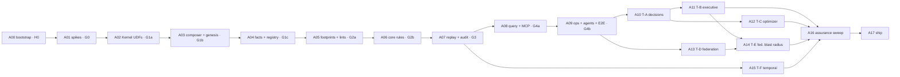

# RUNBOOK A · GNOMON Master Build Pipeline
### Compiles `graph-hack-supreme-master-blueprint.md` into 18 self-contained agent modules

| Field | Value |
|---|---|
| Source spec | `graph-hack-supreme-master-blueprint.md` (3,491 lines), referred to in prompts as `docs/design/master.md` |
| Target agent | Claude Opus 5.5 (`claude-opus-5-5`), high reasoning effort, **one fresh session per module** |
| Harness | pytest + Testcontainers (`falkordb/falkordb`, pinned digest) + hypothesis. Tests are written and seen failing before any implementation |
| Unit of work | One module = one prompt = one gate. Each module reads only the spec sections it names and hands off through files on disk, never through chat history |
| Status | Pre-event process notes. Contains no application code |

---

## 0. How to run this pipeline

1. **After 15 Oct 2026, 12:01 AM IST**, create a new, empty repository. Its first commit must come after the window opens.
2. Copy the blueprint into the repo as `docs/design/master.md`, and this runbook into `docs/process/RUNBOOK_A_GNOMON_master.md`. Both are design and process input; rule 8 allows notes prepared beforehand. Every prompt can then read the contract and harness sections from disk.
3. Open a fresh agent session at the repo root and paste **Module A00** verbatim. Let it finish its exit gate.
4. For every following module, in DAG order (§6):
   1. open a **new** session;
   2. paste the module prompt verbatim;
   3. let it reach its exit gate;
   4. answer its human checkpoint;
   5. continue.
5. Never paste two modules into one session. Never continue a module in a session that has already compacted its context; start a fresh session with the same prompt instead. The prompt is idempotent because it resumes from `.agent/STATE.md`.
6. If a module stops with an entry in `.agent/QUESTIONS.md`, answer it in that file, then re-paste the same prompt into a fresh session.
7. **Driver mode (ORRERY-Lite, patches P1–P5).** Instead of steps 3–6, `orrery init` creates the repo and `orrery run` drives every module: a test-writing session, a red check, an implementing session, the gate, then the handoff. Commits, evidence, STATE, LEDGER and gate JSON belong to the driver (P2). Gates are first `provisional` (P1) and turn `green` after `orrery explain <module>`. `ORRERY:` lines under a module header are machine-readable directives (P5): `bootstrap`, `spike`, `allow-green`, `barrier`, `fix-mode`, `human-tasks=…`, `bash+=…`.

---

## 1. Rule 8 / 11 / 12 / 13 execution protocol

| Rule | Protocol |
|---|---|
| 8 | The repo is created after the window opens. `docs/design/` holds design notes only. The agent writes every line of code in the repo against tests. **It must not paste code blocks from `docs/design/` into source files.** The design's Cypher defines the behaviour the tests check, and the implementation is authored in the repo. Git history (test commit, then feat commit, per behaviour) is the authorship record |
| 11 | `.agent/LEDGER.md` records every module run: model, date and time, module id, gate result. The README's AI-disclosure section is generated from it at A17 |
| 12 | Every gate ends with a **human checkpoint**: the agent writes `docs/explain/<module>.md` (what was built, the three riskiest decisions, five questions). The human answers the questions in their own words before the gate is marked green |
| 13 | The human owns the design decisions recorded in `.agent/DECISIONS.md` (spike fallbacks, spec deviations, tuning constants). The agent proposes; the human approves. That makes the participant's contribution and understanding real and on the record |

---

## 2. Target repository layout

```
gnomon/
  kernel/        jcs.py macros.py composer.py registry.py service.py diagnosis.py outcomes.py
                 segments/  pg.cypher p0.cypher p1.cypher p2.cypher p3.cypher q0.cypher e0.cypher ret.cypher
  bootstrap/     ddl.py genesis.py
  rules/         registry.yaml                 # rule definitions as data: caller, prelude, flags, key/view templates, probes
                 core/   *.cypher              # R0, R1.*, R4–R11, M3, M4, M6
                 families/ *.cypher.tmpl       # AssertFact, RetractFact, RegisterEntity shapes
                 titan/  *.cypher              # R12–R18, M1, M2, M5, X0–X6, S1, S2
  footprint/     parser.py keys.py lints.py verify.py matrix.py
  query/         service.py session.py  enablement/*.cypher  reads/*.cypher  algorithms/*.cypher
  mcp/           server.py tools.py schemas.py
  ops/           dispatcher.py scheduler.py sweeper.py reconciler.py relay.py
  executive/     branches.py candidates.py simapply.py score.py select.py footprint.py evidence.py envelope.py machine.py
  optimizer/     telemetry.py plans.py detect.py trials.py cost.py machine.py
  federation/    sys.py channels.py relay_protocol.py fedlog.py
  temporal/      asof.py counterfactual.py
  audit/         replay.py canonical.py k1.py … k9.py runner.py mutations.py
  sim/           infra.py generator.py scenarios/*.yaml
  agents/        llm.py recorded.py triage.py investigator.py comms.py responder.py
  cli.py                                      # the `gk` command
udf/             kernel.js exec.js
tests/           conftest.py  unit/ integration/ property/ stateful/ concurrency/ mutation/ e2e/ chaos/ spikes/ fixtures/
scripts/         gate.py check_tdd.py explain.py
gates/           <GATE>.json
.agent/          CONTRACT.md STATE.md DECISIONS.md QUESTIONS.md LEDGER.md evidence/<module>/
docs/design/     master.md        docs/explain/  <module>.md
pyproject.toml   docker-compose.yml   .github/workflows/ci.yml   README.md
```

---

## 3. Agent operating contract (A00 saves this verbatim as `.agent/CONTRACT.md`)

```text
GNOMON AGENT OPERATING CONTRACT  (applies to every module)

C1  SOURCE OF TRUTH. docs/design/master.md is the specification. Where code and spec disagree,
    the spec wins, unless .agent/DECISIONS.md records an approved deviation (id, reason, approver).
C2  READ BUDGET. Read only .agent/CONTRACT.md, .agent/STATE.md and the spec sections your module
    lists. To follow a cross-reference (§n), read that section only. Never load the whole spec.
C3  TESTS FIRST. For each behaviour batch: (a) write the tests; (b) run them and confirm they FAIL
    for the stated reason (missing module, NotImplemented, assertion), not for a harness error;
    (c) save the failing output to .agent/evidence/<module>/red-<n>.txt; (d) commit
    "test(<module>): <batch>"; (e) implement; (f) run until green; save green-<n>.txt;
    (g) commit "feat(<module>): <batch>".
    DRIVER MODE (ORRERY-Lite, patch P2): steps (b)–(d), (f)–(g), all commits, evidence files,
    STATE.md, LEDGER.md and gates/*.json are performed by the driver. Agents NEVER run git commit,
    never write .agent/{CONTRACT,STATE,LEDGER}.md, .agent/evidence/** or gates/**. The test-writing
    role writes tests only; the implementing role never edits test files. During implementation run
    only the current module's marker (inner loop); the driver runs the cumulative gate once (P3).
C4  NEVER WEAKEN TESTS. Do not delete, skip, xfail, loosen or rename a test to make a gate pass.
    If a test is wrong, stop, write to .agent/QUESTIONS.md, and wait for a human decision.
C5  REAL DATABASE. Integration, property, stateful, concurrency, mutation, e2e and chaos tests
    run against the Testcontainers falkordb/falkordb image pinned in STATE.md. FalkorDB is never mocked.
C6  SCOPE. Create or modify only the files listed in your module's SCOPE, plus tests and .agent/*.
    If you need a change elsewhere, stop and write to QUESTIONS.md.
C7  NO PLACEHOLDERS. No TODO, pass-only bodies, NotImplementedError, or skipped branches in any
    file covered by your gate when you finish.
C8  DETERMINISM. Seeds fixed. Wall-clock time only through the injected clock. Ordered iteration
    wherever output is hashed.
C9  RULE 8. Author all code in this repository. Never paste code blocks from docs/design/ into
    source files; implement against the tests.
C10 PLATFORM FACTS. Behaviour the spec marks as a spike assumption is used only as recorded under
    "platform facts" in STATE.md. If a needed fact is missing, stop and ask.
C11 HANDOFF. Before ending: update STATE.md, write gates/<GATE>.json via scripts/gate.py,
    append one line to LEDGER.md, write docs/explain/<module>.md, commit "gate(<GATE>): green".
    DRIVER MODE (P2): the driver performs the whole handoff. The gate is first recorded as
    "provisional" (scripts/gate.py <GATE> --provisional, patch P1) and becomes "green" only after the
    human answers the explain-back through the driver (`orrery explain <module>`).
C12 STOP CONDITIONS. Stop and write to QUESTIONS.md on: spec ambiguity that changes behaviour;
    a failing precondition; a spike fact contradicting the spec; any need to edit an existing
    test; a context budget near exhaustion (record exactly where you stopped in STATE.md).
```

---

## 4. TDD harness specification (implemented in-window by A00)

### 4.1 Toolchain

Python 3.12 managed by `uv`, with these packages: `pytest`, `pytest-timeout`, `pytest-xdist`, `hypothesis`, `testcontainers`, `falkordb` (official client), `redis`, `pydantic`, `antlr4-python3-runtime` (with the openCypher grammar), and the MCP Python SDK. FalkorDB is pinned by **image digest** in `STATE.md` at A01.

### 4.2 Fixture contract (`tests/conftest.py`)

| Fixture | Scope | Behaviour |
|---|---|---|
| `falkordb_container` | session | Start the pinned `falkordb/falkordb` image with port 6379 exposed. Wait by polling `PING` (60 s timeout). Yield host and port. Stop on teardown |
| `redis_raw` | session | `redis.Redis` client, for raw commands: `GRAPH.UDF`, `GRAPH.CONSTRAINT`, `GRAPH.COPY`, `GRAPH.LIST`, `MEMORY USAGE` |
| `db` | session | `falkordb.FalkorDB(host, port)` |
| `udf_loaded` | session | `GRAPH.UDF LOAD REPLACE` for every library in `udf/`; returns the library shas |
| `tenant` | function | A unique graph key `t:test-<uuid8>`. On teardown, `GRAPH.DELETE` the key and every key matching `t:test-<uuid8>:*` (scratch) |
| `golden_genesis` (patch P3, from A03) | session | Builds bootstrap DDL plus R0 **once** into `t:test-golden-<uuid8>` and waits until every index and constraint is operational |
| `genesis` | function | Returns a `KernelHandle` (submit, read, head) for `tenant`. From A03 on it is created by **`GRAPH.COPY` of `golden_genesis`** (copy carries indexes and constraints), not by re-running DDL and R0 per test (patch P3) |
| `clock` | function | Injected wall clock; deterministic and steppable |
| `recorded_llm` | function | Replays LLM responses from `tests/fixtures/llm/` keyed by prompt hash; fails on a cache miss |

### 4.3 Markers and gates

Markers are registered with `--strict-markers`: `unit`, `integration`, `property`, `stateful`, `concurrency`, `mutation`, `e2e`, `chaos`, `spike`, plus one gate marker per gate: `gate_h0`, `gate_g0`, `gate_g1a`, `gate_g1b`, `gate_g1c`, `gate_g2a`, `gate_g2b`, `gate_g3`, `gate_g4a`, `gate_g4b`, `gate_ta`, `gate_tb`, `gate_tc`, `gate_td`, `gate_te`, `gate_tf`, `gate_assure`, `gate_ship`. A gate's test set is every test carrying **its marker or the marker of any earlier gate in the DAG**, so gates are cumulative regression ratchets.

### 4.4 Hypothesis profiles

| Profile | `max_examples` | `derandomize` | `deadline` | Used for |
|---|---|---|---|---|
| `ci` | 200 | true | 2 s | Gates |
| `nightly` | 2000 | false | none | Nightly CI |

### 4.5 Gate runner contract (`scripts/gate.py <GATE> [--provisional]`)

1. Run `pytest -m "<cumulative gate markers>" --strict-markers -p no:randomly -n 4 --junitxml=.agent/evidence/<GATE>/junit.xml`. `-n 4` (pytest-xdist, patch P3) is safe because graph names are unique per test and UDF libraries are identical across workers.
2. Fail on any skipped, xfailed or deselected-by-condition test in the gate set.
3. Scan the module's scope for `TODO`, `NotImplementedError`, `pytest.skip`, `xfail` and bare `pass` bodies. Any hit fails the gate.
4. Run `scripts/check_tdd.py <module>`. For each `feat(<module>)` commit there must be an earlier `test(<module>)` commit touching tests of the same batch, and a `red-<n>.txt` evidence file must exist.
5. Check coverage of the Python packages in scope: `gnomon/kernel` and `gnomon/audit` ≥ 90%, others ≥ 80%.
6. Check that `docs/explain/<module>.md` exists and contains `HUMAN-SIGNED: yes`. **With `--provisional` (patch P1) this check alone is skipped.** If every other check passes, the status is `"provisional"` and the exit code is 0.
7. Write `gates/<GATE>.json` (schema §5.2; `status ∈ {green, provisional, red}`). Exit non-zero on any failure.

### 4.6 CI

The GitHub Actions workflow runs `scripts/gate.py` for every green gate on every push, so a regression in any earlier gate fails the build. The `nightly` profile runs stateful, chaos and full mutation suites.

---

## 5. Handoff files

### 5.1 `.agent/STATE.md` template

```text
# STATE
current_module:        <id>          status: in_progress | blocked | green
last_green_gate:       <GATE>
falkordb_image:        falkordb/falkordb@sha256:<digest>
python:                3.12.x
platform_facts:        (written by A01; one line per spike: S<n>: PASS|FAIL → fact / fallback in effect)
fallbacks_in_effect:   [S<n>: <fallback>]
layers_active:         [core, T-A, …]
open_questions:        <count> (see QUESTIONS.md)
resume_point:          <file / test / step where work stopped, if not green>
module_table:          | module | gate | status | commit |
```

### 5.2 `gates/<GATE>.json` schema

```text
{ "gate": "G1b", "module": "A03", "status": "green|provisional|red",
  "commit": "<sha>", "utc": "<iso8601>", "image_digest": "<sha256>",
  "tests": {"passed": n, "failed": 0, "skipped": 0, "duration_s": x},
  "coverage": {"gnomon/kernel": 0.93, ...},
  "tdd": {"batches": n, "red_evidence": ["red-1.txt", ...], "order_ok": true},
  "forbidden_patterns": 0, "human_signed": true }
```

### 5.3 `.agent/DECISIONS.md` and `.agent/QUESTIONS.md`

```text
D-<n> | <date> | module | decision | reason | spec ref | approved-by: <human> | status
Q-<n> | <date> | module | question | options considered | blocking: yes/no | answer: <human>
```

---

## 6. Module DAG



**Parallel lanes**, optional and only with separate git worktrees, merged by a human:

- {A12, A13} after A10;
- A15 any time after A07.

Run sequentially unless you use the orchestrator described in `ORRERY_execution_substrate.md`.

---

## 7. Modules

Every module prompt below is self-contained. Paste the whole fenced block.

### A00 · Bootstrap and TDD harness · gate H0

```text
MODULE A00 · GATE H0 · DEPENDS: none
ORRERY: bootstrap, allow-green

CAPSULE
GNOMON is an event-sourced, multi-agent operating system on FalkorDB. Every state change is one
atomic GRAPH.QUERY composed from kernel segments (prelude, pinned rule body, postlude) that checks
optimistic concurrency, ticks a dual clock (seq + HLC) and appends a hash-chained Rewrite node.
LLM agents only propose. Titan layers add counterfactual simulation on GRAPH.COPY branches, a
self-optimizing index engine, and multi-tenant federation. The spec is docs/design/master.md.
This module builds only the repository skeleton and the test harness. It writes no product logic.

PRECONDITIONS
- Current UTC time is after 2026-10-14T18:31:00Z (15 Oct 12:01 AM IST). If not, STOP.
- The repo contains only docs/design/, docs/process/ and optionally a LICENSE, plus (in driver mode, P2)
  the .agent/ files and .gitignore created by `orrery init`. If not, STOP.
- Docker is available (`docker info` succeeds).

SPEC INPUTS
- RUNBOOK_A §2 (layout), §3 (contract text), §4 (harness), §5 (handoff files): the human pastes
  these sections into the session if the runbook is not in the repo.
- master.md §0.3 (conventions), §22 (test architecture), §24 (expansion gates).

SCOPE (create)
pyproject.toml · tests/conftest.py · tests/unit/test_harness_smoke.py
tests/integration/test_container_smoke.py · scripts/gate.py · scripts/check_tdd.py
scripts/explain.py · .github/workflows/ci.yml
(.agent/CONTRACT.md, STATE.md, DECISIONS.md, QUESTIONS.md and LEDGER.md are created and maintained
 by the driver in driver mode, P2; without the driver, create them per RUNBOOK_A §3 and §5.1)
docker-compose.yml (FalkorDB only, image placeholder until A01 pins the digest) · README.md (title only)

STEP 1 · TESTS FIRST (RED)
tests/unit/test_harness_smoke.py
  - test_markers_registered: every marker in RUNBOOK_A §4.3 is registered; an unknown marker errors
  - test_hypothesis_profiles: "ci" and "nightly" exist with the values in §4.4
tests/integration/test_container_smoke.py   (markers: integration, gate_h0)
  - test_ping: falkordb_container answers PING
  - test_graph_roundtrip: on `tenant`, CREATE (:X {v:1}) then MATCH returns 1
  - test_tenant_cleanup: after a test creates `<tenant>` and `<tenant>:sim:x`, both are gone
    (verified by a follow-up check of GRAPH.LIST in a dedicated fixture-level test)
  - test_udf_load_roundtrip: load a throwaway library "Smoke" registering one function and call it.
    The library lives in tests/fixtures/udf/smoke.js (test fixture, not product code)
tests/unit/test_gate_runner.py
  - test_gate_fails_on_skip, test_gate_fails_on_todo_in_scope, test_gate_requires_human_signed,
    test_check_tdd_requires_test_commit_before_feat: run against a temporary git repo fixture
  - test_gate_provisional_skips_only_human_signed (P1): with --provisional, an unsigned explain doc
    yields status "provisional" and exit 0; any other failing check still yields "red"
Run the tests; confirm RED (fixtures and scripts are missing); save evidence; commit.

STEP 2 · IMPLEMENT (GREEN)
- conftest fixtures exactly per RUNBOOK_A §4.2 (genesis and recorded_llm may raise a clear
  "not yet available until A03 / A09" error; they are not used by H0 tests)
- scripts/gate.py and scripts/check_tdd.py per §4.5; scripts/explain.py scaffolds
  docs/explain/<module>.md with sections: Built · Risky decisions · Questions (5) · HUMAN-SIGNED: no
- CI workflow per §4.6
Commit feat.

STEP 3 · EXIT GATE
python scripts/gate.py H0 → status green; all H0 tests pass; 0 skipped.

STEP 4 · HANDOFF
STATE.md: last_green_gate H0, module_table row A00 green. LEDGER.md line. docs/explain/A00.md.
Commit "gate(H0): green".

HUMAN CHECKPOINT (answer in docs/explain/A00.md, then set HUMAN-SIGNED: yes)
1 Why are gates cumulative? 2 What does check_tdd.py verify, and how could it be fooled?
3 Why is FalkorDB never mocked? 4 What happens to scratch graphs after a test?
5 Where does the pinned image digest come from?

OUT OF SCOPE: any gnomon/ package code.
```

### A01 · Platform spikes · gate G0

```text
MODULE A01 · GATE G0 · DEPENDS: H0
ORRERY: spike, allow-green, bash+=docker pull, bash+=docker image inspect, bash+=docker inspect

CAPSULE
(as in A00). This module turns every platform assumption in the spec into an executable spike
test against the real FalkorDB image, records the observed facts, and chooses fallbacks.
Later modules rely only on facts recorded here.

READ FIRST: .agent/CONTRACT.md, .agent/STATE.md
PRECONDITIONS: gates/H0.json status green.
SPEC INPUTS: master.md §23 (all), §3.5, §6.2–6.7 (only to see which constructs are used),
             §8.1, §10.5, §15.2, §16.3, §16.7, §16.11.

SCOPE: tests/spikes/test_s01_… through test_s22_… (one file per spike) · tests/fixtures/udf/spike_*.js
       · .agent/FACTS.md (driver mode; without the driver write .agent/STATE.md platform_facts) ·
       .agent/DECISIONS.md · docker-compose.yml (digest) · tests/conftest.py (image digest pin only)

STEP 1 · TESTS (spike tests encode the question; RED is expected only where no probe code exists yet)
Pin the image first: pull falkordb/falkordb, record the digest in .agent/FACTS.md (driver mode) or
STATE.md, and use it in conftest.
spikes:
  One test per row of master §23.2 (S1–S8, S10–S22), one file per spike.
facts:
  Confirmation tests for the §23.1 facts:
  F1 GRAPH.COPY snapshot isolation: writes to the source after the copy are not visible in the dest
  F2 FOREACH accepts CREATE / MERGE / SET / REMOVE / DELETE / nested FOREACH and sees outer variables
  F3 relationship-property index syntax, DROP INDEX ON :R(p), and that EXPLAIN shows Edge By Index Scan
  F4 GRAPH.CONSTRAINT replies PENDING and db.constraints() reaches OPERATIONAL
  F5 GRAPH.PROFILE line format parses as documented
  F6 algo.* signatures: pageRank(label, relType), betweenness({…}), WCC, labelPropagation,
     bfs(node, depth, relType), SPpaths({…}), maxFlow({…})
  F7 UDF API: falkor.register, getNeighbors({direction, types, returnType}), graph.getNodeById,
     graph.traverse; UDFs cannot write
Each spike test asserts the behaviour the spec ASSUMES. Where FalkorDB differs, the test must
still pass by asserting the OBSERVED behaviour, and the module records a fact and a fallback.
Encode the observation; do not mark the test failed or skipped.

STEP 2 · RECORD
For every spike, write one line to .agent/FACTS.md (driver mode; the driver merges it into STATE.md
platform_facts) or to STATE.md platform_facts: "S<n>: PASS | FAIL → <observed fact>; fallback: <none | §23.2 fallback>".
The first line of FACTS.md is "falkordb_image: falkordb/falkordb@sha256:<digest>".
For every FAIL, add a DECISIONS.md entry proposing the §23.2 fallback, status: needs-approval.

STEP 3 · EXIT GATE
python scripts/gate.py G0 → green, and every S/F test present. The gate also fails if any
DECISIONS entry from this module is still "needs-approval".

STEP 4 · HANDOFF: standard (CONTRACT C11).

HUMAN CHECKPOINT
1 Which spikes failed, and what does each chosen fallback cost? 2 What does S4 (rollback) protect?
3 Does F1 change the need for the torn-copy check in §15.2? 4 Which spike blocks the most later
modules if wrong? 5 What did the S1 result do to the kernel design?

STOP CONDITIONS: S1 and S3 both FAIL (the kernel needs a client-side mutex design). Ask before continuing.
OUT OF SCOPE: product code.
```

### A02 · Kernel UDF library · gate G1a

```text
MODULE A02 · GATE G1a · DEPENDS: G0

CAPSULE: (as A00). Build the server-side JavaScript UDF library "Kernel": the hashing, digest,
hybrid-logical-clock and hash-chain functions every atomic apply query calls.

READ FIRST: CONTRACT, STATE (use platform_facts S1, S11, F7)
PRECONDITIONS: gates/G0.json green; S1 fact recorded.
SPEC INPUTS: master.md §8.1–§8.5, §2.2, §2.3, §0.3 rows "Hashing", "Digest", "Infinity".
             (§8.6 invariantProbe is built in A07, not here.)

SCOPE: udf/kernel.js · gnomon/udf/loader.py (load REPLACE, compute library sha from GRAPH.UDF LIST
       Kernel WITHCODE) · tests/integration/udf/test_*.py · tests/property/test_hlc_props.py

STEP 1 · TESTS FIRST (RED)
test_sha256.py
  - test_fips_vectors: the three vectors in §8.2 via RETURN Kernel.sha256($s)
  - test_matches_hashlib (property): any text up to 2000 chars, including astral-plane characters,
    equals hashlib.sha256(s.encode()).hexdigest()
test_digest.py
  - test_netstring_example: digest(["abc",7,null]) == sha256("3:abc,1:7,~,")
  - test_matches_reference (property): lists of str/int/null equal a Python reference encoder
  - test_rejects_float_bool_nested: each raises a query error
test_tick.py
  - test_live_rules: the table in §2.2 (pt advance, lc increment, lc reset)
  - test_replay_returns_recorded / test_sim_returns_recorded
  - test_hlc_regression_throws: rec <= (pt, lc) raises HLC_REGRESSION
  - test_lc_overflow_throws, test_bad_mode_throws
test_recv.py
  - test_receive_table: the four branches of §2.2 / §8.4
test_hlc_props.py (property)
  - outputs strictly greater than (pt, lc); recv output > (m_pt, m_lc); live pt_out >= wall
test_chain.py
  - test_chain_is_digest_of_tagged_fields: equals the Python digest of ["rw/1", …] (§8.5)
test_udf_in_write.py
  - test_udf_value_in_set: CREATE (n) SET n.h = Kernel.sha256('x') persists the expected hash
    (if S1 recorded a FAIL, assert the recorded fallback path instead and cite S1)
test_loader.py
  - test_library_sha_stable: loader sha equals sha256 of the WITHCODE text; reload is idempotent

STEP 2 · IMPLEMENT
udf/kernel.js: sha256, digest, tick, recv, chain per the reference algorithms in §8.2–§8.5
(pure JS, manual UTF-8, 32-bit arithmetic; throw named errors). Register each with falkor.register.
gnomon/udf/loader.py.

STEP 3 · EXIT GATE: python scripts/gate.py G1a → green.
STEP 4 · HANDOFF: standard. Record the Kernel library sha in STATE.md.

HUMAN CHECKPOINT
1 Why 2^53−1 for INF? 2 Why is the netstring encoding prefix-free, and why does that matter?
3 Walk through recv when the message pt equals the local pt. 4 What happens to an apply query
when tick throws? 5 Why must replay never read the wall clock?
```

### A03 · Composer, bootstrap DDL, genesis and rule registry · gate G1b

```text
MODULE A03 · GATE G1b · DEPENDS: G1a

CAPSULE: (as A00). Build the kernel's trusted write path: rule definitions and SHA pinning,
JCS canonical JSON, macro expansion, segment composition (PG, P0, Q0, RET), the kernel service
(submit → compose → execute → outcome), diagnosis, bootstrap DDL, and R0 Genesis.

READ FIRST: CONTRACT, STATE (facts S2, S3, S4, S15, S20, S21, F2, F4)
PRECONDITIONS: gates/G1a.json green.
SPEC INPUTS: master.md §0.3, §0.4 (I1–I4), §2.3, §2.5, §3.1 (Core rows), §3.5, §5.1, §5.3,
             §6.1, §6.2, §6.3, §6.6, §6.8, §6.9, §6.10 (D1–D5, D8, D9), §9.1, Appendix A, Appendix C.

SCOPE: gnomon/kernel/{jcs,macros,composer,registry,service,diagnosis,outcomes}.py
       gnomon/kernel/segments/{pg,p0,q0,ret}.cypher · gnomon/bootstrap/{ddl,genesis}.py
       gnomon/rules/core/genesis.cypher · gnomon/rules/registry.yaml (Genesis entry only)
       tests/fixtures/rules/noop.yaml + noop.cypher (test-only rule: writes one test node, caller "kernel")
       tests/unit/kernel/*, tests/integration/kernel/*
       tests/conftest.py (golden_genesis session fixture + copy-based genesis, patch P3)

STEP 1 · TESTS FIRST (RED)
unit:
  - test_jcs_rfc8785: key ordering, number serialization, unicode escaping vectors
  - test_macros: KCTX and LIVE(f) expand exactly as in §0.3; expansion happens before hashing
  - test_rule_sha: sha = SHA-256(JCS(def_json)); a changed flag changes the sha
  - test_compose_order: R0 → PG·BODY·Q0·RET; standard → P0·BODY·Q0·RET; requesting the add-ons
    P1/P2/P3/E0 raises "segment not installed" (installed later by A10 / A13)
  - test_parameter_binding: write_keys come from templates and $p only; params_json = JCS($p)
integration:
  - test_bootstrap_ddl: every §3.5 index and constraint operational (db.indexes / db.constraints)
  - test_genesis_creates_kernel: Head(seq 1, hash chained from ZERO64), Rules, FactTypes, Skills,
    Agents with HAS_SKILL, IndexEntry/ConstraintEntry rows match the base catalogue
  - test_genesis_twice_rejected · test_genesis_requires_kernel_agent · test_genesis_rule_sha_mismatch
    · test_genesis_agent_unknown_skill_rejected
  - test_apply_noop_increments_seq_and_chains (seq, pt/lc tick, prev = previous hash, KeyVersion
    updated, CAUSED_BY created to the last writers of view keys)
  - test_outcomes: DUPLICATE (same pid and content) · PID_CONFLICT · RULE_PINNED · CALLER_DENIED ·
    INVALID_VIEW · REJECTED_STALE names the key, seq and writer · REJECTED_GUARD names the probe ·
    INDETERMINATE
  - test_zero_rows_writes_nothing: Head hash and node counts are identical after any rejection
  - test_error_rolls_back: a forced UDF throw leaves the graph unchanged (S4 fact)
  - test_replay_mode_uses_recorded_clock
concurrency:
  - test_50_parallel_noop_distinct_pids: seq = 51, chain intact
harness (patch P3):
  - test_copied_genesis_equals_fresh_genesis: a tenant created by GRAPH.COPY of golden_genesis has
    the same Head (seq, hash), Rule shas, IndexEntry rows and operational indexes/constraints as a
    freshly bootstrapped tenant; setup time per test is recorded in the evidence

STEP 2 · IMPLEMENT
Segments PG, P0, Q0, RET (§6.2, §6.3, §6.6) and R0 body (§9.1) authored as .cypher files.
The composer selects segments by rule flags (§6.1) and substitutes <TICK> (T0 only in this module).
The service computes write keys and params_json, executes, and on zero rows runs diagnosis D1–D5,
D8, D9 (§6.10). The registry loads registry.yaml, computes def_json and sha, and expands
families (expansion is exercised in A04).

STEP 3 · EXIT GATE: python scripts/gate.py G1b → green (cumulative with H0, G0, G1a).
STEP 4 · HANDOFF: standard. Record kernel_sha in STATE.md.

HUMAN CHECKPOINT
1 Why does every filter precede the first write? 2 Where is the clock ticked, and why there and
not in the postlude (master §0.2 C1)? 3 Trace a REJECTED_STALE from proposal to diagnosis.
4 Why is Genesis validation entirely in PG? 5 What exactly does kernel_sha pin?
```

### A04 · Bitemporal facts, projections and registry meta-rules · gate G1c

```text
MODULE A04 · GATE G1c · DEPENDS: G1b

CAPSULE: (as A00). Implement the bitemporal fact model: AssertFact and RetractFact families
(versions with valid time [vf,vt) and transaction time [ts,te)), projection edges for algorithms,
plus the registry meta-rules RegisterRule, DeactivateRule, RegisterAgent and RegisterEntity.

READ FIRST: CONTRACT, STATE (facts S2, S15)
PRECONDITIONS: gates/G1b.json green.
SPEC INPUTS: master.md §3.2, §3.3, §3.4 (projection rows), §4.1, §4.2, §4.3 (Q7 only),
             §5.2, §5.4, §9.3, §9.4, §9.13, §9.14, §9.15, §9.16, §0.4 (I7, I9).

SCOPE: gnomon/rules/families/{assert_fact,retract_fact,register_entity}.cypher.tmpl
       gnomon/rules/core/{register_rule,deactivate_rule,register_agent}.cypher
       gnomon/rules/registry.yaml (these entries + FactType registry)
       gnomon/kernel/registry.py (family instantiation) · tests/integration/facts/*,
       tests/integration/registry/*, tests/property/test_bitemporal_props.py

STEP 1 · TESTS FIRST (RED)
facts (one test per row of the §4.2 table, per shape FP / F / SP / S):
  - assert creates a version [vf,∞) with ts = seq, te = ∞, fid = <pid>#0, plus a projection when projected
  - supersede (functional): old version te closed; new current-closed copy [old.vf, new.vf)
    pointing at the OLD object; new open version; projection moved; requires $p.old_o = actual old object
  - end: new current-closed version [vf, vt_end); projection removed; vt_end > now rejected
  - void: version closed, nothing replaces it; projection removed if present
  - vf in the future rejected · duplicate open set fact rejected · self-dependency rejected
  - DEPLOYED requires o.service = s.id · DEPENDS_ON object may be Service or ExternalService
  - write keys: <REL>:<s>:*, <REL>:*:<o>, <REL>:*, plus <REL>:*:<old_o> on supersede
property:
  - random assert/supersede/end/void sequences keep I7 (no overlap among current versions) and
    I9 (projection = current open-ended facts), checked by direct Cypher after every step
registry:
  - M3: version must be top+1; sha must equal Kernel.sha256(def_json); replacing deactivates the
    previous version; Genesis cannot be re-registered
  - M4: cannot deactivate kernel-class rules or RegisterRule / DeactivateRule / RegisterAgent
  - M6: register (role in ROLES, not kernel, skills exist) and deactivate
  - M7: each member of §9.16, including RegisterEntity.Deploy needing its Service
concurrency:
  - 50 parallel identical AssertFact.OWNED_BY proposals: exactly 1 APPLIED; the rest
    REJECTED_GUARD or REJECTED_STALE

STEP 2 · IMPLEMENT
The family templates with placeholders <REL> <SPRED> <OPRED> <PROJ> <EXTRA> <ATTRS> <ATTR_COPY>,
and the instantiation table (§9.3, §9.4). The registry expands each member, runs macro expansion,
hashes it, and registers it at genesis (core members) or via M3. Bodies per §9.13–§9.16.

STEP 3 · EXIT GATE: python scripts/gate.py G1c → green. This completes G1 (G1a + G1b + G1c).
STEP 4 · HANDOFF: standard.

HUMAN CHECKPOINT
1 Draw the versions after assert → supersede → end on one service. 2 Why can't projections hold
future-dated facts? 3 Why does supersede need $p.old_o? 4 How does M3 verify its own input?
5 What would break in algorithms without projections?
```

### A05 · Footprints, key templates, lints, dynamic verification, conflict matrix · gate G2a

```text
MODULE A05 · GATE G2a · DEPENDS: G1c

CAPSULE: (as A00). Build the static and dynamic footprint machinery: parse rule bodies, extract
read and write sets, instantiate key templates, run lints L1–L8 before registration, verify actual
writes ⊆ declared writes on scratch copies, and generate the conflict matrix.

READ FIRST: CONTRACT, STATE
PRECONDITIONS: gates/G1c.json green.
SPEC INPUTS: master.md §5.4, §5.5, §7.1–§7.7, Appendix B (grammar line).

SCOPE: gnomon/footprint/{parser,keys,lints,verify,matrix}.py · grammar/ (openCypher grammar, vendored)
       tests/unit/footprint/*, tests/integration/footprint/*, tests/fixtures/rules/lint_cases/*
       tests/fixtures/rules/claimtask_v0.cypher (no lease guard; used ONLY as a lint fixture)

STEP 1 · TESTS FIRST (RED)
  - test_key_templates: {p.x}, {p.list[]}, {p.list[].field}, {pid}, {m.field} (P2/P3 only);
    null elements skipped; deterministic order
  - test_parser_read_write_sets: for every registered rule, reads/writes match registry.yaml
  - test_guard_reads: properties read in WHERE before the first write
  - one positive and one negative fixture per lint L1–L8
  - test_claimtask_v0_refused_by_L1: exact lint message names HOLDS and Task.state
  - test_dynamic_verification (property): for every registered rule and generated params,
    actual writes on a scratch copy ⊆ declared writes and instantiated keys (§7.5)
  - test_matrix_snapshot: the generated matrix contains every expected classification in §7.6
    for rules that exist so far (later modules extend the snapshot)
  - test_registration_runs_lints: M3 proposals with a lint failure are refused before submission

STEP 2 · IMPLEMENT: per §7.4–§7.6 and §5.5. Dynamic verification uses t:<tenant>:replay:fpv-<n> scratch keys.
STEP 3 · EXIT GATE: python scripts/gate.py G2a → green.
STEP 4 · HANDOFF: standard. Save the generated matrix to docs/explain/matrix.md.

HUMAN CHECKPOINT
1 What is the difference between a guarded and an unguarded conflict? 2 Why must key templates
depend only on params? 3 What does dynamic verification catch that the parser cannot?
4 Explain ClaimTask_v0's race. 5 Which matrix entry surprised you?
```

### A06 · Core memory rules R1, R4–R11 · gate G2b

```text
MODULE A06 · GATE G2b · DEPENDS: G2a

CAPSULE: (as A00). Implement the incident-response memory and coordination rules: observations,
incidents, task leases, updates with live citations, root causes and resolution. Every rule ships
with generated guard probes and passes the lints and the dynamic verifier from A05.

READ FIRST: CONTRACT, STATE
PRECONDITIONS: gates/G2a.json green.
SPEC INPUTS: master.md §9.0, §9.2, §9.5–§9.12, §11.1 (Outbox states only), §13.3 (Task, Lease,
             Incident), §0.4 (I6, I8), Appendix C (MAX_TTL_MS, MAX_ATTEMPTS).

SCOPE: gnomon/rules/core/{observe_alert,observe_health,observe_receipt,open_incident,claim_task,
       complete_task,handoff,expire_lease,post_update,propose_cause,resolve_incident}.cypher
       gnomon/rules/registry.yaml (entries, view templates, probes) · gnomon/kernel/registry.py (probe generation)
       tests/integration/rules/*, tests/concurrency/test_claims.py, tests/property/test_lifecycle_props.py

STEP 1 · TESTS FIRST (RED). For EACH rule:
  - happy path: exact graph delta and write keys
  - one test per guard conjunct: the proposal is REJECTED_GUARD and diagnosis names that probe (G1…Gn)
  - state-machine transitions from §13.3 (Task, Lease, Incident) as table-driven tests
Specific:
  - R8 uses the rewrite's own now: a lease expiring between scheduler read and apply is still expired
  - R9: a cite of a retracted fact (R3 'end') → REJECTED_GUARD; a live cite → CITES edge with fid
  - R10: confidence bounds; duplicate current ROOT_CAUSE rejected
  - R11: all tasks done + root cause + service ok and normal
  - R1.receipt: attempts and dead transition (MAX_ATTEMPTS)
concurrency:
  - 50 parallel ClaimTask on one task → exactly 1 APPLIED and 49 REJECTED_GUARD (state or lease)
property:
  - random lifecycle sequences keep I6 (at most one unclosed lease per task)
matrix:
  - the snapshot now includes every pair in §7.6 among R1–R11

STEP 2 · IMPLEMENT: rule bodies per §9.2, §9.5–§9.12, authored in gnomon/rules/core; registry entries.
STEP 3 · EXIT GATE: python scripts/gate.py G2b → green. This completes G2.
STEP 4 · HANDOFF: standard.

HUMAN CHECKPOINT
1 Why does ExpireLease compare against now rather than a parameter? 2 What makes 49 of 50 claims
fail, and with which codes? 3 Why does R4 take service and signature as params? 4 How does R9
prove a citation is live? 5 Which guard probe is hardest to read?
```

### A07 · Replay, canonical state hash, audits K1–K6, mutations MU1–MU18 · gate G3

```text
MODULE A07 · GATE G3 · DEPENDS: G2b

CAPSULE: (as A00). Build the trust layer: replay the log into a fresh graph using recorded inputs,
hash the whole logical graph canonically, run audits K1–K6, add invariantProbe to the Kernel
library, and prove every audit catches its mutations.

READ FIRST: CONTRACT, STATE
PRECONDITIONS: gates/G2b.json green.
SPEC INPUTS: master.md §8.6, §12.1–§12.3, §0.4, §21.1 (K1–K6 rows), §21.2 (MU1–MU18), §21.3 (WHY-entity).

SCOPE: udf/kernel.js (add invariantProbe only) · gnomon/audit/{replay,canonical,k1,k2,k3,k4,k5,k6,runner,mutations}.py
       gnomon/cli.py (gk replay, gk audit, gk why) · tests/integration/audit/*, tests/mutation/*,
       tests/stateful/test_core_machine.py

STEP 1 · TESTS FIRST (RED)
  - test_replay_reproduces_each_step: every replayed seq returns the recorded seq and hash
    (DIVERGENCE raised otherwise); recorded view keys re-validate and recreate CAUSED_BY
  - test_canonical_hash_order_independent (property: insertion order permutations give the same hash)
  - test_k1 … test_k6 on a clean scenario: all pass
  - mutation tests MU1–MU18: each applied to a scratch copy (dropping a constraint first where
    needed) is detected by EXACTLY the checks listed in §21.2 (others may also fire; the listed
    ones must)
  - test_invariant_probe_kinds: lease / overlap / projection / causal per §8.6
  - test_why_entity: returns the creating rewrite and its causal chain
stateful (hypothesis.stateful RuleBasedStateMachine):
  - rules = every agent-callable Core rule with generated params; invariant = K5 after each step;
    teardown: K1–K6 pass and replay hash == live hash

STEP 2 · IMPLEMENT per §12 and §8.6.
STEP 3 · EXIT GATE: python scripts/gate.py G3 → green.
STEP 4 · HANDOFF: standard.

HUMAN CHECKPOINT
1 Why does replay pass recorded view keys? 2 What is in the K4 hash and what is excluded?
3 Pick one mutation and trace how each listed check detects it. 4 Why compare the citation seq
with ts/te instead of pt? 5 What would a K4-only audit miss?
```

### A08 · Query service, enablement, id provenance, core MCP tools · gate G4a

```text
MODULE A08 · GATE G4a · DEPENDS: G3

CAPSULE: (as A00). Build the tool plane: the read-only query service (atomic read_seq, binding
vs advisory reads, view-key algebra, id provenance), enablement queries for agent-callable rules,
as-of reads, algorithm tools on projections, and the MCP server exposing the core tools.

READ FIRST: CONTRACT, STATE (facts F6, S17, S20)
PRECONDITIONS: gates/G3.json green.
SPEC INPUTS: master.md §7.2, §7.3, §10 (all), §4.3 (Q1–Q7), §20 (Core rows only).

SCOPE: gnomon/query/{service,session}.py · gnomon/query/enablement/en_r4…en_r11.cypher
       gnomon/query/reads/{rd_facts,rd_entity,q1…q7}.cypher · gnomon/query/algorithms/al_*.cypher
       gnomon/mcp/{server,tools,schemas}.py · tests/integration/query/*, tests/integration/mcp/*,
       tests/property/test_enablement_soundness.py

STEP 1 · TESTS FIRST (RED)
  - test_read_seq_atomic: read_seq comes from the same RO query as the rows
  - test_view_algebra: proposal read_seq = min over cited reads; view_keys = union; phantom keys added
  - test_id_provenance: an id absent from the cited reads → SCHEMA_REJECTED before composition
  - test_advisory_reads_add_no_keys
  - test_enablement_soundness (property): every tuple returned by EN-Rx, proposed immediately with
    its view keys, is APPLIED (or REJECTED_STALE if a concurrent writer is injected)
  - test_enablement_completeness: on fixture states, every valid tuple appears
  - test_asof_queries: Q1–Q6 on a hand-built history with known answers
  - test_algorithm_tools: pageRank / betweenness (fixed seed) / WCC / labelPropagation / bfs /
    SPpaths on a fixture topology over DEP_NOW, signatures per STATE facts
  - test_mcp_schemas: every core tool in §20 is listed with its JSON schema; propose accepts only
    (rule, tuple_index | params, free text, cite_reads, pid); $agent comes from the session
  - test_mcp_never_writes_except_propose

STEP 2 · IMPLEMENT per §10 and §20 (core rows).
STEP 3 · EXIT GATE: python scripts/gate.py G4a → green.
STEP 4 · HANDOFF: standard.

HUMAN CHECKPOINT
1 Why are algorithm reads advisory? 2 What does id provenance stop? 3 Why is read_seq the minimum?
4 How would an agent get a stale proposal applied, and why can't it? 5 Which tool would you cut
from a minimal demo, and why?
```

### A09 · Ops, synthetic world, agents and Core end-to-end · gate G4b (Core release)

```text
MODULE A09 · GATE G4b · DEPENDS: G4a

CAPSULE: (as A00). Complete the Core Substrate: outbox dispatcher, lease scheduler, the seeded
synthetic infrastructure and company generator, LLM agents (Triage, Investigator A/B, Comms)
running on recorded responses, and end-to-end proofs P1–P5.

READ FIRST: CONTRACT, STATE
PRECONDITIONS: gates/G4a.json green.
SPEC INPUTS: master.md §11 (all), §13.1, §13.2, §26 (P1–P5 rows), §10.3 (rule 5).

SCOPE: gnomon/ops/{dispatcher,scheduler,sweeper}.py · gnomon/sim/{infra,generator}.py
       gnomon/sim/scenarios/core.yaml · gnomon/agents/{llm,recorded,triage,investigator,comms}.py
       gnomon/cli.py (gk run, gk proof) · tests/integration/ops/*, tests/e2e/test_core_*.py,
       tests/e2e/test_proof_p1…p5.py, tests/fixtures/llm/*

STEP 1 · TESTS FIRST (RED)
  - test_outbox_state_machine (§11.1 table) · test_dispatcher_idempotent_by_pid ·
    test_receipt_source_ids_deterministic
  - test_scheduler_deterministic_pids · test_scheduler_uses_wall_then_guard_uses_now
  - test_generator_deterministic: same seed → same canonical hash; 40 services DAG, 8 teams,
    backdated ownership changes, one bad deploy, one unhealthy replica
  - test_infra_actions_idempotent · test_infra_emits_observe_health
  - test_agent_loop_outcomes: the §13.2 outcome table with recorded responses
  - test_core_scenario_triple: three runs from one seed → identical final state hashes
  - test_proof_p1 … test_proof_p5: each §26 row asserted as an executable scenario

STEP 2 · IMPLEMENT per §11, §13.
STEP 3 · EXIT GATE: python scripts/gate.py G4b → green. CORE RELEASE: tag v-core.
STEP 4 · HANDOFF: standard, plus "layers_active: [core]".

HUMAN CHECKPOINT
1 Narrate P2 in two sentences for a judge. 2 Why are receipts Observe rewrites? 3 What makes the
triple run deterministic, given LLMs? 4 Where is the hidden ground truth, and why can it disagree
with the graph? 5 What would you show first in a 60-second demo?
```

### A10 · T-A Decision framework · gate TA

```text
MODULE A10 · GATE TA · DEPENDS: G4b
ORRERY: barrier

CAPSULE: (as A00). Install the decision framework shared by all decided rules: the P1 prelude
add-on, the E0 evidence segment, Scorer / Approval / Decision / Candidate / Evidence schema,
RegisterScorer (M5), RequestApproval (R16), ApproveDecision (R17), and the K7 skeleton.

READ FIRST: CONTRACT, STATE
PRECONDITIONS: gates/G4b.json green.
SPEC INPUTS: master.md §14 (all), §6.1, §6.4, §6.7, §6.10 (D6), §3.1 (T-A rows), §3.5 (T-A DDL),
             §0.4 (I11), §15.13 steps 1 and 8 only, §21.2 (MU19–MU21).

SCOPE: gnomon/kernel/segments/{p1,e0}.cypher · gnomon/kernel/composer.py (install add-ons)
       gnomon/rules/titan/{register_scorer,request_approval,approve_decision}.cypher · registry.yaml
       gnomon/executive/envelope.py (schema + sha only) · gnomon/audit/k7.py (skeleton)
       gnomon/cli.py (gk approve, gk veto) · tests/integration/decision/*, tests/mutation/test_mu19_21.py
       tests/fixtures/rules/noop_action.* (test-only action rule; requires_decision; gated variant)

STEP 1 · TESTS FIRST (RED)
  - test_envelope_sha: sha = SHA-256(JCS(decision without sha)); params carry decision_sha and attach_sha
  - test_decided_commit: noop_action commits; Decision/Candidate/Evidence/CITES/COMMITTED_AS exist
    and match the envelope
  - test_rejected_decision_causes: scorer inactive · approval missing (gated) · approval sha mismatch ·
    approval veto · dead cite · attach sha mismatch · read_seq mismatch → each REJECTED_DECISION with
    the D6 sub-reason
  - test_approval_state_machine (§14.6) including expiry and APPROVES on commit
  - test_r17_not_exposed_over_mcp
  - test_k7_skeleton: sha recompute, node-vs-attach equality, I11
  - MU19–MU21 detected

STEP 2 · IMPLEMENT per §14, §6.4, §6.7. Activation in tests and in the demo tenant is by logged
rewrites: M3 for R16 and R17, M5 for a test scorer, M6 for the human role.
STEP 3 · EXIT GATE: python scripts/gate.py TA → green.
STEP 4 · HANDOFF: standard; layers_active adds T-A.

HUMAN CHECKPOINT
1 What exactly does a human sign? 2 Why can't E0 contain WHERE? 3 Which binding can the kernel not
check atomically, and who checks it? 4 Why is the approval keyed by aid, not did? 5 What makes Titan
activation replayable?
```

### A11 · T-B Counterfactual Executive · gate TB

```text
MODULE A11 · GATE TB · DEPENDS: TA
ORRERY: barrier

CAPSULE: (as A00). Build the Executive: branch manager on GRAPH.COPY, sim-mode applies, the
Exec.blastRadius UDF scorer with integer weights, deterministic selection, simulation footprint,
evidence extraction, the decision state machine, action rules R12–R15 and R18, the MCP decide and
simulate tools, and full K7.

READ FIRST: CONTRACT, STATE (facts F1, S5, S11, S13, S15)
PRECONDITIONS: gates/TA.json green.
SPEC INPUTS: master.md §15 (all), §13.3 (Service rows), §20 (T-B rows), §21.2 (MU22–MU23), §26 rows A and B.

SCOPE: udf/exec.js · gnomon/executive/*.py · gnomon/rules/titan/{isolate_service,failover_service,
       rollback_deploy,escalate_incident,restore_service}.cypher · gnomon/query/enablement/en_r12…en_r18.cypher
       gnomon/agents/responder.py · gnomon/mcp/tools.py (decide, simulate, decision) · gnomon/audit/k7.py (full)
       tests/integration/executive/*, tests/property/test_scorer_props.py, tests/e2e/test_proof_a.py,
       tests/e2e/test_proof_b.py, tests/mutation/test_mu22_23.py, tests/fixtures/graphs/blast_*.yaml

STEP 1 · TESTS FIRST (RED)
scorer:
  - test_blast_radius_hand_computed: on 3 fixture graphs with hand-calculated impacted sets, weights
    (W = 2520), parents and teams
  - test_propagate_table: every row of propagate() in §15.6
  - test_scorer_byte_identical (property): two runs on equal graphs give identical output
  - test_region_bounded_by_hops; test_soft_reached_nodes_do_not_propagate
executive:
  - test_base_snapshot_verify; test_branches_share_read_seq; test_sim_apply_never_touches_live
    (live Head.hash unchanged across 100 simulations)
  - test_candidate_set_exhaustive_vs_nominated; test_escalate_always_k0_scores_zero
  - test_scoring_integer_formulas (§15.7) with hand-built B/K maps; test_margin_falls_back_to_escalate
  - test_footprint_keys (§15.8) and footprint ⊆ view_keys
  - test_evidence_paths_and_cites (§15.9); cites ⊆ $d.cites
  - test_state_machine_transitions (§15.11), including veto re-selection and expiry
  - test_stale_flush: an ownership retraction inside the region between snapshot and commit →
    REJECTED_STALE → re-snapshot → APPLIED with the new read_seq
  - test_crash_recovery_duplicate: re-issuing decide with the same request id after a commit → DUPLICATE
  - test_no_branch_leaks (GRAPH.LIST)
rules:
  - R12, R13, R14 (gated), R15, R18: happy path, every guard probe, write keys
  - test_r13_unhealthy_replica_guard_pruned_in_branch
k7:
  - test_k7_full on committed decisions; MU22–MU23 detected
e2e:
  - test_proof_a and test_proof_b per §26

STEP 2 · IMPLEMENT per §15. Activation: M5 Exec.blastRadius@1, M3 R12–R15 and R18, M6 executive
and responder.
STEP 3 · EXIT GATE: python scripts/gate.py TB → green.
STEP 4 · HANDOFF: standard; layers_active adds T-B.

HUMAN CHECKPOINT
1 Walk the integer arithmetic for one candidate in proof A. 2 Why are P1 and E0 absent in sim mode?
3 What makes a decision stale, and why is that the right behaviour? 4 How does K7 rebuild the base?
5 Defend λ = 3/2.
```

### A12 · T-C Self-Optimizing Engine · gate TC

```text
MODULE A12 · GATE TC · DEPENDS: TA   (parallel-safe with A13 on a separate worktree)
ORRERY: barrier

CAPSULE: (as A00). Build the optimizer: workload telemetry, PROFILE/EXPLAIN plan parsing,
detection rules D1–D4, shadow trials on scratch copies, the integer cost model, decided
IndexChange (M1), the reconciler executing DDL on live and confirming with IndexSettled (M2),
and audit K8.

READ FIRST: CONTRACT, STATE (facts F3, F5, S6, S7, S14, S16, S18, S19)
PRECONDITIONS: gates/TA.json green.
SPEC INPUTS: master.md §16 (all), §4.3 (Q5), §21.2 (MU24–MU25), §26 row C.

SCOPE: gnomon/optimizer/*.py · gnomon/ops/reconciler.py · gnomon/rules/titan/{index_change,index_settled}.cypher
       gnomon/audit/k8.py · gnomon/query/service.py (telemetry append only)
       tests/integration/optimizer/*, tests/unit/optimizer/*, tests/fixtures/plans/*,
       tests/e2e/test_proof_c.py, tests/mutation/test_mu24_25.py

STEP 1 · TESTS FIRST (RED)
  - test_shape_normalization: literals lifted; equal shapes give equal shape_sha
  - test_plan_parser: fixtures recorded in A01 parse to the expected tree and plan_sha
  - test_detection_d1…d4 on fixture trees
  - test_q5_seeded_slow_yields_edge_owned_by_vf: end to end on a generated graph large enough
    that the label scan dominates
  - test_trials_only_on_scratch: live db.indexes() unchanged until M1 is applied
  - test_plan_change_required: a candidate whose EXPLAIN does not change is discarded
  - test_cost_model_from_recorded_samples: medians, MAD, significance, net_us exact
  - test_m1_guards: budget, cooldown, single in-flight, genesis-origin drop refused
  - test_m2_transitions (§16.13)
  - test_reconciler_crash_table: one test per row of §16.11
  - test_k8_both_directions; MU24–MU25 detected
  - test_verify_after_settle: EXPLAIN on live shows Edge By Index Scan for Q5
  - test_proof_c

STEP 2 · IMPLEMENT per §16. Activation: M5 Opt.queryCost, M3 M1 and M2, M6 optimizer and reconciler.
STEP 3 · EXIT GATE: python scripts/gate.py TC → green.
STEP 4 · HANDOFF: standard; layers_active adds T-C.

HUMAN CHECKPOINT
1 Why is the reconciler the only process allowed to run DDL on live? 2 What is reproducible in an
index decision, and what is only attested? 3 Explain the cooldown's purpose. 4 How does K8 catch an
out-of-band index? 5 What does the optimizer refuse to touch?
```

### A13 · T-D Multi-tenant federation · gate TD

```text
MODULE A13 · GATE TD · DEPENDS: G4b   (parallel-safe with A12 on a separate worktree)
ORRERY: barrier

CAPSULE: (as A00). Build federation: the t:_sys registry graph (S0–S2), tenant anchors, channels,
federation rules X0–X6 with the P2 (receive) and P3 (ack) preludes, the relay protocol, ordering
guarantees F1–F5, the federated log, and audit K9.

READ FIRST: CONTRACT, STATE
PRECONDITIONS: gates/G4b.json green.
SPEC INPUTS: master.md §17 (all), §6.5, §6.10 (D7), §2.4, §21.2 (MU26–MU31), §26 row D, §9.16 (ExternalService member).

SCOPE: gnomon/kernel/segments/{p2,p3}.cypher · gnomon/kernel/composer.py (T2/T3 ticks)
       gnomon/federation/*.py · gnomon/ops/relay.py · gnomon/rules/titan/{open_channel,send_notice,
       publish_health,receive_*,ack_message,send_subscription,send_unsubscription,register_tenant,
       peer_tenants}.cypher · gnomon/audit/k9.py · gnomon/cli.py (gk fedlog)
       tests/integration/federation/*, tests/stateful/test_federation_machine.py, tests/chaos/test_relay_*.py,
       tests/e2e/test_proof_d.py, tests/mutation/test_mu26_31.py

STEP 1 · TESTS FIRST (RED)
  - sys genesis, S1, S2; tenant R0 with sys_anchor; K9f
  - each X rule: happy path, guards, write keys; receive kinds notice/health/subscribe/unsubscribe;
    unknown service consumed as 'unroutable'; stale health consumed as 'superseded'
  - P2: OUT_OF_ORDER, CORRUPT, SKEW_QUARANTINED; P3 skew
  - relay: duplicate delivery → DUPLICATE (dup checked before order); crash mid-delivery; resume
    from XMsg states
  - stateful property across 3 tenants: F1–F5 hold under random sends, deliveries, acks, crashes
  - K9a–f; MU26–MU31 detected
  - test_fedlog_linearizes_happens_before
  - test_proof_d

STEP 2 · IMPLEMENT per §17.
STEP 3 · EXIT GATE: python scripts/gate.py TD → green.
STEP 4 · HANDOFF: standard; layers_active adds T-D.

HUMAN CHECKPOINT
1 Prove F3 in your own words. 2 Why consume unroutable messages instead of rejecting them?
3 What happens when a sender's clock runs ahead? 4 Why does the relay keep no durable state?
5 How does `gk why` cross graphs?
```

### A14 · T-E Federated blast radius · gate TE

```text
MODULE A14 · GATE TE · DEPENDS: TB, TD
ORRERY: barrier

CAPSULE: (as A00). Extend the Executive to federation: scorer v2 (CONSUMES_NOW, Consumer leaves,
ExternalService sources), channel keys in footprints, and channel positions in envelopes.

READ FIRST: CONTRACT, STATE
PRECONDITIONS: gates/TB.json and gates/TD.json green.
SPEC INPUTS: master.md §18, §15.5–§15.8 (v2 deltas), §14.1 (channels field), §26 row E.

SCOPE: udf/exec.js (v2 behind cfg.federation) · gnomon/executive/{footprint,envelope,score}.py
       tests/integration/executive_fed/*, tests/e2e/test_proof_e.py

STEP 1 · TESTS FIRST (RED)
  - test_v2_counts_consumer_harm: the provider prefers failover over isolation when hard consumers exist
  - test_subscription_mid_decision_goes_stale: X3.subscribe after the snapshot → REJECTED_STALE → re-sim
  - test_consumer_side_sources: ExternalService proxy health drives consumer-tenant impact
  - test_envelope_channels_recorded_and_k7_rebuilds_them
  - test_v1_unchanged_when_federation_false
  - test_proof_e

STEP 2 · IMPLEMENT per §18. Activation: M5 Exec.blastRadius@2.
STEP 3 · EXIT GATE: python scripts/gate.py TE → green.
STEP 4 · HANDOFF: standard; layers_active adds T-E.

HUMAN CHECKPOINT
1 Why are consumers leaves? 2 What keeps a provider decision honest about in-flight subscriptions?
3 Describe proof E's narrative. 4 What can a provider not know about consumers? 5 How does K7 handle channel positions?
```

### A15 · T-F Temporal projection graphs and counterfactual time travel · gate TF

```text
MODULE A15 · GATE TF · DEPENDS: G3 (and TB for the counterfactual test)
ORRERY: barrier

CAPSULE: (as A00). Build as-of scratch graphs whose projections reflect a past valid time or seq,
the `asof` argument on advisory algorithm tools, and the `gk counterfactual` command.

READ FIRST: CONTRACT, STATE
PRECONDITIONS: gates/G3.json green (and TB green for the counterfactual tests; otherwise mark them pending).
SPEC INPUTS: master.md §19 (all), §4.3 (Q7), §10.5, §26 row F.

SCOPE: gnomon/temporal/{asof,counterfactual}.py · gnomon/mcp/tools.py (asof args) · gnomon/ops/sweeper.py (ASOF TTL)
       tests/integration/temporal/*, tests/e2e/test_proof_f.py

STEP 1 · TESTS FIRST (RED)
  - test_asof_projection_equals_q7 (property over random histories)
  - test_asof_seq_variant
  - test_algorithms_on_asof_graph: results equal a NetworkX reference computed from Q7 topology
    (NetworkX allowed in tests only, as an oracle)
  - test_sweeper_deletes_after_ttl
  - test_counterfactual_differs_when_ownership_differs; test_proof_f

STEP 2 · IMPLEMENT per §19.
STEP 3 · EXIT GATE: python scripts/gate.py TF → green.
STEP 4 · HANDOFF: standard; layers_active adds T-F.

HUMAN CHECKPOINT
1 Why can't node properties be time-travelled by asof graphs? 2 What does the counterfactual reuse
from the original decision? 3 Why is pruning a copy safe? 4 What would make asof graphs expensive?
5 Which question from Track 03 does this answer best?
```

### A16 · Assurance sweep · gate ASSURE

```text
MODULE A16 · GATE ASSURE · DEPENDS: TB, TC, TE, TF
ORRERY: fix-mode

CAPSULE: (as A00). Prove the whole system: the full mutation suite MU1–MU32, a stateful property
test across every layer, the chaos suite, a determinism triple-run including decisions and the
federated log, performance smoke tests, and proof G.

READ FIRST: CONTRACT, STATE
PRECONDITIONS: all of TB, TC, TE and TF green.
SPEC INPUTS: master.md §21 (all), §22 (all), §25.4, §26 row G, §28.

SCOPE: tests/stateful/test_all_layers.py · tests/chaos/* · tests/mutation/test_mu32.py and suite
       runner · tests/e2e/test_proof_g.py · tests/perf/test_smoke.py · docs/explain/assurance.md

STEP 1 · TESTS FIRST (RED)
  - stateful: random interleavings of every agent-callable rule, decide, optimizer runs and relay
    deliveries across 3 tenants; K5 after each step; teardown K1–K9 and replay hash == live hash
  - full mutation suite: every MU caught by its listed checks; the suite report lists the checks
    that fired per mutation
  - chaos: agent kill, dispatcher duplicate and drop, relay crash, clock skew, delayed health
  - determinism: 3 seeded runs → identical state hashes, decision shas and fedlog
  - perf smoke (record only, no thresholds): p50/p95 apply latency, copy time at demo size,
    decision latency
  - test_proof_g

STEP 2 · Fix only defects the new tests expose. Each fix references the failing test in its commit.
         A fix outside a module's original scope requires a DECISIONS entry.
STEP 3 · EXIT GATE: python scripts/gate.py ASSURE → green.
STEP 4 · HANDOFF: standard.

HUMAN CHECKPOINT
1 Which mutation was the hardest to catch? 2 What did chaos expose? 3 Which known limit (§28) would
a judge ask about first? 4 Read the perf numbers aloud and interpret them. 5 What remains untested?
```

### A17 · Ship · gate SHIP

```text
MODULE A17 · GATE SHIP · DEPENDS: ASSURE
ORRERY: barrier, human-tasks=video|readme-narrative

CAPSULE: (as A00). Produce the submission: README with every rule-10 item, Docker Compose
deployment, demo scripts for the proof catalogue, the video script, AI disclosure generated from
the ledger, and per-track sections.

READ FIRST: CONTRACT, STATE, LEDGER
PRECONDITIONS: gates/ASSURE.json green.
SPEC INPUTS: master.md §26, §27, §28, §29, §3 (graph model), §0.1 (layers).

SCOPE: README.md · docker-compose.yml · scripts/demo_*.sh or .ps1 · docs/video_script.md ·
       docs/tracks/{01,02,03}.md · tests/e2e/test_clean_install.py

STEP 1 · TESTS FIRST (RED)
  - test_readme_contains_rule10_items: setup, graph data model, every rule template path, the queries
    and algorithms the product depends on, demo video link placeholder, tracks entered, AI disclosure
  - test_clean_install: docker compose up from a clean checkout → genesis → core scenario green
  - test_demo_scripts_run: each proof script exits 0 against the compose stack

STEP 2 · Write the README and docs from the spec and the ledger. The AI disclosure lists models,
modules and dates from LEDGER.md. Per-track pages map focus areas to proofs (§27).
STEP 3 · EXIT GATE: python scripts/gate.py SHIP → green.
STEP 4 · HANDOFF: tag v-submission.

HUMAN CHECKPOINT
Record the video yourself from docs/video_script.md. Write the "What I built and why" README
section in your own words. The gate is signed only after both are done.
```

---

## 8. Failure playbook

| Symptom | Response |
|---|---|
| A test fails RED for a harness reason (container, import path) | Fix the harness first, as its own test batch. Never count it as red evidence |
| A spike fact contradicts the spec mid-module | Stop. Add a QUESTIONS entry naming the spec line and the observed fact. A01 is re-run for that spike |
| The context window nears its limit | Write `resume_point` in STATE.md, commit, and end. Re-paste the same module into a fresh session |
| The gate fails on coverage | Add behaviour tests, not coverage padding. If code is unreachable, delete it |
| Flaky integration test | Quarantine is a human decision recorded in DECISIONS.md with a fix-by module |
| The agent wants to change an earlier module's file | Stop and ask. If approved, the change carries a DECISIONS id and the earlier gate is re-run |
| A Titan layer misbehaves after activation | Deactivate its rules with M4 (logged). Core gates must stay green |
| The spec is wrong | The human records the deviation in DECISIONS.md, and the agent implements the decision, not the spec |
